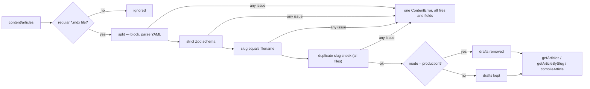

# Brief: Define the Article schema and MDX pipeline (BLOG-001)

- Story: [docs/stories/blog-001-article-schema-mdx-pipeline.md](../stories/blog-001-article-schema-mdx-pipeline.md), https://github.com/eng-rodriguez/personal-website/issues/14
- Branch: `feat/blog-001-article-schema-mdx-pipeline`, baseline e66c548
- ADR: [0006 MDX content pipeline](../adr/0006-mdx-content-pipeline.md)

Add a build-time content pipeline for Articles. Each Article is one local MDX file at `content/articles/<slug>.mdx`. Its Frontmatter is parsed with `yaml` and validated by a strict Zod 4 schema, and its body is compiled on the server with `next-mdx-remote` 6.0.0 (`compileMDX` from `next-mdx-remote/rsc`). Any JavaScript expression, `import`, `export` or JSX element outside an explicit component allowlist fails compilation and names the file. A small generic loader in `src/lib/content/` holds the shared rules (directory scan, Frontmatter split, slug equals filename, duplicate check, draft rule, error format, per-process cache, safe compile), so PROJ-001 can add Project with its own schema. `src/lib/articles.ts` defines the Article schema and the public API. `/writing` calls `getArticles()` while it is prerendered, so `next build` validates every Article's Frontmatter. No Article is published, no e2e test changes, and there is no CI, `.factory.yml` or `next.config.ts` change.

## 1. Layers touched

| Order | Layer | Builder | Paths | Depends on |
| --- | --- | --- | --- | --- |
| 1 | frontend (`web` area, repository root) | factory:react-builder with stack-react | `package.json`, `package-lock.json`, `src/lib/content/`, `src/lib/articles.ts`, `src/lib/__fixtures__/articles/`, `content/articles/`, `src/app/writing/page.tsx`, docs | FOUND-001 (merged); HOME-001 primitives (merged) |

- One builder and one PR. Implementation order inside the PR:
  1. Install the three dependencies (D1) and record `npm ci`, `npm ls` and `npm audit --omit=dev`.
  2. Shared schema pieces and Frontmatter parsing (D3, D4), with their tests.
  3. The generic collection loader (D5) and the Article module (D2, D6), with fixtures and tests.
  4. The safe compiler (D7) and its tests.
  5. `/writing` (D8) and the real-content test (D9).
  6. Docs (section 10), with the docs test.
- Merge order: a single merge. No rollout, because nothing is deployed.
- Pipeline: no change. `web`, `e2e`, `scope` and `ci-ok` must pass unchanged. The `e2e/` specs are not edited (story A8).
- Infra, backend, ml: not touched.
- Stack: Next.js 16.4.2 App Router (Turbopack build), React 19.3.1, TypeScript ~6.0.3 strict, Vitest 5 (jsdom default, `src/**/*.test.{ts,tsx}`), Prettier 3.9.10 (checks `.mdx`, ignores `*.md`), npm, Node.js 24. `typecheck` is `next typegen && tsc --noEmit`. `next.config.ts`, `tsconfig.json`, `vitest.config.mts`, `eslint.config.mjs`, `.prettierignore` and `src/app/globals.css` do not change.

## 2. Ownership
- Bounded context: Writing (`docs/domain.md`) owns Articles. Site presentation (`/writing`) consumes them through `src/lib/articles.ts` only, an in-process function call at build time. There are no services, events or network calls.
- `src/lib/content/*` is the shared content mechanism. It knows nothing about Articles: it takes a directory, a Zod schema and a component allowlist. It owns the rules every content type shares (story A2, A4, A6 and the edge cases).
- `src/lib/articles.ts` owns the Article schema, the content directory constant, the ordering and the Article component allowlist (empty in this story). Pages never import `src/lib/content/*` directly.
- Portfolio and Career are not touched. PROJ-001 adds `src/lib/projects.ts` on the same loader with its own schema (out of scope).
- The generic layer is justified by a known second consumer (PROJ-001) and by rules that must change together for every content type (slug, draft, error format, compile safety). It is kept to four small modules with no registry, plugin system or configuration file.

## 3. Domain model
No database and no migrations. The model is the Article schema and its invariants.

- **D2. Article schema (`src/lib/articles.ts`).** `articleFrontmatterSchema = z.strictObject({...})` with:

  | Field | Rule | Default |
  | --- | --- | --- |
  | `title` | non-empty string (after trim) | required |
  | `slug` | `slugSchema` (D3), and equal to the filename (checked by the loader, D5) | required |
  | `description` | non-empty string (after trim) | required |
  | `publishedAt` | `isoDateSchema` (D3) | required |
  | `updatedAt` | `isoDateSchema`, not before `publishedAt` (equal allowed) | absent |
  | `tags` | `tagsSchema` (D3) | `[]` |
  | `draft` | boolean | `false` |
  | `featured` | boolean | `false` |
  | `cover` | `z.strictObject({ src, alt })`: `src` a string matching `/^\/(?![/\\])[^\s\\]*$/` (single leading `/`, no spaces, control characters or backslashes), `alt` non-empty | absent |

  - `updatedAt >= publishedAt` is a `superRefine` on the object with `path: ["updatedAt"]`. Plain string comparison is correct for validated `YYYY-MM-DD` strings.
  - Exported types, inferred from the schema:
    - `ArticleFrontmatter = z.input<typeof articleFrontmatterSchema>`: what an author writes (defaulted fields optional).
    - `Article = Readonly<z.output<typeof articleFrontmatterSchema>>` with `tags: readonly string[]`: the normalized metadata the API returns. Dates stay strings with no timezone conversion.
    - `CompiledArticle = { readonly article: Article; readonly content: ReactElement }`.
  - Unknown keys, including in `cover`, are rejected by `strictObject`.
- Invariants (confirmed in `docs/domain.md`):
  - Every Article's Frontmatter passes the schema; invalid Frontmatter fails `next build`, and an invalid body fails `npm run check` (D9) and, from BLOG-003, `next build`.
  - A slug equals its filename, is lowercase kebab-case and is unique among Articles.
  - Drafts never appear when `NODE_ENV` is `production`. Drafts are still validated.
  - Publication depends only on `draft`. A future `publishedAt` is not hidden.

## 4. API contract
None for HTTP. No route handlers, server actions, OpenAPI or API collection (CLAUDE.md: no API contract artifacts). The in-process content API below is the contract that HOME-003, BLOG-002 and BLOG-003 build on.

- **D6. Article API (`src/lib/articles.ts`, server only).**
  ```ts
  export type ContentMode = "production" | "development";
  export type ContentOptions = { directory?: string; mode?: ContentMode };

  export function getArticles(options?: ContentOptions): readonly Article[];
  export function getArticleBySlug(slug: string, options?: ContentOptions): Article | undefined;
  export function compileArticle(slug: string, options?: ContentOptions): Promise<CompiledArticle | undefined>;
  ```
  - `ContentMode` and `ContentOptions` are defined in `src/lib/content/collection.ts` and re-exported from `articles.ts`.
  - `getArticles` is synchronous (sync `node:fs`), so `/writing` stays a synchronous Server Component and the existing RTL page tests keep working (D8). It returns published Articles sorted by `publishedAt` descending, then `slug` ascending, and `[]` for a missing or empty directory or only drafts in production.
  - `getArticleBySlug` returns the Article from the validated list, or `undefined` when the slug is unknown, a draft in production, or not kebab-case. It never builds a path from its argument.
  - `compileArticle` looks up the validated entry the same way, then compiles the stored body with the Article allowlist. It returns `undefined` where `getArticleBySlug` would, and rejects with a `ContentError` for an unsafe or malformed body.
  - Defaults: `directory` is `path.join(process.cwd(), "content", "articles")`; `mode` is `"production"` when `process.env.NODE_ENV === "production"`, otherwise `"development"`. Only tests pass these options.
  - Every call first loads and validates the whole directory (D5), so any loader call fails on any invalid file, including drafts.
  - Downstream use, with no further API: HOME-003 takes `getArticles().slice(0, n)` and `getArticles().filter((a) => a.featured)`; BLOG-002 lists `getArticles()` and reads `tags`; BLOG-003 uses `getArticles().map(({ slug }) => ({ slug }))` for `generateStaticParams` and `compileArticle(slug)` for the page.
- **Errors.** `ContentError extends Error` (`src/lib/content/collection.ts`), `name = "ContentError"`, with `issues: readonly { file: string; field?: string; message: string }[]`. `file` is relative to `process.cwd()` (for example `content/articles/foo.mdx`). The message lists every issue, grouped by file:
  ```text
  Invalid content (2 files):
    content/articles/foo.mdx
      - title: must not be empty
      - publishedAt: must be a real date in YYYY-MM-DD format
    content/articles/bar.mdx
      - slug: "other" must equal the filename "bar"
  ```
  Zod issue paths are joined with `.` (`cover.alt`, `tags.1`). Root-level issues (not an object, unknown key) use the key name where Zod gives one, otherwise `(frontmatter)`. Compile errors have one issue with `field: "(body)"` and the line and column when known.

## 5. Data and consistency
- Source of truth: the `.mdx` files in Git. There is no store, index, event or outbox. Consistency is "what is on disk when the build reads it".
- **D5. Collection loader (`src/lib/content/collection.ts`).**
  - `loadCollection({ directory, schema, mode })` reads the directory with `readdirSync(directory, { withFileTypes: true })`. ENOENT returns `[]`; any other read error is thrown.
  - It keeps regular files ending in `.mdx` only. `.gitkeep`, `.md`, other extensions, symlinks and subfolders are ignored (no recursion). Entries are processed in filename order, so errors and results are deterministic.
  - Per file, collecting issues instead of stopping: read as UTF-8, split Frontmatter (D4), `schema.safeParse`, then check `data.slug === basename(file, ".mdx")`.
  - Across files: group by slug and add an issue to each file that shares a slug, naming the other files (`slug "shared-slug" is also used by content/articles/copy-of-shared.mdx`).
  - If any issue exists, throw one `ContentError` with all of them. Validation runs before the draft filter.
  - In `"production"` mode, entries with `draft: true` are removed.
  - Each entry is `{ data, file, body }`, frozen (including `tags`), so cached results cannot be changed by callers.
  - The schema type parameter is constrained to output `{ slug: string; draft: boolean }`, so every content type must have these two fields.
- **Cache.** Only when `process.env.NODE_ENV === "production"` (checked at call time), results are kept in a module-level `Map` keyed by the resolved directory and mode. A `next build` reads and validates each file once per worker process. In `next dev` and in tests nothing is cached, so edits show up without a restart. A thrown `ContentError` is not cached.
- Idempotency: loading is a pure function of the directory contents. Concurrency: synchronous reads in one process; build workers each hold their own cache.
- Indexes: not applicable.

The diagram shows what happens to each file when a loader function runs.



- **D3. Shared field schemas (`src/lib/content/schema.ts`).**
  - `slugSchema`: string matching `^[a-z0-9]+(?:-[a-z0-9]+)*$`.
  - `isoDateSchema`: `z.iso.date()` (exactly `YYYY-MM-DD`, no time or offset) plus a real-date check: `2026-02-30` and `2026-13-01` are rejected and `2024-02-29` is accepted. If `z.iso.date()` accepts an impossible day in Zod 4.6.5, add a `refine` that round-trips through `Date.UTC`. The builder records which form was needed.
  - `tagsSchema`: `z.array(slugSchema).default([])` with a `superRefine` that reports each repeated tag at its index (`tags.2: duplicate tag "nextjs"`).
  - `nonEmptyText`: `z.string().trim().min(1, "must not be empty")`. Trimming is applied to the output too, which is acceptable for titles and descriptions.
  - Messages are written for authors, as in the error example above.
- **D4. Frontmatter split (`src/lib/content/frontmatter.ts`).**
  - `splitFrontmatter(source, file): { data: unknown; body: string }`, throwing a `ContentError` with one issue.
  - A leading BOM is removed and CRLF is accepted. The file must start with a line that is exactly `---`, and a later line that is exactly `---` closes the block. A missing opening line gives `missing Frontmatter block (--- at the first line)`. A missing closing line gives `unterminated Frontmatter block`.
  - The block is parsed with `yaml`'s `parse(text, { schema: "core", uniqueKeys: true, prettyErrors: true })`. The core schema keeps `2026-03-10` a string. A YAML error becomes an issue with the parser message, which includes the line. An empty block gives `null`, which the schema rejects as "expected an object".
  - The body is everything after the closing line, passed to the compiler unchanged. `compileMDX` is called with `parseFrontmatter: false`.

## 6. Frontend

### Design decisions
- **D1. Dependencies.** Exact pins, each published at least 2 weeks before 2026-10-20, in `dependencies` (they run during `next build` on the server and none reaches the browser bundle):

  | Package | Version | Published | Why |
  | --- | --- | --- | --- |
  | `next-mdx-remote` | `6.0.0` | 2026-02-12 | Approved MDX compiler (story A1). Brings `@mdx-js/mdx` ^3, `@mdx-js/react` ^3, `vfile`, `vfile-matter`, `unist-util-remove`, `unist-util-visit`, `@babel/code-frame`. Peer `react >=16`. |
  | `yaml` | `2.9.1` | 2026-09-11 | Frontmatter parser; strict, no type coercion of dates with the core schema. |
  | `zod` | `4.6.5` | 2026-09-13 | Frontmatter schemas (approved decision). |

  - `package-lock.json` already has `zod` 4.6.7 as a transitive dev dependency (through `eslint-plugin-react-hooks`). 4.6.6 and 4.6.7 are less than 2 weeks old, so the direct pin is `4.6.5`. npm either dedupes the transitive copy to 4.6.5 (if its range allows) or keeps a nested 4.6.7 for the plugin. Both are acceptable. The builder records which one happened (`npm ls zod`).
  - Install with `npm install --save-exact next-mdx-remote@6.0.0 yaml@2.9.1 zod@4.6.5`. No `--force` or `--legacy-peer-deps`. The only expected `npm ci` notices are the 3 known ESLint `ERESOLVE` warnings.
  - A scratch `npm audit --omit=dev` with these three packages and React 19.3.1 reported 0 vulnerabilities. The builder re-runs it on the branch.
  - No remark or rehype plugin dependency. The rejection plugin (D7) walks the tree by hand.
- **D7. Safe compile (`src/lib/content/compile.ts`).**
  - `compileContent(body, { file, components }): Promise<ReactElement>`. `components` is the allowlist, typed by an exported alias `ContentComponents = Readonly<Record<string, ComponentType<Record<string, unknown>>>>`. The Article allowlist is `const articleComponents: ContentComponents = {}` in `articles.ts`. If `compileMDX`'s `components` option needs a different type, the builder adapts the alias without `any` or an `as` cast and records it.
  - It calls `compileMDX({ source: body, components, options: { parseFrontmatter: false, blockJS: true, blockDangerousJS: true, mdxOptions: { remarkPlugins: [[rejectUnsafeMdx, { file, allowed: Object.keys(components) }]] } } })` and returns `content`.
  - `rejectUnsafeMdx` is a module-private remark plugin. It walks the mdast recursively and throws a `ContentError` naming the file, the line and column, and the construct, on the first of:
    - `mdxjsEsm`: `import` or `export is not allowed`.
    - `mdxFlowExpression`, `mdxTextExpression`: `JavaScript expressions ({...}) are not allowed; escape a literal brace as \{`.
    - `mdxJsxFlowElement`, `mdxJsxTextElement` whose name is `null` (fragment) or not in `allowed`: `component <Name> is not allowed`. This includes lowercase HTML tags such as `<div>`, `<script>` or `<iframe>`: authors write Markdown, and HTML-like JSX is rejected. It is checked at compile time, because MDX's own missing-component error only fires at render.
    - On an allowed element, any `mdxJsxExpressionAttribute` (spread) or attribute whose value is an `mdxJsxAttributeValueExpression`: `attribute expressions are not allowed`.
  - Any other error thrown by `compileMDX` (an MDX syntax error) is rethrown as a `ContentError` for the file, with `field: "(body)"`, the original message and `cause`.
  - Ordering safeguard: next-mdx-remote implements `blockJS` as its own tree transform. The rejection plugin must see the tree before anything is stripped, or an expression would be silently removed instead of failing. The AC7 tests prove this for each construct. If they show the expression was stripped first, the builder stops and reports. The fallback (promoting the already-installed `@mdx-js/mdx` to an exact direct dependency and running the check on `createProcessor().parse(body)` before `compileMDX`) needs a brief revision, because it changes `package.json` beyond D1.
  - `compileMDX` runs only on the server during prerendering, so the result is static HTML and the RSC payload. No MDX compiler or runtime reaches the browser.
- **D8. `/writing` (`src/app/writing/page.tsx`).**
  - It stays a synchronous Server Component: `const articles = getArticles();` at the top. It renders the unchanged PageHeading, then the unchanged EmptyState (`mt-8`, "No articles yet", "Articles will appear here.") only when `articles.length === 0`. When the list is not empty it renders nothing beyond the PageHeading, until BLOG-002 adds the list. No Article is published in this story, so the page looks the same.
  - `metadata` is unchanged. The route must still build as static (○).
  - Why it stays synchronous: `src/app/core-pages.test.tsx` and `src/components/site/site-shell.test.tsx` render `<WritingPage />` with React Testing Library, which cannot render an async Server Component. With a synchronous loader both tests pass unchanged; they read the real `content/articles`, which only holds `.gitkeep`. NODE_ENV is `test` there, so nothing is cached.
  - Consequence for AC7: `/writing` validates Frontmatter, slugs and duplicates during `next build`, but it does not compile bodies. Body safety is enforced now by `compileArticle` and by D9 inside `npm run check` (so CI's `web` job fails), and by `next build` itself once BLOG-003 prerenders each Article page. See section 13.
- **D9. Real-content test (`src/lib/articles-content.test.ts`, node).** It runs `getArticles({ mode: "development" })` on the real `content/articles` and then `compileArticle` for every slug, drafts included. With no content it passes trivially. Once Articles exist, an invalid Frontmatter or an unsafe or broken body in any Article, draft or not, fails `npm test`, so `npm run check` and CI fail.
- **Content directory.** `content/articles/.gitkeep` (empty) creates the layout. No README there; the guide is `docs/content.md`.
- States: loading, error and denied do not apply (static build). Empty is the existing EmptyState. An invalid content error is a build failure, never a rendered state.
- Tailwind v4 detects sources from the project root (only `docs` is excluded), so it also scans `content/` and the fixtures. This can at most add a few unused utility rules from words in prose. It is left as is; BLOG-003 can add `@source not` if it matters.

### Test design
Node-only tests start with `// @vitest-environment node` and use `test_acN_` names with `it.each` where cases repeat, as in `src/lib/theme.test.ts`. Loader tests pass `directory` pointing to a fixture folder and an explicit `mode`. Tests that need a changing directory create one with `mkdtempSync(join(tmpdir(), "articles-"))` and remove it in `afterEach`.

Fixtures (`src/lib/__fixtures__/articles/`, formatted by Prettier, frontmatter values are test data only):
- `valid/full-article.mdx`: every field, `publishedAt: 2026-03-10`, `updatedAt: 2026-03-12`, two tags, `featured: true`, a `cover`, and a Markdown body with a heading, emphasis, a list, inline code, a fenced code block and a link.
- `valid/another-article.mdx`: required fields only, `publishedAt: 2026-03-10` (same date as `full-article`, sorts first by slug).
- `valid/minimal-article.mdx`: required fields only, `publishedAt: 2026-01-05`.
- `valid/draft-article.mdx`: `draft: true`, `publishedAt: 2026-04-01` (newest, so its position proves the filter).
- `valid/notes.md` and `valid/nested/nested-article.mdx`: must be ignored. `nested-article.mdx` has invalid Frontmatter, so reading it would fail the test.
- `invalid/broken-article.mdx`: `draft: true`, empty `title`, `publishedAt: 2026-02-30`, `updatedAt` before `publishedAt`, an unknown key `author`, duplicate tags and a `cover` without `alt`.
- `invalid/no-frontmatter.mdx`: a body with no `---` block.
- `duplicate/shared-slug.mdx` and `duplicate/copy-of-shared.mdx`: both `slug: shared-slug`.
- `drafts-only/only-draft.mdx`: a valid draft.

Test files:
- **`src/lib/content/schema.test.ts`** (AC2, edge cases): `slugSchema` accepts `a`, `a-1`, `next-js-16`; rejects `""`, `A`, `a_b`, `a b`, `-a`, `a-`, `a--b`. `isoDateSchema` accepts `2026-01-01`, `2024-02-29`; rejects `2026-02-30`, `2025-02-29`, `2026-13-01`, `2026-1-1`, `2026-01-01T00:00:00Z`, `2026-01-01+02:00`. `tagsSchema` defaults to `[]`, rejects uppercase and duplicates with the index path.
- **`src/lib/content/frontmatter.test.ts`** (AC2, edge cases): body and data split with LF, CRLF and a BOM; missing block, unterminated block, YAML syntax error and duplicate YAML key each throw a `ContentError` naming the file; `publishedAt: 2026-03-10` stays a string.
- **`src/lib/articles-schema.test.ts`** (AC1, AC2): defaults applied for a minimal object; each rule from D2 rejected with the expected field path (missing and whitespace-only `title` and `description`, unknown key, unknown `cover` key, `cover.src` `images/a.png` and `//host/a.png`, `cover` without `alt`, `updatedAt` before `publishedAt`); `updatedAt` equal to `publishedAt` accepted.
- **`src/lib/articles.test.ts`** (AC1 to AC6, edge cases):
  - `valid` in development: four Articles in the order `draft-article`, `another-article`, `full-article`, `minimal-article`; `full-article` has every field; `minimal-article` has `tags: []`, `draft: false`, `featured: false` and no `updatedAt` or `cover` keys. `notes.md` and `nested/` are ignored.
  - `valid` in production: the same without `draft-article`. `getArticleBySlug("draft-article")` and `compileArticle("draft-article")` return `undefined` in production and an Article in development.
  - `invalid`: one `ContentError` whose issues cover both files and the fields `title`, `publishedAt`, `updatedAt`, `author`, the duplicate tag index, `cover.alt` and the missing block; the message contains both relative paths. It fails in production too (draft still validated).
  - `duplicate`: the error names both files, with a slug/filename mismatch for `copy-of-shared.mdx` and the duplicate issue on both.
  - Missing directory, an empty temp directory and `drafts-only` in production return `[]`.
  - `getArticleBySlug` returns `undefined` for an unknown slug and for `../valid/full-article`, `Full-Article` and `""`, without throwing.
  - Cache: with `vi.stubEnv("NODE_ENV", "production")`, load a temp directory, add an invalid file, load again: same result (cached). With `NODE_ENV` `test`, the second load throws (not cached). `vi.unstubAllEnvs()` in `afterEach`.
  - Returned Articles and their `tags` are frozen.
  - `compileArticle("full-article", { directory: valid })` returns `article.slug === "full-article"` and content whose HTML (`renderToStaticMarkup`) contains the body heading.
- **`src/lib/content/compile.test.ts`** (AC6, AC7): compiles inline strings, rendered with `renderToStaticMarkup` from `react-dom/server`.
  - Markdown body: HTML contains `<h2>`, `<em>`, `<code>`, `<li>` and `<a href="https://example.com">`.
  - `it.each` over unsafe bodies, each rejecting with a `ContentError` whose message names the file: `{process.env.SECRET}`, inline `a {1 + 1} b`, `{globalThis.__mdxRan = true}`, `import x from "node:fs"`, `export const y = (globalThis.__mdxRan = true)`, `<Callout />`, `<div>x</div>`, `<script>alert(1)</script>`, `<>x</>`, and with an allowlist `{ Note }`: `<Note {...props} />` and `<Note title={1} />`. After all cases `globalThis.__mdxRan` is `undefined`.
  - An allowed component with string attributes (`<Note title="Hi" />`) renders.
  - An MDX syntax error (`<Note`) rejects with a `ContentError` naming the file.
  - A literal `\{` renders as `{`.
- **`src/lib/articles-content.test.ts`** (D9, AC7, AC8).
- **`src/lib/content/content-source.test.ts`** (node, AC6): the five new modules contain no `"use client"`, no `: any`, `as any` or `<any>`, and `articles.ts` and `collection.ts` import from `node:fs`. `src/app/writing/page.tsx` has no `async` keyword and no `"use client"`.
- **`src/lib/content/content-docs.test.ts`** (node, AC9): `docs/content.md` contains `content/articles`, `slug`, `publishedAt`, `updatedAt`, `tags`, `draft`, `featured`, `cover`, `NODE_ENV`, `\{` and the phrase `does not build`; `docs/adr/0006-mdx-content-pipeline.md` contains `next-mdx-remote`, `6.0.0`, `blockJS` and `Status: Accepted`; `CLAUDE.md` contains `ADR 0006`, `content/articles` and `src/lib/articles.ts`, and its "Unresolved architecture" section no longer contains `MDX pipeline`; `docs/domain.md` has the code names `Article` and `ArticleFrontmatter`.
- Unchanged and passing: `src/app/core-pages.test.tsx`, `src/components/site/site-shell.test.tsx`, `src/app/layout.test.ts`, `shell-docs.test.ts`, `src/scaffold.test.ts` and every `e2e/*.spec.ts`.

## 7. Infra and pipeline
Not applicable. No workflow, Dependabot, environment, deployment or `.factory.yml` change. Dependabot's npm updates (if configured) will propose newer `next-mdx-remote`, `yaml` and `zod`; the 2-week rule still applies to merging them.

## 8. Security and threat notes
- Authn/z and tenant isolation: not applicable (no users, static output).
- Input validation: Frontmatter by strict Zod schemas; bodies by the rejection plugin plus `blockJS` and `blockDangerousJS`; slug arguments by the kebab-case rule and by lookup in the validated list (no path is built from an argument).
- Trust model: content is authored by the owner in Git and reviewed in PRs. The pipeline still treats it as untrusted code, because MDX is a JavaScript dialect and a mistaken paste or a malicious PR should not execute during the build.
- Secrets: none. No environment variable other than `NODE_ENV` is read.
- Data classification: public. Drafts are hidden from the site but are still public in the GitHub repository. `docs/content.md` says so: nothing private goes in a draft. Fixtures use `example.com` and placeholder text, never real contact details.
- Dependencies: three new runtime packages, audited (D1). They run at build time only.
- Top threats (STRIDE-style):
  1. Elevation of privilege or information disclosure through code in MDX (`{process.env.X}`, `import`, `export`) executing during `next build`, which could read build secrets or the filesystem. Mitigation: the rejection plugin fails the build before evaluation, `blockJS` and `blockDangerousJS` stay on (`blockDangerousJS` is inert while `blockJS` is true and is kept as defense in depth), and the tests prove no side effect ran.
  2. Tampering or XSS through HTML-like JSX (`<script>`, `<iframe>`, event attributes) or URL schemes in the published HTML. Mitigation: every JSX element outside the (empty) allowlist is rejected, including lowercase tags. Markdown links with `javascript:` URLs are blocked by React 19 when rendering `href`. BLOG-003 owns link and image components and re-checks this when it adds any.
  3. Information disclosure through a draft shipping to production, or a path traversal through a slug. Mitigation: the draft filter keys on `NODE_ENV === "production"`, which is set for `next build`, `next start` and Vercel previews; tests cover all three API functions. Slugs are looked up, not joined into paths.

## 9. Verification per criterion
Local checks run from the repository root on Node.js 24.

| AC | Check | Level |
| --- | --- | --- |
| 1 | `articles.test.ts` (`valid` fixtures, full and minimal), `articles-schema.test.ts` defaults | local |
| 2 | `articles-schema.test.ts`, `schema.test.ts`, `frontmatter.test.ts`, `articles.test.ts` `invalid` case; `next build` failure in Manual step 4 | local + manual |
| 3 | `articles.test.ts` `duplicate` case; Manual step 4 | local + manual |
| 4 | `articles.test.ts` production and development cases for all three functions; Manual step 6 | local + manual |
| 5 | `articles.test.ts` ordering, missing, empty and drafts-only cases | local |
| 6 | `compile.test.ts` Markdown case, `compileArticle("full-article")` in `articles.test.ts`, `content-source.test.ts`; after `npm run build`, `grep -rl "mdx-js\|next-mdx-remote" .next/static` prints nothing | local |
| 7 | `compile.test.ts` unsafe cases with the `globalThis.__mdxRan` check; `articles-content.test.ts`; Manual step 5 (`npm test` fails on an unsafe body) | local + manual |
| 8 | `npm run build` with only `.gitkeep`: `/writing` listed as ○ static; built `.next/server/app/writing.html` has one `<h1` and `data-slot="empty-state"`; `core-pages.test.tsx` and `site-shell.test.tsx` unchanged; `npm run e2e` with `git diff --stat origin/main -- e2e` empty | local |
| 9 | `content-docs.test.ts`; `shell-docs.test.ts` unchanged; Manual step 7 | local + manual |
| 10 | `npm run check` exit 0 (record Vitest file and test counts) and `npm run e2e` exit 0 | local |
| 11 | `npm ci` (only the 3 known `ERESOLVE` notices), `npm audit --audit-level=high --omit=dev` exit 0, `npm ls next-mdx-remote yaml zod`, exact pins in `package.json`; CI `web` | local + environment |
| 12 | CI `scope` job; locally `git diff --name-only origin/main...HEAD`, each path exempt or found with `grep -F` in this brief | local + environment |

Edge cases: missing or empty directory, missing or unterminated block, YAML error, unknown key, bad and impossible dates, equal `updatedAt`, slug and tag casing, duplicate tags, mismatch and duplicate slugs, drafts-only, invalid draft, bad `cover`, MDX syntax error, unsafe bodies, unknown component, non-`.mdx` files and subfolders, caching and slug traversal are covered by the tests in section 6.

Builder-verified at implementation (record in the Checkpoint):
- The rejection plugin sees `mdxjsEsm` and expression nodes before next-mdx-remote strips them (the AC7 tests). If not, stop and report (D7 fallback needs a brief revision).
- `z.iso.date()` in Zod 4.6.5 rejects `2026-02-30`, or the `Date.UTC` refine was added.
- `yaml` core schema keeps unquoted dates as strings.
- Importing `src/lib/articles.ts` (which imports `next-mdx-remote/rsc`) works in the jsdom page tests and in `next build`. If the static import fails in jsdom, load `compile.ts` with a dynamic `import()` inside `compileArticle`, without changing the tests.
- `/writing` still builds as ○ static and `next build` prints no new warning (for example a Turbopack file-tracing warning about `process.cwd()`).
- The `npm ls zod` result (deduped or nested).
- The type used for the component allowlist (D7).

Environment evidence, blocked until the PR exists: CI `web`, `e2e`, `scope` and `ci-ok`. Not covered by automation: `next build` failing on invalid content in a real build (Manual step 4), because a test cannot leave invalid content in the repository.

### Manual verification
The owner runs this on a fresh clone of the branch with Node.js 24 before marking the PR ready, and records who ran it and each result in the Checkpoint. Items marked "automated" may also be run by the test agent, which does not replace the human run.

1. `git status` on the branch before committing. Expected: every changed path is in section 11; nothing under `.next/` or `node_modules/` is staged. Automated.
2. `npm ci`, then `npm audit --audit-level=high --omit=dev; echo $?`, then `npm ls next-mdx-remote yaml zod`. Expected: only the 3 known `ERESOLVE` notices, audit exit 0, the three pinned versions. Covers AC11. Automated.
3. `npm run check; echo $?` and `npm run e2e; echo $?`. Expected: both exit 0; the build output lists `/writing` as ○. Then `grep -c 'data-slot="empty-state"' .next/server/app/writing.html` prints 1 and `grep -rl "mdx-js\|next-mdx-remote" .next/static` prints nothing. Covers AC6, AC8 and AC10. Automated.
4. Create `content/articles/bad-article.mdx` with `slug: other-name`, an empty `title` and `publishedAt: 2026-02-30`, and run `npm run build`. Expected: the build fails with one `ContentError` naming `content/articles/bad-article.mdx`, `title`, `publishedAt` and the slug mismatch. Replace it with a valid `content/articles/first-article.mdx` and a copy `content/articles/copy.mdx` that keeps `slug: first-article`, and rebuild: the error names both files. Delete the files. Covers AC2 and AC3 at build level. Automated.
5. Create a valid `content/articles/unsafe-article.mdx` (`slug: unsafe-article`) whose body is `{process.env.HOME}`, then run `npm test`. Expected: `articles-content.test.ts` fails naming the file and the expression; `npm run build` still passes in this story (bodies are compiled by BLOG-003 pages). Set `draft: true` and run `npm test` again: still fails. Delete the file. Covers AC7. Automated.
6. With only a valid draft in `content/articles/`, run `npm run build`: it passes and `writing.html` still contains the EmptyState (the draft is excluded, so the list is empty). Delete the file. Covers AC4 at build level. Automated.
7. Read ADR 0006, `docs/content.md`, the Article and Frontmatter rows and invariants of `docs/domain.md`, and the CLAUDE.md Current state, Approved decisions, Unresolved architecture and Paths. Expected: the content in section 10. Covers AC9. Human only.
8. Open the PR. Expected: `web`, `e2e`, `scope` and `ci-ok` succeed. Environment evidence, blocked until the PR exists.

Rollback: revert the merge commit through a PR (`git revert -m 1 <merge-sha>`), run `npm ci`, then step 3. Expected: the three dependencies, `src/lib/content`, `src/lib/articles.ts` and `content/articles` are gone, and `/writing` renders the EmptyState unconditionally.

## 10. Docs impact and observability
- `docs/adr/0006-mdx-content-pipeline.md` (new, written with this brief).
- `docs/content.md` (new authoring guide):
  - Where files go: `content/articles/<slug>.mdx`, one file, no folders, slug equals filename.
  - A copyable Frontmatter example and a field table matching D2 with defaults. Dates are `YYYY-MM-DD` with no time; tags are free kebab-case; `cover.src` is a path under `public/` (existence checked later).
  - The draft rule: hidden when `NODE_ENV` is `production`, including Vercel previews; shown in `npm run dev`; still validated; still public in the repository; `publishedAt` does not schedule.
  - What MDX allows: Markdown only, no `{}` expressions, no `import`/`export`, no HTML or JSX tags, no HTML comments; escape `\{` and `\<`.
  - "Invalid content does not build", with what fails where: `next build` for Frontmatter, `npm run check` for bodies until BLOG-003.
  - Format with `npm run format`, because Prettier checks `.mdx`. Preview with `npm run dev`.
- `docs/domain.md`: Article code name `Article` (`src/lib/articles.ts`); Frontmatter code name `ArticleFrontmatter` / `articleFrontmatterSchema` for Articles, with other types added by their stories; the three invariants marked confirmed for Articles, worded as in section 3; the intro sentence updated.
- `docs/testing.md`: one short "Content tests" section: node-environment tests, fixtures under `src/lib/__fixtures__/articles/<case>/`, inject `directory` and `mode`, and `articles-content.test.ts` validating the real content.
- `CLAUDE.md`:
  - Current state: replace "No content or MDX yet." with a sentence saying the Article pipeline exists (`src/lib/articles.ts` on `src/lib/content`), `content/articles` is empty, and `/writing` validates content at build; add `next-mdx-remote 6.0.0, yaml 2.9.1, zod 4.6.5` to the installed versions.
  - Approved decisions: replace the Content item with the decided pipeline and a pointer to ADR 0006 and `docs/content.md`.
  - Unresolved architecture: remove the MDX pipeline item. Keep the Content model item (case studies and resume) and note that a Project schema is PROJ-001.
  - Paths: add content in `content/articles`, the Article API in `src/lib/articles.ts`, the shared loader in `src/lib/content`, fixtures in `src/lib/__fixtures__`, and the guide `docs/content.md`.
  - Ownership and contracts: "Content contract: the Zod schemas in `src/lib/articles.ts` (ADR 0006)".
  - Keep every string asserted by `shell-docs.test.ts` and `scaffold.test.ts`.
- `README.md`: no change.
- Observability: none. There is no runtime service and nothing is logged. Build failures are reported through the thrown `ContentError` message, which contains only file paths, field names and parser messages, never environment values (the plugin reports the construct, not evaluated content).

## 11. Files that will change
Builders create or modify only these paths. Any other file is out of scope and must not be committed.

Dependencies (factory:react-builder):
- `package.json` (modified: three exact `dependencies`)
- `package-lock.json` (modified)

Application (factory:react-builder):
- `src/lib/content/schema.ts` (new)
- `src/lib/content/errors.ts` (new: `ContentError`, `ContentIssue`, `formatIssues`; added in review round 1, approved by @eng-rodriguez)
- `src/lib/content/frontmatter.ts` (new)
- `src/lib/content/collection.ts` (new)
- `src/lib/content/compile.ts` (new)
- `src/lib/articles.ts` (new)
- `src/app/writing/page.tsx` (modified: calls `getArticles()`, EmptyState only when empty)
- `content/articles/.gitkeep` (new, empty)

Fixtures (factory:react-builder):
- `src/lib/__fixtures__/articles/valid/full-article.mdx`
- `src/lib/__fixtures__/articles/valid/another-article.mdx`
- `src/lib/__fixtures__/articles/valid/minimal-article.mdx`
- `src/lib/__fixtures__/articles/valid/draft-article.mdx`
- `src/lib/__fixtures__/articles/valid/notes.md`
- `src/lib/__fixtures__/articles/valid/nested/nested-article.mdx`
- `src/lib/__fixtures__/articles/invalid/broken-article.mdx`
- `src/lib/__fixtures__/articles/invalid/no-frontmatter.mdx`
- `src/lib/__fixtures__/articles/duplicate/shared-slug.mdx`
- `src/lib/__fixtures__/articles/duplicate/copy-of-shared.mdx`
- `src/lib/__fixtures__/articles/drafts-only/only-draft.mdx`

Tests (factory:react-builder; exempt from the scope check):
- `src/lib/content/schema.test.ts`
- `src/lib/content/frontmatter.test.ts`
- `src/lib/content/compile.test.ts`
- `src/lib/content/content-source.test.ts`
- `src/lib/content/content-docs.test.ts`
- `src/lib/articles-schema.test.ts`
- `src/lib/articles.test.ts`
- `src/lib/articles-content.test.ts`

Docs (factory:react-builder):
- `CLAUDE.md` (modified)
- `docs/content.md` (new)
- `docs/domain.md` (modified)
- `docs/testing.md` (modified)

Planning (architect/orchestrator):
- `docs/briefs/blog-001-article-schema-mdx-pipeline.md` (this brief)
- `docs/adr/0006-mdx-content-pipeline.md` (new)
- `docs/stories/blog-001-article-schema-mdx-pipeline.md` (already present, untracked)

Not committed: `.next/`, `node_modules/`, `next-env.d.ts`, `*.tsbuildinfo`, and any temporary file from Manual steps 4 to 6.

Explicitly not changed: `next.config.ts`, `tsconfig.json`, `vitest.config.mts`, `vitest.setup.ts`, `eslint.config.mjs`, `.prettierignore`, `src/app/globals.css`, `src/app/layout.tsx`, the other pages, `src/components/*`, `src/lib/navigation.ts`, `src/lib/site.ts`, `src/lib/theme.ts`, `e2e/*`, `playwright.config.ts`, `.github/`, `.factory.yml` and `README.md`.

## 12. Risk
- Level: **Medium**. Three new runtime dependencies and a new build-time behavior: every `next build` now reads `content/articles`, and invalid content stops the build. There is no deployment, data, auth or secret impact, the page output is unchanged with no content, and the change reverts as one PR.
- Recovery: revert the merge commit on `main` (`git revert -m 1 <merge-sha>`) through a PR, then `npm ci`, `npm run check` and `npm run e2e` (Manual verification, Rollback). There is no flag: with an empty `content/articles` the pipeline has no visible effect, and a content-caused build failure is fixed by correcting or removing the offending file, which the error names.
- Owner: @eng-rodriguez.

## 13. Open questions and ADRs
- ADR written: [0006 MDX content pipeline](../adr/0006-mdx-content-pipeline.md) (Accepted). It records the compiler, the parser, the schemas, the layout, the slug and draft rules, the rejection rule, the allowlist and how the build validates content.
- Open (owner, does not block; default chosen): story AC7 says body failures also fail `next build` "through `/writing` or any later page". This brief keeps `/writing` synchronous and metadata-only, so in BLOG-001 an unsafe body fails `npm run check` and CI (D9), and fails `next build` from BLOG-003, when each Article page compiles its body. The alternative is an async `/writing` that compiles every body now; it changes `core-pages.test.tsx` and `site-shell.test.tsx` (async pages cannot be rendered by RTL) and compiles bodies a list page does not need. Default confirmed by @eng-rodriguez at brief approval.
- Open (owner, does not block): D7 rejects every JSX element outside the allowlist, including plain HTML tags such as `<div>` or `<details>`. This is stricter than the story's "component not in the allowlist" wording; it closes `<script>` and `<iframe>` in published HTML. Confirmed by @eng-rodriguez at brief approval.
- Open (owner, does not block): MDX treats `{` and `<` in prose as code, so authors must escape them (`\{`, `\<`). This is documented in `docs/content.md`; BLOG-003 may add a writing convention if it becomes a burden.
- Follow-up (BLOG-003): any allowlisted component and the link and image renderers are reviewed against threat 2; `cover.src` existence is checked; Tailwind `@source not` for `content/` if prose words add CSS.
- Follow-up (PROJ-001): add `src/lib/projects.ts` with its own schema on `loadCollection` and `compileContent`; extend `docs/content.md`.
- Builder-verified at implementation: the items listed in section 9.
- Resolved in this brief: exact versions (D1), the shared field schemas (D3), the Frontmatter rules (D4), the loader and cache (D5), the API surface and error format (D6), the rejection of all JSX outside the allowlist including HTML tags (D7), the synchronous `/writing` (D8) and the real-content test (D9).

## 14. Checkpoint
- Phase: shipped (eng-rodriguez/personal-website#48 merged as a90a345)
- Scope: BLOG-001 as in the approved story (A1 to A8) and this brief
- Baseline: `feat/blog-001-article-schema-mdx-pipeline` to be cut from `origin/main` at e66c548
- Revisions: none
- Approvals: story and brief approved by @eng-rodriguez (section 13 defaults confirmed)
- Builder-verified items:
  - The rejection plugin sees `mdxjsEsm` and expression nodes before `blockJS` strips them (user remark plugins run first); `compile.test.ts` rejects each construct and `globalThis.__mdxRan` stays undefined. next-mdx-remote rewraps thrown errors, so the plugin records its `ContentError` in a holder and `compileContent` rethrows it.
  - `z.iso.date()` in Zod 4.6.5 rejects `2026-02-30`, `2025-02-29` and `2026-13-01` and accepts `2024-02-29`, so no `Date.UTC` refine was added.
  - `yaml` core schema keeps `2026-03-10` a string (`frontmatter.test.ts`).
  - Importing `src/lib/articles.ts` (static import of `next-mdx-remote/rsc`) works in the jsdom page tests and in `next build`; no dynamic import needed.
  - `/writing` builds as ○ static, `next build` printed no new warning, `writing.html` has one `<h1` and one `data-slot="empty-state"`, and `grep -rl "mdx-js\|next-mdx-remote" .next/static` prints nothing.
  - `npm ls zod`: direct `zod@4.6.5`; the transitive copies under `eslint-plugin-react-hooks` and `zod-validation-error` are deduped to 4.6.5.
  - Component allowlist type: `ContentComponents = Readonly<Record<string, ComponentType<Record<string, unknown>>>>` was accepted by `compileMDX` without a cast.
  - Deviation: `updatedAt >= publishedAt` uses `.refine(..., { when: () => true })` instead of `superRefine`, because Zod 4 skips object refinements when another field is invalid. The loader also reports a slug/filename mismatch when other fields are invalid.
- Check evidence: `npm run check` exit 0 (34 test files, 441 tests at the first run; 449 tests after repair round 1, build lists `/writing` as ○); `npm run e2e` exit 0 (11 passed); `npm audit --audit-level=high --omit=dev` exit 0 (0 vulnerabilities); `git diff --stat -- e2e` empty. The full `npm audit` reports 5 high dev-only vulnerabilities (`braces` via eslint-config-next), not caused by this change.
- Repairs used: 1 of 3 (review round 1: cover.src rule, file-relative MDX error lines, nested-construct test and blockDangerousJS note, code-point slug ordering, `src/lib/content/errors.ts` split)
- Manual verification: steps 4 to 6 run by the builder agent (bad file: build fails naming `content/articles/bad-article.mdx`, `title` and `publishedAt`, the slug mismatch is covered by `articles.test.ts` after a loader fix made late; duplicate: both files named; unsafe body, draft or not: `articles-content.test.ts` fails naming file and construct; draft-only: build passes with EmptyState). Human run: steps 1 to 3 and 7 run by @eng-rodriguez, all as expected. Step 8: `web`, `e2e`, `scope` and `ci-ok` passed on eng-rodriguez/personal-website#48.
- Remaining blockers: none
- Next action: none
