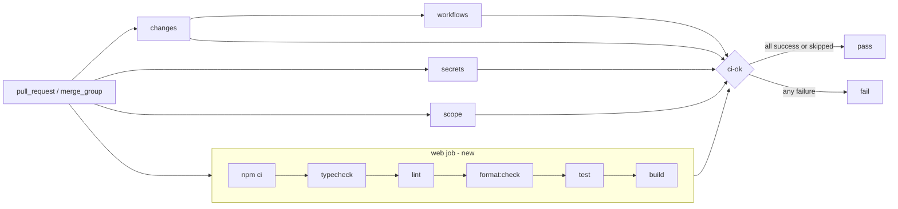

# Brief: Initialize Next.js application (FOUND-001)

- Story: [docs/stories/found-001-initialize-nextjs-app.md](../stories/found-001-initialize-nextjs-app.md), https://github.com/eng-rodriguez/personal-website/issues/1
- Branch: `feat/found-001-initialize-nextjs-app`, baseline `origin/main` b9b9b13
- ADR: [0001. Pin Node 24 and check script](../adr/0001-pin-node-24-and-check-script.md)

Scaffold a minimal Next.js App Router application at the repository root with strict TypeScript, ESLint, Prettier, Vitest and React Testing Library, plus a single `npm run check` command. Register it in `.factory.yml`, run that command in CI and add Dependabot npm updates. No Tailwind, shadcn/ui, MDX, Playwright or Vercel work.

## 1. Layers touched

| Order | Layer | Builder | Paths | Depends on |
| --- | --- | --- | --- | --- |
| 1 | frontend (`web` area, repository root) | factory:react-builder with stack-react | app files, tooling config, `package.json`, `package-lock.json`, `README.md`, `CLAUDE.md`, `.factory.yml` | none |
| 2 | pipeline | factory:pipeline-builder with devsecops-gha | `.github/workflows/ci.yml`, `.github/dependabot.yml` | `.nvmrc`, `package-lock.json` and the `check` script from step 1 |

The two builders run one after the other, never in parallel. Everything ships in one PR. Merge order: a single merge. There is no rollout because no deployment exists.

Stack: Next.js 16 App Router, React 19, TypeScript (pinned below 7, see D3), npm, Node.js 24. Versions in CLAUDE.md come from `package-lock.json` after install, not from this brief.

## 2. Ownership
One repository and one application. Everything here is tooling plus a placeholder page in the Site presentation context (`docs/domain.md`). No content types, so Writing, Portfolio and Career are not touched. No integrations.

## 3. Domain model
Not applicable. No content schemas, aggregates or migrations.

## 4. API contract
None. The site is static-first and this change adds no route handlers, server actions or API artifacts.

## 5. Data and consistency
Not applicable. No data store. `package-lock.json` is the source of truth for installed dependency versions. `npm ci` fails on drift, so `package.json` and `package-lock.json` are always committed together.

## 6. Frontend
- One route: `/` (`src/app/page.tsx`), a static placeholder Server Component. It must be a synchronous component, because Vitest cannot render async Server Components. Markup: `<main>` containing an `<h1>` and a short `
`, with text taken from `src/lib/site.ts`.
- `src/app/layout.tsx`: root layout with `<html lang="en">`. It exports `metadata` (title, description) from `src/lib/site.ts` and imports `./globals.css`.
- `src/lib/site.ts`: `export const site = { name, description } as const`. Placeholder copy: name `Personal website`, description `Personal engineering website featuring technical writing, projects, professional experience and resume.` This module exists so the `@/*` alias is exercised in real imports (AC6).
- `src/app/globals.css`: minimal base styles only (system font stack, `color-scheme: light dark`, body margin). No Tailwind. The Tailwind story replaces this file.
- Do not use `next/font/google`. It downloads fonts at build time, which adds a network call and makes offline builds fail. Do not add `favicon.ico`, `page.module.css` or anything under `public/`. Branding assets come later.
- Loading, empty, error and denied states: not applicable to a static placeholder with no data. Next.js default `not-found` handling is acceptable for now.

## 7. Infra and pipeline

### Design decisions
- **D1. Scaffolding method.** Run `npx create-next-app@16.4.2` in a scratch directory outside the repository with TypeScript, ESLint, App Router, `src/` directory, import alias `@/*`, npm and no Tailwind. Copy over only the files listed in section 11, edited as described here. Then run `npm install` at the repository root to produce `package-lock.json`. Do not run the generator in the repository root, and do not copy any generated `README.md`, `AGENTS.md`, `CLAUDE.md`, `public/` assets, favicon or CSS module.
- **D2. Node.js 24 pin (ADR 0001).** `.nvmrc` contains `24`. `package.json` sets `"engines": { "node": "24.x" }`. CI uses `node-version-file: .nvmrc`. No `.npmrc` and no `engine-strict`: npm's `EBADENGINE` warning is the visible signal the story asks for.
- **D3. TypeScript stays below 7.** TypeScript 7.0 is the native port. Next.js build-time type checking and typescript-eslint both load the JavaScript compiler API, and TypeScript 7 does not provide it in a compatible form. Pin `typescript` with `~` to the newest 6.0.x that satisfies the installed `typescript-eslint` `peerDependencies.typescript` range (check with `npm view typescript-eslint@<installed> peerDependencies`). If 6.0.x is outside that range, use the newest 5.9.x. Record the chosen version and the reason in CLAUDE.md. Do not install `@typescript/native-preview`.
- **D4. Peer compatibility.** Accept the ESLint major that `eslint-config-next@16.4.2` supports. If ESLint 10.x is outside its peer range, pin `eslint` to `^9`. `npm install` must succeed without `--force` or `--legacy-peer-deps`, and `npm ls` must report no invalid or missing peers.
- **D5. Dependencies (complete list; add nothing else).**
  - `dependencies`: `next` 16.4.2, `react` 19.3.1, `react-dom` 19.3.1 (exact, as create-next-app writes them).
  - `devDependencies`: `typescript` (D3), `@types/node` `^24`, `@types/react` `^19`, `@types/react-dom` `^19`, `eslint` (D4), `eslint-config-next` 16.4.2, `eslint-config-prettier` `^10.1.8`, `prettier` 3.9.10 (exact, as Prettier recommends), `vitest` `^5.0.5`, `@vitejs/plugin-react` `^6.1.2`, `jsdom` `^30.1.3`, `@testing-library/react` `^16.3.3`, `@testing-library/dom` (React Testing Library 16 needs it as an explicit peer; use the version its peer range accepts), `@testing-library/jest-dom` `^7.0.1`, `vite-tsconfig-paths` `^6.1.1`.
  - Use `vite-tsconfig-paths` as the Next.js Vitest guide does. If the installed Vite has native `resolve.tsconfigPaths` support, the builder may use that instead and leave out `vite-tsconfig-paths`, recording the choice in the checkpoint.
- **D6. Scripts (ADR 0001).** `dev: next dev`, `build: next build`, `start: next start`, `typecheck: next typegen && tsc --noEmit`, `lint: eslint . --max-warnings=0`, `format: prettier --write .`, `format:check: prettier --check .`, `test: vitest run`, `check: npm run typecheck && npm run lint && npm run format:check && npm test && npm run build`. `next typegen` generates `next-env.d.ts` and route types, so `typecheck` passes on a fresh clone before any build. That matters because CSS imports need the Next.js type references. `next lint` no longer exists in Next.js 16, which is why ESLint is called directly.
- **D7. `next-env.d.ts` is gitignored** (current create-next-app default). D6 regenerates it.
- **D8. `tsconfig.json`.** Use the create-next-app 16 config with `"strict": true`, `"paths": { "@/*": ["./src/*"] }`, `"moduleResolution": "bundler"`, the Next.js plugin, and the generated `include` (including `next-env.d.ts`, `.next/types/**/*.ts` and `**/*.mts`). No `baseUrl`.
- **D9. ESLint (`eslint.config.mjs`).** Flat config: `eslint-config-next/core-web-vitals`, `eslint-config-next/typescript`, then `eslint-config-prettier/flat` last so formatting rules never conflict. Global ignores: `.next/**`, `out/**`, `build/**`, `coverage/**`, `next-env.d.ts`.
- **D10. Prettier.** `.prettierrc.json` is `{}` (Prettier defaults, which match the generated code). `.prettierignore` lists `.next/`, `out/`, `coverage/`, `package-lock.json`, `next-env.d.ts`, `docs/`, `.github/`, `.factory.yml` and `*.md`. Markdown, workflows and factory config are left out because Prettier would rewrap human-authored planning documents and the long flow mappings in `.github/dependabot.yml`. That would churn files outside this story and make `format:check` fail on agent-written briefs.
- **D11. Vitest.** `vitest.config.mts` uses `@vitejs/plugin-react` and tsconfig paths (D5), with `environment: "jsdom"`, `setupFiles: ["./vitest.setup.ts"]` and `include: ["src/**/*.test.{ts,tsx}"]`. Globals stay off. `vitest.setup.ts` imports `@testing-library/jest-dom/vitest` (check the export path for jest-dom 7) and registers `afterEach(cleanup)` from `@testing-library/react`, because automatic cleanup needs globals.
- **D12. Smoke test.** `src/app/page.test.tsx` imports `Home` from `@/app/page` (this exercises the alias in Vitest) and checks that `getByRole("main")` and `getByRole("heading", { level: 1 })` are present. It does not check copy.
- **D13. `.gitignore`.** New file containing `node_modules/`, `.next/`, `out/`, `build/`, `coverage/`, `.env*` followed by `!.env.example`, `next-env.d.ts`, `*.tsbuildinfo`, `.vercel`, `npm-debug.log*`, `.DS_Store`. The `!.env.example` line is required: the create-next-app default `.env*` would otherwise ignore `.env.example`.
- **D14. `.env.example`.** Comments only. It explains that the app needs no environment variables yet, that local overrides go in `.env.local` (gitignored), that secrets are never committed, and that `NEXT_PUBLIC_` variables are visible to every browser.
- **D15. `next.config.ts`.** `const nextConfig: NextConfig = {}`. No `output`, revalidation or image settings, because rendering details are still unresolved in CLAUDE.md.
- **D16. Telemetry.** The CI job sets `NEXT_TELEMETRY_DISABLED: "1"`. The README explains how to opt out locally with `npx next telemetry disable`. The scaffold adds no other network calls.
- **D17. `.factory.yml`.** Use `layout: monorepo`, `default_branch: main`, `areas: { web: { path: ., stack: react } }` and `commands: { check: npm run check }`, and replace the TODO comment. Use `react` rather than `nextjs`: it matches the factory routing (react-builder, stack-react) and the hook's built-in React profile if `commands.check` is ever removed. Next.js is recorded in the comment and in CLAUDE.md. Make this edit last in step 1: once `commands.check` exists, the factory Stop hook runs `npm run check` whenever files have changed.
- **D18. CI `web` job** (step 2), added to `.github/workflows/ci.yml`:
  - Runs unconditionally on `pull_request` and `merge_group`. The app is at the root, so a path filter would have to list nearly everything, and docs-only PRs pay a few minutes for a full check.
  - `runs-on: ubuntu-latest`, `timeout-minutes: 15`, `permissions: { contents: read }`, `env: { NEXT_TELEMETRY_DISABLED: "1" }`.
  - `actions/checkout@11d5960a326750d5838078e36cf38b85af677262 # v4` with `{ persist-credentials: false }`, the same pin as the existing jobs.
  - `actions/setup-node@49933ea5288caeca8642d1e84afbd3f7d6820020 # v4` (the factory template pin) with `{ node-version-file: .nvmrc, cache: npm }`. Before use, confirm the SHA resolves to a release tag of `actions/setup-node`.
  - `run: npm ci --ignore-scripts`, then `run: npm audit --audit-level=high --omit=dev` (SCA, owner decision), then `run: npm run check`. Skipping install scripts is the factory supply-chain default. First confirm locally that `rm -rf node_modules && npm ci --ignore-scripts && npm run check` passes. If it fails because a dependency needs its install script, use plain `npm ci` and record the package and reason in the checkpoint.
  - Add `web` to `ci-ok` `needs: [changes, secrets, workflows, scope, web]`. Update the header comment on line 2 to say the web job exists.
- **D19. Dependabot.** Add the factory template npm entry with `directory: /`: `{ package-ecosystem: npm, directory: /, schedule: { interval: weekly }, groups: { npm-minor: { update-types: [minor, patch] } }, ignore: [{ dependency-name: "*", update-types: ["version-update:semver-major"] }], commit-message: { prefix: build, include: scope } }`. Keep the `github-actions` entry and update the header comment. Major updates (Next.js, React, TypeScript) are taken through stories.

The flowchart below shows the CI gate after this change: the new `web` job runs `npm run check`, and any failed step fails `ci-ok`.

Resources, cost, identities, secrets, network and storage: none added. The web job uses GitHub-hosted minutes on a public repository and gets the read-only `GITHUB_TOKEN` with no secrets. The npm cache is keyed by `package-lock.json`. Operational handoff: none, since nothing is deployed.

## 8. Security and threat notes
- Authn/z and tenant isolation: not applicable (no auth, no users, no data).
- Input validation: none. The page has no input.
- Secrets: none are used. `.env*` is gitignored except `.env.example`, which holds comments only. gitleaks already scans PRs. The web job has no secrets and `contents: read`.
- Data classification: public placeholder copy only. No contact details or personal data.
- Top threats (STRIDE):
  1. Tampering through the npm supply chain (malicious package or install script). Mitigations: committed lockfile, `npm ci`, `--ignore-scripts` in CI (D18), the closed dependency list (D5), no secrets reachable from the job, and Dependabot updates reviewed through PRs.
  2. Tampering through a hijacked action tag. Mitigation: SHA-pinned `checkout` and `setup-node`, `persist-credentials: false`, and zizmor/actionlint on `.github/` changes.
  3. Information disclosure through committed env files or build-time network calls. Mitigations: the `.gitignore` rules in D13, a comments-only `.env.example`, no `next/font/google`, and Next.js telemetry disabled in CI.
- SCA: the web job runs `npm audit --audit-level=high --omit=dev` before `npm run check` (owner decision). Dev-only advisories are covered by Dependabot.

## 9. Verification per criterion
Step 1 local checks run from the repository root on Node.js 24.19.0 / npm 11.17.0. "Fresh clone" means a clean tree: `git clean -xfd` (after committing) or a separate clone, then `npm ci`.

| AC | Check | Level |
| --- | --- | --- |
| 1 | Fresh clone: `npm ci && npm run build`, exit 0 | local |
| 2 | `npm run typecheck` on a fresh clone (no `.next`, no `next-env.d.ts`), exit 0; `tsconfig.json` has `"strict": true` | local + static |
| 3 | `npm run lint` and `npm run format:check`, both exit 0 | local |
| 4 | `npm test`: Vitest reports at least 1 passing test from `src/app/page.test.tsx`; record the count | local |
| 5 | `npm run check`, exit 0, with step order visible in the output. Negative check: temporarily add a type error to `src/lib/site.ts` and confirm `npm run check` stops at `typecheck` with a non-zero exit; revert and confirm the tree is clean. Not an automated test, because asserting script text would just mirror configuration | local |
| 6 | The smoke test imports `@/app/page`, and layout/page import `@/lib/site`; typecheck, test and build all pass | local |
| 7 | Follow the README setup on a fresh clone: `nvm use`, `cp .env.example .env.local` (optional), `npm ci`, `npm run dev`, GET `http://localhost:3000` returns 200 with the h1, then `npm run check`. See Manual verification | local (manual) |
| 8 | `git ls-files package-lock.json .env.example` lists both; `git check-ignore -v node_modules .next .env .env.local` matches all four; `git check-ignore .env.example` matches nothing; `.env.example` has only comment or blank lines | static |
| 9 | `.nvmrc` is `24`; `package.json` `engines.node` is `24.x`. Optional: under Node 22, `npm ci` prints `EBADENGINE` | static (+ local) |
| 10 | `yq '.areas.web, .commands.check' .factory.yml` shows `path: .`, `stack: react`, `npm run check` | static |
| 11 | Locally: `actionlint` and `zizmor --min-severity medium .github/workflows` pass, and the `ci-ok` `needs` list includes `web`. Environment: the PR's `ci` run shows `web` succeeding on Node 24.x, followed by `ci-ok` passing | static + environment |
| 12 | `.github/dependabot.yml` has both `github-actions` and `npm` entries with `directory: /`; actionlint does not validate this file, so inspect it | static |
| 13 | CLAUDE.md Current state, Existing commands and the Node.js decision match `package-lock.json` (`npm ls next react typescript vitest eslint prettier --depth=0`) | static |

Blocked until the PR exists: environment evidence for AC11 (the actual GitHub Actions run). Not proven by this story: that `ci-ok` fails when `web` fails. Static evidence covers it, because the existing loop fails on any result other than success or skipped. A deliberately failing CI run is optional. No Vercel or environment evidence applies.

### Manual verification
Run by the owner on a fresh clone with Node.js 24 before marking the PR ready. Record who ran it and the result in the Checkpoint; builders do not claim it.
1. `nvm use` selects Node 24 from `.nvmrc`.
2. `npm ci` completes without `EBADENGINE` or peer warnings.
3. `npm run dev`, then open `http://localhost:3000`: the placeholder heading renders with no console errors, and no requests go to third-party hosts (check the Network tab).
4. `npm run check` exits 0 and runs typecheck, lint, format:check, test and build in that order.
5. Do the AC5 negative check once and revert it.

## 10. Docs impact and observability
- `README.md`: add a "Local setup" section covering the required Node.js 24 (`.nvmrc`, `nvm use`), `npm ci`, `cp .env.example .env.local` (optional; no variables yet), `npm run dev` at `http://localhost:3000`, a table of npm scripts (`dev`, `build`, `start`, `typecheck`, `lint`, `format`, `format:check`, `test`, `check`), `npm run check` as the full verification, and the telemetry opt-out. Keep the existing title and description.
- `CLAUDE.md`: rewrite Current state (scaffolded app plus lockfile versions for next, react, typescript, eslint, prettier, vitest). Move the Node.js decision and the check command and scripts from Unresolved to Approved, citing ADR 0001, and note that Playwright is still deferred. Update Existing commands (`npm run check`, build/run commands, the CI `web` job), Paths (application at the root, `src/app`) and Verification. Update the Factory routing line to say `.factory.yml` now registers `web`.
- Observability: none. There is no runtime service, and nothing is logged.

## 11. Files that will change
Builders create or modify only these paths. Any other file, including generator output not listed here, is out of scope and must not be committed.

Frontend / application (factory:react-builder):
- `package.json` (new)
- `package-lock.json` (new)
- `.nvmrc` (new)
- `tsconfig.json` (new)
- `next.config.ts` (new)
- `eslint.config.mjs` (new)
- `.prettierrc.json` (new)
- `.prettierignore` (new)
- `vitest.config.mts` (new)
- `vitest.setup.ts` (new)
- `.gitignore` (new)
- `.env.example` (new)
- `src/app/layout.tsx` (new)
- `src/app/page.tsx` (new)
- `src/app/globals.css` (new)
- `src/lib/site.ts` (new)
- `src/app/page.test.tsx` (new)

Factory configuration and docs (factory:react-builder):
- `.factory.yml` (modified)
- `README.md` (modified)
- `CLAUDE.md` (modified)

Pipeline (factory:pipeline-builder):
- `.github/workflows/ci.yml` (modified)
- `.github/dependabot.yml` (modified)

Planning (orchestrator/architect):
- `docs/briefs/found-001-initialize-nextjs-app.md` (this brief)
- `docs/adr/0001-pin-node-24-and-check-script.md` (new)
- `docs/stories/found-001-initialize-nextjs-app.md` (already present, untracked)

Not committed (gitignored, generated): `next-env.d.ts`, `.next/`, `node_modules/`, `*.tsbuildinfo`.
Explicitly not added: `public/`, `src/app/favicon.ico`, `src/app/page.module.css`, `.npmrc`, `AGENTS.md`, Tailwind/PostCSS config, `components.json`, Playwright config.

## 12. Risk
- Level: **Standard**. This adds a new application scaffold and a required CI job. There is no deployment, data, secrets or auth, and the change reverts cleanly as one PR.
- Recovery: revert the merge commit on `main` (`git revert -m 1 <merge-sha>` through a PR). Nothing is deployed, so there is no runtime rollback. Close any Dependabot npm PRs opened after the merge. If only the CI job misbehaves (for example a runner or cache issue), revert just the `.github/workflows/ci.yml` hunk in a `fix/` PR; the app and local check are unaffected.
- Owner: @eng-rodriguez.

## 13. Open questions and ADRs
- ADR written: [0001. Pin Node 24 and check script](../adr/0001-pin-node-24-and-check-script.md) (Accepted). It resolves the Node.js version and pinning and the complete check command and script names. The Vercel Node setting and Playwright are follow-ups.
- Resolved: SCA in the web job. The owner chose to add `npm audit --audit-level=high --omit=dev` as a web-job step in this story.
- Open (does not block): Node.js 24 moves to Maintenance LTS around 2026-10-20. Accepted for now; ADR 0001 records a follow-up to evaluate Node.js 26.
- Open (minor): the placeholder site name and description in `src/lib/site.ts`. The owner may supply final copy in a later story.
- Builder-verified at implementation (record results in the Checkpoint): the TypeScript version chosen under D3, the ESLint major under D4, the jest-dom 7 `vitest` export path, whether `--ignore-scripts` works (D18), the setup-node SHA-to-tag mapping, and whether `next typegen` exists in 16.4.2.

## 14. Checkpoint
- Phase: brief approved; builders pending
- Scope: FOUND-001 as in the approved story; CI web job and Dependabot npm entry included by owner decision
- Baseline: `origin/main` b9b9b13; current revision: n/a (branch not created)
- Preserved user edits: `docs/stories/found-001-initialize-nextjs-app.md` (untracked, approved story)
- Revisions: 0
- Approvals: story approved by owner (CI web job and Dependabot npm included); brief approved by owner with `npm audit` added to the web job
- Check evidence: none yet
- Builder-verified decisions: pending (D3, D4, D5 tsconfig paths, D11, D18)
- Manual verification: pending
- Repairs used: 0
- Remaining blockers: none
- Next action: factory:react-builder runs step 1
