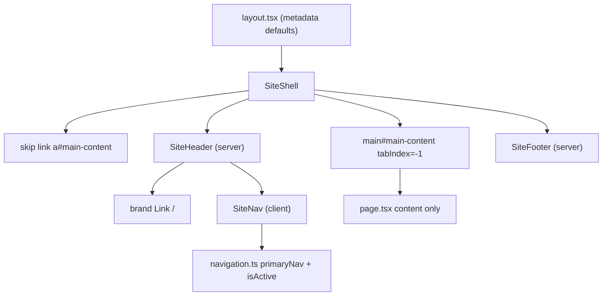
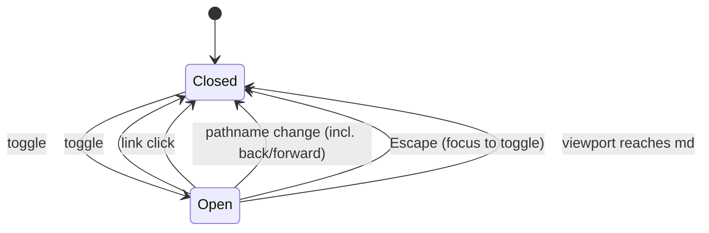

# Brief: Build global shell (FOUND-003)

- Story: [docs/stories/found-003-build-global-shell.md](../stories/found-003-build-global-shell.md), https://github.com/eng-rodriguez/personal-website/issues/3
- Branch: `feat/found-003-build-global-shell`, baseline `origin/main` (record the SHA in the Checkpoint; the local HEAD at drafting time is ec4a13d)
- ADR: [0003. Core section routes and shell](../adr/0003-core-section-routes-and-shell.md) (Accepted)

Add the Site presentation shell to the root layout: a skip link, a header with the site name and the primary navigation, one `main` landmark with the shared content container, and a footer with a copyright line. Add four placeholder pages (`/writing`, `/projects`, `/experience`, `/resume`), metadata defaults with a title template, and a small client component for the mobile disclosure menu. No new dependency, shadcn component, color token, content loading, Playwright or deployment work.

## 1. Layers touched

| Order | Layer | Builder | Paths | Depends on |
| --- | --- | --- | --- | --- |
| 1 | frontend (`web` area, repository root) | factory:react-builder with stack-react | `src/app`, `src/components/site`, `src/lib/navigation.ts`, `docs/design-system.md`, `CLAUDE.md` | none |

- One builder and one PR. Merge order: a single merge. No rollout, because nothing is deployed.
- Pipeline: no change. The `web` job (`npm ci --ignore-scripts`, `npm audit --audit-level=high --omit=dev`, `npm run check`) and the `scope` job must pass unchanged.
- Infra, backend, ml: not touched.
- Stack: Next.js 16.4.2 App Router (Turbopack build), React 19.3.1, TypeScript ~6.0.3, Tailwind CSS 4.3.3, Vitest 5 with jsdom and React Testing Library, npm, Node.js 24. `next.config.ts` is empty, so `cacheComponents` is off and `usePathname` needs no Suspense boundary. `package.json` and `package-lock.json` do not change.

## 2. Ownership
Site presentation context (`docs/domain.md`): layout, navigation and pages. The Writing, Portfolio and Career contexts are not touched; their placeholder pages contain no content and load nothing. Boundaries:
- `src/app/layout.tsx` owns metadata defaults and mounts the shell once. Pages render content only (ADR 0003).
- `src/components/site/*` owns the shell markup. Only `site-nav.tsx` is a Client Component; everything else stays a Server Component.
- `src/lib/navigation.ts` owns the core route list and the active-link rule. It is the only place a core route is added, renamed or removed.
- `src/lib/site.ts` stays the source of the site name and description (unchanged).

## 3. Domain model
Not applicable. No content schemas, aggregates or migrations. The route set is recorded in ADR 0003.

## 4. API contract
None. No route handlers, server actions or API artifacts.

## 5. Data and consistency
Not applicable. No data store. `src/lib/navigation.ts` is the source of truth for navigation items, and `src/lib/site.ts` for the site name. All five routes prerender as static pages.

## 6. Frontend

### Design decisions
- **D1. Navigation module (`src/lib/navigation.ts`, new, no React import).**
  - `export type NavItem = { readonly href: string; readonly label: string };`
  - `export const primaryNav = [{ href: "/", label: "Home" }, { href: "/writing", label: "Writing" }, { href: "/projects", label: "Projects" }, { href: "/experience", label: "Experience" }, { href: "/resume", label: "Resume" }] as const satisfies readonly NavItem[];`
  - `export function isActive(pathname: string | null | undefined, href: string): boolean`, a pure function:
    1. Return `false` for a null, undefined or empty pathname.
    2. Normalize: drop anything from the first `?` or `#`, then strip trailing slashes, keeping `/` for the root (`"/writing/"` becomes `"/writing"`, `"//"` becomes `"/"`).
    3. If `href === "/"`, return `normalized === "/"`.
    4. Otherwise return `normalized === href || normalized.startsWith(href + "/")`.
  - `usePathname` already excludes the query string. Step 2 makes the function correct for any input, so it can be unit-tested on its own. Because the section hrefs are disjoint, at most one item is active for any pathname, and none for an unknown route such as `/missing`.
- **D2. Shared container (`src/components/site/container.ts`, new).** `export const containerClassName = "mx-auto w-full max-w-prose px-6";`. The header, `main` and footer use it, so their edges line up and the width changes in one place. It matches the current home page width.
- **D3. Shell (`src/components/site/site-shell.tsx`, new, Server Component).** Exports `export const mainContentId = "main-content";` and `export function SiteShell({ children }: { children: ReactNode })`, which renders, in order:
  1. `<div className="flex min-h-dvh flex-col">` wrapping everything below (the footer sits at the bottom of short pages).
  2. The skip link as the first focusable element: `<a href={"#" + mainContentId} className="sr-only focus:not-sr-only focus:absolute focus:left-4 focus:top-4 focus:z-50 focus:rounded-md focus:bg-background focus:px-3 focus:py-2 focus:text-foreground">Skip to main content</a>`. It is a plain `<a>`, not `next/link`, so the browser handles the fragment and moves focus. The `focus:` classes control visibility and position only; the focus indicator remains the global `:focus-visible` outline. This is the single, intended exception to the "no plain `focus:` styles" rule in `docs/design-system.md`, and the doc records it.
  3. `<SiteHeader />`.
  4. `<main id={mainContentId} tabIndex={-1} className={cn(containerClassName, "flex-1 py-16")}>{children}</main>`. `tabIndex={-1}` lets the skip link move focus to `main` without adding it to the Tab order. No `outline-none` on `main`; if the browser draws the global outline after a skip, the owner judges it in Manual verification step 7.
  5. `<SiteFooter />`.
- **D4. Root layout (`src/app/layout.tsx`, modified).**
  - `metadata`: ``{ title: { default: site.name, template: `%s · ${site.name}` }, description: site.description }``. No `metadataBase`, Open Graph, icons or robots. The template applies to child segments, so the four placeholder pages get it. Home exports no title and shows the default.
  - `viewport` unchanged. `<html lang="en">` and `<body>` unchanged apart from rendering `<body><SiteShell>{children}</SiteShell></body>`. No class on `<body>`.
- **D5. Header (`src/components/site/site-header.tsx`, new, Server Component).** `<header className="border-b border-border">` containing `<div className={cn(containerClassName, "flex flex-wrap items-center justify-between gap-x-6 gap-y-2 py-4")}>` with:
  - The brand: `<Link href="/" className="inline-flex min-h-10 items-center font-semibold">{site.name}</Link>` (`next/link`). Never `aria-current`.
  - `<SiteNav />`. Its toggle and `<nav>` become flex items of this row (D6).
- **D6. Navigation (`src/components/site/site-nav.tsx`, new, `"use client"`).** Returns a fragment of two siblings, so the open list can wrap onto its own full-width row below the brand and toggle without overlaying page content (an overlay could hide the focused element when Tab moves past the last link):
  1. The toggle: `<button type="button" ref={toggleRef} aria-expanded={open} aria-controls="primary-navigation" onClick={...} className="inline-flex min-h-10 items-center rounded-md border border-input px-3 text-sm font-medium md:hidden">Menu</button>`. The accessible name stays "Menu"; state is carried by `aria-expanded`. Text only, no icon. The `border-input` border is the tested 3:1 interactive border.
  2. The navigation: `<nav id="primary-navigation" aria-label="Primary" className={cn(open ? "block" : "hidden", "basis-full md:block md:basis-auto")}>` containing `<ul className="flex flex-col gap-1 py-2 md:flex-row md:flex-wrap md:gap-x-1 md:py-0">`, one `<li>` per `primaryNav` item, each with a `next/link`:
     - Shared classes: `inline-flex min-h-10 items-center px-2 text-sm transition-colors motion-reduce:transition-none`.
     - Active (`isActive(pathname, item.href)`): `aria-current="page"` and `font-semibold text-foreground underline decoration-2 underline-offset-4`. Underline and weight are the non-color cues; text decoration survives forced-colors mode.
     - Inactive: no `aria-current` attribute at all, and `text-muted-foreground hover:text-foreground`. No hover underline, so only the active link is underlined.
     - `onClick` on each link closes the menu (covers choosing the link for the current page, where the pathname does not change).
  - State, using the "adjust state when a value changes" pattern, not an effect that sets state:
    ```tsx
    const pathname = usePathname();
    const [open, setOpen] = useState(false);
    const [renderedPath, setRenderedPath] = useState(pathname);
    if (pathname !== renderedPath) {
      setRenderedPath(pathname);
      setOpen(false);
    }
    ```
    Any pathname change, including browser back and forward, closes the menu, and returning to a previous page does not reopen it.
  - Escape: while `open`, a `useEffect` adds a `keydown` listener on `document` and removes it on cleanup. On `Escape` it calls `setOpen(false)` and `toggleRef.current?.focus()`. A document listener works even when the click did not focus the toggle (Safari does not focus buttons on click).
  - Breakpoint: while `open`, a `useEffect` subscribes to `window.matchMedia("(min-width: 48rem)")` (Tailwind v4 `md`) with `addEventListener("change", ...)` and closes the menu when `matches` becomes true. Guard with `typeof window.matchMedia === "function"`, because jsdom has no `matchMedia`. Widening shows the inline list through `md:block`, and narrowing again shows the menu closed.
  - State is only set inside event handlers, listener callbacks and the render-time reset above, so `react-hooks` lint rules pass without exemptions.
  - Before hydration or without JavaScript, the links are in the server HTML; at `md` and wider they are visible, and below `md` they stay hidden (accepted by the story).
  - There is no open or close animation. The `transition-colors` on links is covered by `motion-reduce:transition-none` and the global reduced-motion rule.
- **D7. Footer (`src/components/site/site-footer.tsx`, new, Server Component).** `<footer className="border-t border-border">` with `<div className={cn(containerClassName, "py-8")}><p className="text-sm text-muted-foreground">© {new Date().getFullYear()} {site.name}</p></div>`. No email, phone, social or other links. The pages are prerendered, so the year is fixed at build time and moves forward on the next build (section 13).
- **D8. Pages.**
  - `src/app/page.tsx`: remove the `<main>` wrapper and its classes, and return a fragment with the same `h1` and `p` and their classes. Still a synchronous Server Component with no metadata export.
  - New `src/app/writing/page.tsx`, `src/app/projects/page.tsx`, `src/app/experience/page.tsx`, `src/app/resume/page.tsx`: each exports `metadata: Metadata = { title: "<Label>" }` with the label from D1, and renders `<h1 className="text-3xl font-semibold tracking-tight"><Label></h1>` and `<p className="mt-4 text-muted-foreground">` with one placeholder sentence, for example "Articles will appear here." / "Projects and case studies will appear here." / "Professional experience will appear here." / "The resume will appear here." No content loading, no links, no contact details.
  - No `not-found.tsx`. The framework 404 already renders inside the root layout, so it gets the shell with no active link.
- **D9. Tokens.** Only existing token utilities: `background`, `foreground`, `muted-foreground`, `border` (decorative), `input`. Every text pair used (foreground/background, muted-foreground/background) and `input`/`ring` against `background` is already in `TEXT_PAIRS`. No `dark:` class, no new token, so `src/app/globals.test.ts` and `src/app/globals.css` do not change.
- States (loading, empty, error, denied): not applicable. Static pages with no data. The placeholder sentence is the empty state for each section.
- No `next/font`, analytics, icons or new network calls.

The diagram shows how the shell wraps each page and which part runs on the client.



The menu has two states below `md`; every path that changes page or crosses the breakpoint ends closed.



### Test design
Tests follow the `test_acN_` naming. Components are rendered directly; `RootLayout` is not rendered, because it outputs `<html>` and `<body>`. `next/navigation` is mocked with `vi.mock("next/navigation", () => ({ usePathname: vi.fn() }))` and a per-test return value. `fireEvent` only, no `user-event`. jsdom applies neither media queries nor Tailwind, so responsive behavior is asserted through class names and state attributes. If `next/link` needs more than this mock in jsdom, mock only what it needs and record it in the Checkpoint.

- **`src/lib/navigation.test.ts`** (new):
  - `primaryNav` hrefs and labels are exactly the five from D1, in order.
  - `isActive` table: `/` activates only Home; `/writing`, `/writing/`, `/writing?x=1`, `/writing#a` and `/writing/example` activate only Writing; `/writingx`, `/missing`, `""` and `null` activate nothing; `/projects/a/b` activates only Projects.
  - For each core route, exactly one item is active and it is the matching one.
- **`src/components/site/site-nav.test.tsx`** (new):
  - The nav has the accessible name "Primary", five links with the D1 hrefs, and a button named "Menu" with `aria-expanded="false"` and `aria-controls` equal to the nav's `id`.
  - Responsive classes: the toggle has `md:hidden`; the nav has `hidden` and `md:block` when closed and `block` (not `hidden`) when open.
  - Toggle click sets `aria-expanded="true"` and a second click sets it back to `false`.
  - With the menu open: clicking a link closes it; `fireEvent.keyDown(document, { key: "Escape" })` closes it and `document.activeElement` is the toggle; a non-Escape key leaves it open.
  - Rerendering with a new mocked pathname closes it, and rerendering back to the first pathname leaves it closed.
  - With a stubbed `window.matchMedia` that captures its `change` listener, firing `matches: true` closes the open menu. Without `matchMedia` (jsdom default), opening the menu does not throw.
  - Active link per route (`/`, `/writing`, `/writing/example`): exactly one link has `aria-current="page"` and the classes `underline` and `font-semibold`; the others have neither and no `aria-current`. On `/writingx` and `/missing` no link has `aria-current`.
  - Target size and focus: the toggle and every link have `min-h-10`; no element has `outline-none` or a plain `focus:` class; transitioning links have `motion-reduce:transition-none`.
- **`src/components/site/site-shell.test.tsx`** (new):
  - For each of the five pages (imported from `@/app/.../page`), rendering `<SiteShell><Page /></SiteShell>` with the matching pathname gives exactly one `main`, one `banner`, one `contentinfo` and one navigation named "Primary", and the page's level 1 heading is inside `main`.
  - The first element matching `a[href], button, input, select, textarea, [tabindex]:not([tabindex="-1"])` in document order is the skip link, named "Skip to main content", with `href="#main-content"`; `main` has `id="main-content"` and `tabIndex` -1; the skip link has `sr-only` and `focus:not-sr-only`.
  - The brand link points to `/`, shows `site.name` and has no `aria-current`.
- **`src/components/site/site-footer.test.tsx`** (new): with `vi.useFakeTimers({ toFake: ["Date"] })` and `vi.setSystemTime(new Date("2031-06-01T12:00:00Z"))`, the footer text contains `© 2031` and `site.name`; it has no links, and its text matches neither an email pattern (`/@/`) nor a phone pattern (`/\+?\d[\d\s().-]{6,}\d/`). Restore real timers after.
- **`src/app/layout.test.ts`** (new, `// @vitest-environment node`): `metadata.title` equals `{ default: site.name, template: "%s · " + site.name }`, `metadata.description` equals `site.description`, and `metadata.metadataBase` is undefined. Each placeholder page module exports `metadata.title` equal to its D1 label. Importing `layout.tsx` imports `globals.css`, which Vitest stubs by default; if that fails, record it and assert through the built HTML only (section 9, AC7).
- **`src/app/page.test.tsx`** (modified): renders `Home`, asserts the level 1 heading with `site.name` and that `queryByRole("main")` is null (the shell owns `main`).

## 7. Infra and pipeline
Not applicable. No workflow, Dependabot, environment or deployment change.

## 8. Security and threat notes
- Authn/z, tenant isolation, input validation: not applicable (no users, no input, no data). The only client input is the pathname, used for string comparison.
- Secrets: none. Data classification: public copy only. The footer publishes the site name and year, nothing else.
- No new dependencies.
- Top threats (STRIDE-style):
  1. Information disclosure: contact details (email, phone, social profiles) published in the footer or placeholders beyond what is intended. Mitigations: D7 and D8 content rules, the footer test's email and phone patterns, and the owner's read in Manual verification.
  2. Tampering or spoofing through the skip-link fragment or links: none of the hrefs comes from user input. All are constants from `navigation.ts` or `mainContentId`, rendered through React, which escapes attributes.
  3. Denial of navigation to keyboard, screen reader, zoom or high-contrast users (not classic STRIDE, the main user-facing risk). Mitigations: the skip link, `aria-current`, `aria-expanded`/`aria-controls`, non-color active cues, outline focus, 40px targets, an in-flow menu, and the manual checks.

## 9. Verification per criterion
Local checks run from the repository root on Node.js 24. "Built HTML" means `.next/server/app/<route>.html` after `npm run build` (for Home, `index.html`).

| AC | Check | Level |
| --- | --- | --- |
| 1 | `site-shell.test.tsx` landmarks per route. `npm run build` route table lists `/`, `/writing`, `/projects`, `/experience`, `/resume` as static (○). Each built HTML contains exactly one `<main` (`grep -o '<main' <file> \| wc -l` is 1), `id="main-content"`, `aria-label="Primary"` and `<footer`. Manual steps 4 and 5 | local + manual |
| 2 | `site-nav.test.tsx` classes (`md:block`, `md:hidden`). Each built HTML contains the five hrefs inside the nav (server-rendered). Manual step 5 | local + manual |
| 3 | `site-nav.test.tsx` initial state (`aria-expanded="false"`, name "Menu", `hidden`). Manual step 4 | local + manual |
| 4 | `site-nav.test.tsx` toggle, link, Escape and focus tests. Manual step 4 | local + manual |
| 5 | `navigation.test.ts` table and `site-nav.test.tsx` `aria-current` and class assertions. Manual steps 4 to 6 | local + manual |
| 6 | `site-shell.test.tsx` first-focusable and target assertions; `site-nav.test.tsx` no `outline-none` or `focus:` classes. Manual step 7 in both themes (jsdom implements neither Tab order nor `:focus-visible`) | local + manual |
| 7 | `layout.test.ts`. Built HTML: `index.html` contains `<title>Personal website</title>`, `writing.html` contains `<title>Writing · Personal website</title>`, both contain `<meta name="description"`, and no built HTML contains `og:url` or an absolute `canonical` link | local |
| 8 | `site-footer.test.tsx`. Built `index.html` footer shows the build year. Owner read in manual step 9 | local + manual |
| 9 | `npm run check` exit 0, recording Vitest file and test counts; `npm audit --audit-level=high --omit=dev` exit 0; `git diff --stat origin/main -- package.json package-lock.json` is empty | local |
| 10 | `shell-docs.test.ts` checks the design-system "Global shell" section and the CLAUDE.md Current state; owner read in manual step 10 | local + manual |

Edge cases: unknown route (`navigation.test.ts`, manual step 6 on `/missing`); trailing slash and query (`navigation.test.ts`); duplicate landmarks (AC1 tests and built HTML); menu state on navigation and back/forward (rerender test, manual step 4); resize across `md` (matchMedia test, manual step 5); no JavaScript (built HTML contains the links, manual step 5); forced colors and reduced motion (manual step 8); target size (`min-h-10` = 40px, manual step 4); zoom and 320px (manual step 6); contrast (no new pairs, `globals.test.ts` unchanged and passing); footer year (fake timers); no network calls (manual step 9); scope check (section 11).

Environment evidence, blocked until the PR exists: CI `web`, `scope` and `ci-ok`. Not covered by automation: real responsive layout, focus visibility, skip link focus movement, screen reader output, forced colors and zoom. These are manual by design, since Playwright is out of scope.

### Manual verification
Run by the owner on a fresh clone of the branch with Node.js 24, before marking the PR ready. Record who ran it and each result in the Checkpoint; builders do not claim it. Items marked "automated" may also be run by the test agent, which does not replace the human run.

Prerequisites: a fresh clone of `feat/found-003-build-global-shell`; Chrome or Edge with DevTools (device toolbar; Rendering panel: "Emulate CSS media feature prefers-color-scheme", "forced-colors" and "prefers-reduced-motion"). Optionally VoiceOver (macOS) for step 7.

1. `npm ci` then `npm run check; echo $?`. Expected: exit 0, only the 3 known ESLint `ERESOLVE` notices; record the Vitest file and test counts. Covers AC9. Automated.
2. `npm audit --audit-level=high --omit=dev`. Expected: exit 0. Covers AC9. Automated.
3. Run the built-HTML greps in the AC1, AC2 and AC7 rows. Expected: as stated. Automated.
4. `npm run build && npm run start`, open `http://localhost:3000` at 375px width (device toolbar). Expected: brand and a "Menu" button, no links visible. Activate Menu: the five links appear stacked below the header row, pushing content down, with the current page underlined and bold. Activate Writing: the Writing page loads with the menu closed and Writing marked. Reopen the menu and press Escape: it closes and focus is on Menu. Reopen and activate Menu again: it closes. Open the menu, go to Projects, then use browser Back and Forward: the menu is closed on each page. The toggle and links are at least 24 by 24 px (inspect: 40px tall). Covers AC3, AC4, AC5 and the navigation-state and target-size edge cases. Human only.
5. Set the width to 1280px. Expected: the five links are inline in the header with no Menu button, and the active link is underlined and bold on each of the five routes. At exactly 768px, the header fits on one row or wraps without clipping. Narrow to 375px, open the menu, widen past 768px: the inline links show, nothing sticks open. Narrow again: the menu is closed. Disable JavaScript (DevTools command "Disable JavaScript"), reload at 1280px: the links are visible and work. Re-enable JavaScript. Covers AC1, AC2 and the resize and no-JS edge cases. Human only.
6. At 1280px window width, zoom to 200%; then set the width to 320px at 100%. Expected: no horizontal scrollbar, no clipped link or brand text, and links wrap or collapse into the menu. Visit `/missing`: the 404 renders inside the header and footer and no link is marked. Covers the zoom and unknown-route edge cases. Human only.
7. In light and then dark OS theme (or emulation): from the address bar press Tab. Expected: the first stop is a visible "Skip to main content" link; Enter moves focus to `main` (the next Tab goes to the first focusable element after the start of `main`, not back to the header); every header, nav and footer control shows the outline on Tab, and a mouse click shows none. Owner judgment: whether an outline drawn around `main` after a skip is acceptable. Optional VoiceOver: the nav is announced as "Primary" navigation, the current link as "current page", and Menu as collapsed or expanded. Covers AC6. Human only.
8. Emulate `forced-colors: active`: the active link underline and the focus outline remain visible. Emulate `prefers-reduced-motion: reduce`: hovering links changes color without a transition. Covers the forced-colors and reduced-motion edge cases. Human only.
9. Network tab during steps 4 to 8: only `localhost` is contacted. Read the footer: a copyright line with the site name and current year, and no email, phone or social link. Covers AC8 and the no-network edge case. Human only.
10. Read `docs/design-system.md` and the CLAUDE.md Current state. Expected: the content in section 10. Covers AC10. Human only.
11. Open the PR. Expected: `web`, `scope` and `ci-ok` succeed. Environment evidence; blocked until the PR exists.

Rollback: revert the merge commit through a PR (`git revert -m 1 <merge-sha>`, section 12), then re-run step 1. Expected: `/writing`, `/projects`, `/experience` and `/resume` return the framework 404 and the home page renders its own `main` again.

## 10. Docs impact and observability
- `docs/design-system.md`: add a "Global shell" section:
  - Landmarks: the root layout renders one skip link, `header` (banner), `nav` named "Primary", one `main#main-content` and `footer` (contentinfo). Pages render content only and never their own `main`.
  - Container: `containerClassName` in `src/components/site/container.ts` (`max-w-prose` reading width, `px-6`), shared by header, `main` and footer.
  - Breakpoint: `md` (48rem); below it the navigation is a disclosure (Menu button with `aria-expanded` and `aria-controls`) that closes on link choice, pathname change, Escape (focus returns to the toggle) and widening past `md`; at `md` and wider the links are always visible.
  - Active link rule: `isActive` in `src/lib/navigation.ts` (Home exact, sections exact or nested, pathname only); marked with `aria-current="page"`, underline and semibold, never color alone.
  - Skip link: the only allowed plain `focus:` utilities, for visibility and position; the indicator stays the global outline.
  - Adding a core route: add it to `primaryNav`, add its page with a `metadata.title`, update ADR 0003.
  - Target size: interactive shell controls use `min-h-10`.
- `CLAUDE.md`:
  - Current state: the global shell (skip link, header with site name and primary navigation, one `main`, footer), the five core routes with four placeholder pages, metadata defaults with the `%s · <site name>` template, and the pointer to `docs/design-system.md`. Replace "placeholder home page" wording accordingly.
  - Approved decisions: core routes and shell ownership (ADR 0003).
  - Unresolved architecture: note under "Content model" that the route set is decided in ADR 0003 while the case study type and resume format remain open.
  - Paths: `src/components/site` for shell components, `src/lib/navigation.ts` for core routes.
  - Remove nothing else.
- `README.md`: no change (scripts and setup are unchanged).
- Observability: none. No runtime service and nothing is logged.

## 11. Files that will change
Builders create or modify only these paths. Any other file is out of scope and must not be committed.

Frontend / application (factory:react-builder):
- `src/app/layout.tsx` (modified: title template, `SiteShell`)
- `src/app/page.tsx` (modified: no `main`)
- `src/app/writing/page.tsx` (new)
- `src/app/projects/page.tsx` (new)
- `src/app/experience/page.tsx` (new)
- `src/app/resume/page.tsx` (new)
- `src/components/site/container.ts` (new)
- `src/components/site/site-shell.tsx` (new)
- `src/components/site/site-header.tsx` (new)
- `src/components/site/site-nav.tsx` (new, `"use client"`)
- `src/components/site/site-footer.tsx` (new)
- `src/lib/navigation.ts` (new)

Tests (factory:react-builder; also exempt from the scope check):
- `src/lib/navigation.test.ts` (new)
- `src/components/site/site-nav.test.tsx` (new)
- `src/components/site/site-shell.test.tsx` (new)
- `src/components/site/site-footer.test.tsx` (new)
- `src/components/site/shell-docs.test.ts` (new, AC10 doc check)
- `src/app/layout.test.ts` (new)
- `src/app/page.test.tsx` (modified)

Docs (factory:react-builder):
- `docs/design-system.md` (modified)
- `CLAUDE.md` (modified)

Planning (orchestrator/architect):
- `docs/briefs/found-003-build-global-shell.md` (this brief)
- `docs/adr/0003-core-section-routes-and-shell.md` (new)
- `docs/stories/found-003-build-global-shell.md` (already present, untracked)

Not committed (gitignored, generated): `.next/`, `node_modules/`, `next-env.d.ts`, `*.tsbuildinfo`.
Explicitly not changed: `package.json`, `package-lock.json`, `src/app/globals.css`, `src/app/globals.test.ts`, `src/lib/site.ts`, `src/components/ui/*`, `components.json`, `next.config.ts`, `tsconfig.json`, `eslint.config.mjs`, `.prettierignore`, `.github/`. No `not-found.tsx`, `src/hooks/` or `src/components/ui/*` additions.

## 12. Risk
- Level: **Standard**. It changes the layout of every route and adds the site's first Client Component on an undeployed static site, with no data, auth, secrets, dependency or deployment impact, and reverts as one PR.
- Recovery: revert the merge commit on `main` (`git revert -m 1 <merge-sha>`) through a PR. Nothing is deployed, so there is no runtime rollback and no flag.
- Owner: @eng-rodriguez.

## 13. Open questions and ADRs
- ADR written: [0003. Core section routes and shell](../adr/0003-core-section-routes-and-shell.md) (Accepted with this brief). It records the five core routes and labels, case studies under Projects, `/resume` as the entry point for any resume format, and the root layout owning the single `main`.
- Open (owner, does not block): the footer year is fixed when the page is prerendered and updates on the next build. Acceptable while every deploy rebuilds; revisit if the site goes a calendar year without a build.
- Open (owner, does not block): whether an outline around `main` after using the skip link is acceptable (Manual verification step 7). Suppressing it would need a replacement indicator under the focus rules.
- Builder-verified at implementation (record in the Checkpoint): that `next/link` renders in jsdom with only the `usePathname` mock; that importing `layout.tsx` in a node-environment test works with Vitest's CSS stubbing; that the five routes build as static.
- Resolved in this brief: in-flow disclosure rather than an overlay (D6); state reset on pathname change without an effect (D6); a document-level Escape listener (D6); no `not-found.tsx` (D8); no new tokens (D9).

## 14. Checkpoint
- Phase: PR open (eng-rodriguez/personal-website#39); manual verification done; awaiting merge
- Scope: FOUND-003 as in the approved story
- Baseline: `origin/main` b67fb31a29f65c0bb91ec3c84ab80be8cc178080, clean tree; branch `feat/found-003-build-global-shell`
- Revisions: 0
- Approvals: story, brief and ADR 0003 approved by owner
- Check evidence: `npm run check` exit 0 (typecheck, ESLint, Prettier, Vitest 12 files / 152 tests after the test pass, build). Route table: `/`, `/writing`, `/projects`, `/experience`, `/resume` all static (○). Built HTML for all five routes: one `<main`, `id="main-content"`, `aria-label="Primary"`, `<footer`, five hrefs, no `og:url` or canonical; `index.html` title "Personal website", `writing.html` title "Writing · Personal website", both have a description meta; footer shows 2026. `npm audit --audit-level=high --omit=dev` exit 0. `package.json` and `package-lock.json` unchanged. Builder-verified (section 13): `next/link` renders in jsdom with only the `usePathname` mock (no extra mock); importing `layout.tsx` in a node-environment test works with Vitest's CSS stubbing; five routes build as static. Manual verification (section 9) not run by the builder.
- Repairs used: 0
- Remaining blockers: none
- Reviews: implementation validator, design reviewer and security reviewer found no Critical or Important findings (gitleaks clean; semgrep not installed, manual SAST read)
- Manual verification (section 9), 2026-10-18, production build (`npm run start`) in the desktop app's built-in Chromium browser with viewport and `prefers-color-scheme` emulation:
  - Step 1: fresh `npm ci` (3 known `ERESOLVE` notices) then `npm run check` exit 0, 12 files / 152 tests. Step 2: audit exit 0.
  - Step 3: built HTML for all five routes has one `main`, one "Primary" nav and one footer; titles "Personal website" and "<Section> · Personal website"; description meta present; no `og:url` or canonical.
  - Step 4 (375px): Menu button 40px, `aria-expanded="false"`, no links visible; open shows five 40px links with Home underlined and semibold (`aria-current="page"`); choosing Writing loads it closed with Writing active; Escape closes and focuses Menu; toggle closes; open, Projects, Back, Forward: closed each time with the right link active.
  - Step 5: 1280px shows five inline links and no Menu on each route; the server HTML for each route marks exactly the matching link; 768px fits on one 73px row with no clipping; menu open at 375px, widen to 1280px: closes, inline links show; narrow again: closed. The server-rendered HTML contains every link, which covers the no-JS case (not run with JavaScript disabled in the browser).
  - Step 6: 320px and 640px (the layout width of 1280px at 200% zoom): no horizontal scroll, nothing clipped, menu open fits. `/missing` renders the framework 404 inside the header and footer with no active link (the default 404 fills the viewport height, so the footer sits below the fold).
  - Step 7 (light and dark): first Tab stop is the visible "Skip to main content"; Enter focuses `main#main-content` (with the global outline); every header and nav control shows a 2px solid ring outline on keyboard focus, settling after the 150ms `transition-colors` fade; a mouse click on Menu shows no outline. The placeholder pages and footer have no focusable content, so Tab after the skip wraps to the skip link. VoiceOver not run.
  - Step 8: forced colors and reduced motion were not emulated by the tools; the CSS has no `forced-colors` overrides (underline and solid outline are system-rendered) and has the `motion-reduce` rule. Owner checked the site and reported it looks good.
  - Step 9: only `localhost:3000` was contacted; footer reads "© 2026 Personal website" with no links. Step 10: covered by `shell-docs.test.ts` and the implementation validator; owner reported it looks good.
  - Step 11: PR #39 checks `changes`, `secrets`, `scope`, `web`, `pr-format` and `ci-ok` pass; `workflows` skipped (no `.github/` change).
- Next action: owner merges PR #39; then the closing notes are updated to Shipped
