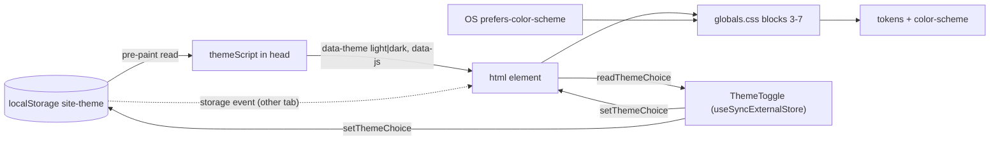

# Brief: Implement themes and responsiveness (FOUND-004)

- Story: [docs/stories/found-004-themes-and-responsiveness.md](../stories/found-004-themes-and-responsiveness.md), https://github.com/eng-rodriguez/personal-website/issues/4
- Branch: `feat/found-004-themes-and-responsiveness`, baseline `origin/main` 1a516f1
- ADR: [0004. Theme choice with pre-paint script](../adr/0004-theme-choice-with-pre-paint-script.md) (Proposed; accepted together with this brief). It supersedes the OS-only theming parts of [ADR 0002](../adr/0002-tailwind-v4-tokens-os-only-theming.md), whose Status line now says so. The rest of ADR 0002 stays in force.

Add a three-option theme choice (System, Light, Dark) stored in `localStorage`. A constant inline script in the root layout applies the choice before first paint, and a segmented radio group in the header changes it. Restructure the dark tokens in `src/app/globals.css` so an explicit choice overrides the OS, System follows the OS in CSS alone, and print always uses light. Fit the toggle into the header from 320px wide upward, and document the breakpoints. No new dependency, color, token, cookie, middleware, CSP, Playwright or deployment work.

## 1. Layers touched

| Order | Layer | Builder | Paths | Depends on |
| --- | --- | --- | --- | --- |
| 1 | frontend (`web` area, repository root) | factory:react-builder with stack-react | `src/lib/theme.ts`, `src/app`, `src/components/site`, `docs/design-system.md`, `CLAUDE.md` | none |

- One builder and one PR. Implementation order inside the PR: D1 theme module and its tests, then D3 and D4 CSS with the updated `globals.test.ts`, then D5 toggle, D6 header, D2 layout, and finally the docs. Merge order: a single merge. No rollout, because nothing is deployed.
- Pipeline: no change. The `web` job (`npm ci --ignore-scripts`, `npm audit --audit-level=high --omit=dev`, `npm run check`) and the `scope` job must pass unchanged.
- Infra, backend, ml: not touched.
- Stack: Next.js 16.4.2 App Router (Turbopack build), React 19.3.1, TypeScript ~6.0.3, Tailwind CSS 4.3.3, Vitest 5 with jsdom and React Testing Library, npm, Node.js 24. `next.config.ts` is empty and stays empty. `package.json` and `package-lock.json` do not change.

## 2. Ownership
Site presentation context (`docs/domain.md`): presentation preference and layout. Writing, Portfolio and Career are not touched. Boundaries:
- `src/lib/theme.ts` owns the theme choice: allowed values, storage key, `<html>` attributes, reading, writing, cross-tab sync and the pre-paint script text. No other module reads or writes `localStorage` or `data-theme`.
- `src/app/globals.css` owns how each state maps to tokens and `color-scheme` (D3), and the `dark:` variant (D4).
- `src/app/layout.tsx` mounts the script once and owns `suppressHydrationWarning` on `<html>`.
- `src/components/site/theme-toggle.tsx` is the only UI that changes the choice. `site-header.tsx` places it, and `site-nav.tsx` keeps the menu behavior from FOUND-003.

## 3. Domain model
Not applicable. No content schemas, aggregates or migrations. The theme choice is a client-side preference value (`"system" | "light" | "dark"`), not domain data.

## 4. API contract
None. No route handlers, server actions, cookies, headers or API artifacts.

## 5. Data and consistency
- Source of truth for the in-session choice: the `data-theme` attribute on `<html>` (absent means System). Persistent copy: `localStorage["site-theme"]`, either `"light"` or `"dark"`. The key is absent for System.
- Order on change: attribute first, storage second. A failed write still leaves the in-session choice applied (AC7). On the next load the script reads storage again, so a failed write falls back to System.
- Consistency across tabs: eventual, through the `storage` event (D1). Same-tab updates are synchronous.
- Values are validated on every read with an allowlist. Anything else is System. Nothing is migrated, because no earlier key exists.
- No server data, events, outbox or indexes.

## 6. Frontend

### Design decisions
- **D1. Theme module (`src/lib/theme.ts`, new, no React import, no `window` access at import time so the root layout can import it on the server).**
  - `export type ThemeChoice = "system" | "light" | "dark";`
  - `export const themeChoices = ["system", "light", "dark"] as const satisfies readonly ThemeChoice[];`
  - `export const themeStorageKey = "site-theme";` (namespaced so it does not collide with another app's `theme` key on `localhost`), `export const themeAttribute = "data-theme";`, `export const scriptReadyAttribute = "data-js";`
  - `export function parseThemeChoice(value: unknown): ThemeChoice` returns `"light"` or `"dark"` for exactly those strings and `"system"` for anything else: `null`, `""`, `"system"`, `"Dark"`, a stale or unknown value, or a non-string.
  - `export function readThemeChoice(): ThemeChoice` returns `parseThemeChoice(document.documentElement.getAttribute(themeAttribute))`. It never reads storage, so it works when storage is blocked and returns a stable primitive for `useSyncExternalStore`.
  - `export function setThemeChoice(choice: ThemeChoice): void`:
    1. For `"system"`, remove `data-theme`. Otherwise set it to the choice.
    2. In a `try`/`catch` that swallows errors without logging, call `localStorage.removeItem(themeStorageKey)` for System and `localStorage.setItem(themeStorageKey, choice)` otherwise. The `try` also wraps reading the `localStorage` global, because it throws a `SecurityError` when site data is blocked.
    3. Notify every subscriber.
  - `export function subscribeThemeChoice(onChange: () => void): () => void` adds `onChange` to a module-level `Set` and adds a `window` `storage` listener. The listener ignores events whose `key` is neither `themeStorageKey` nor `null` (`null` means `clear()`). For a matching event it applies `parseThemeChoice(event.newValue)` to the attribute as in step 1, without writing storage, and calls `onChange`. The returned function removes both.
  - `export const themeScript: string`, built only from the constants above with `JSON.stringify`, equivalent to:
    ```js
    (function(){var d=document.documentElement;try{var t=localStorage.getItem("site-theme");if(t==="light"||t==="dark")d.setAttribute("data-theme",t)}catch(e){}d.setAttribute("data-js","")})()
    ```
    The script never writes a stored value except through this allowlist, never logs, and sets `data-js` even when storage throws. It does not use `matchMedia`: System is handled in CSS (D3).
- **D2. Root layout (`src/app/layout.tsx`, modified).**
  - `<html lang="en" suppressHydrationWarning>`. The script adds `data-theme` and `data-js` before React hydrates, and the flag silences the attribute mismatch on `<html>` only. It does not apply to children, so a real mismatch in the shell still warns. No other element gets the flag.
  - Add `<head><script dangerouslySetInnerHTML={{ __html: themeScript }} /></head>` before `<body>`. The App Router merges metadata tags into this `<head>`. A plain parser-blocking inline script runs before the body is parsed, so the attribute is in place before the first paint. Do not use `next/script` `beforeInteractive`: in the App Router it runs through the Next.js runtime, not as a plain inline script (ADR 0004).
  - `metadata` unchanged. `viewport` stays `{ colorScheme: "light dark" }`, which is right for System and the no-JS page. CSS sets `color-scheme` for explicit choices (D3). If Manual verification step 5 shows a pre-stylesheet canvas flash from the meta tag, record it and stop for a brief revision.
  - If ESLint (for example `@next/next/no-head-element`) or React reports the `<head>` placement, move the same `<script>` to be the first child of `<body>`, which also runs before any content paints. Record which placement was used. No `eslint-disable`.
- **D3. Token structure (`src/app/globals.css`, modified).** Same token names and values. Replace the header comment so it describes this structure as the contract `globals.test.ts` parses. The order is:
  1. `@import "tailwindcss";` and `@source not "../../docs";` (unchanged).
  2. `@custom-variant dark` (D4).
  3. `:root { color-scheme: light dark; --radius: ...; light tokens }` (unchanged).
  4. `:root[data-theme="light"] { color-scheme: light; }`.
  5. `@media screen and (prefers-color-scheme: dark) { :root:not([data-theme="light"]) { dark tokens } }`: System or no JavaScript, with the OS dark.
  6. `@media screen { :root[data-theme="dark"] { color-scheme: dark; dark tokens } }`: explicit Dark. Its token declarations are character-for-character the same as block 5.
  7. `@media print { :root { color-scheme: light; } }`. Dark tokens exist only under `screen`, so print gets the `:root` light tokens whatever the choice (AC14).
  8. `@theme inline`, `@theme` and `@layer base` (unchanged), plus one base rule: `html:not([data-js]) [data-theme-toggle] { display: none; }` (D7).

  | State | Tokens | `color-scheme` |
  | --- | --- | --- |
  | System or no JS, OS light | `:root` light | `light dark` (resolves light) |
  | System or no JS, OS dark | block 5 dark | `light dark` (resolves dark) |
  | Light, any OS | `:root` light (block 5 excluded by `:not`) | `light` |
  | Dark, any OS | block 6 dark | `dark` |
  | Print, any state | `:root` light | `light` |

  Duplicating the dark values was chosen over `light-dark()` and over a script that always sets the resolved theme (ADR 0004 Alternatives). The test in D10 makes drift between blocks 5 and 6 a failure.
- **D4. `dark:` variant.** Replace Tailwind's media-only default so a future `dark:` utility matches the same states as the tokens:
  ```css
  @custom-variant dark {
    @media screen and (prefers-color-scheme: dark) {
      &:where(:root:not([data-theme="light"]), :root:not([data-theme="light"]) *) {
        @slot;
      }
    }
    @media screen {
      &:where([data-theme="dark"], [data-theme="dark"] *) {
        @slot;
      }
    }
  }
  ```
  The policy is unchanged: components avoid `dark:` and keep per-theme differences in tokens. The builder confirms that Tailwind 4.3.3 compiles this form, which has two `@slot` branches. Add a temporary `dark:underline` to a component, run `npm run build`, grep the built CSS for both selectors, then remove the class and record the result. If Tailwind rejects the form or emits only one branch, stop and report: a one-branch variant would be wrong for one of the states.
- **D5. Toggle (`src/components/site/theme-toggle.tsx`, new, `"use client"`).**
  - `const choice = useSyncExternalStore(subscribeThemeChoice, readThemeChoice, () => null);`. On the server and during hydration the choice is `null` (unknown), so the server HTML and the first client render match. React then re-renders with the real choice. There is no effect that sets state.
  - Markup: `<div role="radiogroup" aria-label="Theme" data-theme-toggle="" className={cn("inline-flex rounded-md border border-input", choice === null && "invisible")}>`. `invisible` (visibility hidden) keeps the space reserved, so the header does not shift. It removes the group from the Tab order and the accessibility tree until the real choice is known, so a wrong selected state is never shown or announced.
  - One `<label>` per `themeChoices` entry, in order, with the text "System", "Light" and "Dark". Text only, no icons. Each label contains `<input type="radio" name="theme" value={value} checked={choice === value} onChange={() => setThemeChoice(value)} className="sr-only" />`. Native radios give one Tab stop for the group, arrow keys to change the choice, and the checked state exposed to assistive technology.
  - Label classes: `inline-flex min-h-10 cursor-pointer items-center px-3 text-sm text-muted-foreground first:rounded-s-md last:rounded-e-md has-checked:bg-primary has-checked:font-semibold has-checked:text-primary-foreground has-focus-visible:outline-2 has-focus-visible:outline-offset-2 has-focus-visible:outline-ring forced-colors:has-checked:underline forced-colors:has-checked:decoration-2 forced-colors:has-checked:underline-offset-4`.
    - The selected option is a `primary` fill plus semibold text. In forced-colors mode the fill is replaced by system colors, so an underline marks the selection there.
    - Focus is drawn on the label while its sr-only input has `:focus-visible`. No `outline-none`, no plain `focus:`, no `overflow-hidden` on the group, because it would clip the outline.
    - No hover color and no `transition-*`. A hover rule could override the selected text color, and no color animation runs when the theme changes (reduced-motion edge case).
  - Contrast: only pairs already in `globals.test.ts` are used: `primary-foreground`/`primary` and `muted-foreground`/`background` for text, `primary`/`background` for the selected fill indicator (4.5:1 or more), `input`/`background` for the group border, and `ring`/`background` for focus.
- **D6. Header placement (`site-header.tsx` and `site-nav.tsx`, modified).**
  - `SiteNav` takes an optional `actions?: ReactNode` prop. Its fragment becomes: `<div className="ms-auto flex flex-wrap items-center justify-end gap-2">{actions}<button ...Menu.../></div>` followed by the unchanged `<nav>`. The Menu button's classes, state, Escape, pathname and `matchMedia` behavior are unchanged.
  - `SiteHeader` renders `<SiteNav actions={<ThemeToggle />} />`. The row classes stay as they are (`flex flex-wrap items-center justify-between gap-x-6 gap-y-2 py-4`).
  - DOM and Tab order: skip link, brand, Theme group, Menu (below `md`), navigation links. This matches the visual reading order, left to right and top to bottom.
  - Expected layout, to confirm in Manual verification: below about 400px, row 1 is the brand and row 2 is the Theme group and Menu, right-aligned. The open menu is a full-width row below them, in flow, as in FOUND-003. At `md` and wider, row 1 is the brand and the Theme group, and row 2 is the inline links, because brand, toggle and links do not fit in `max-w-prose`. If the cluster is wider than the 272px content width at 320px, its own `flex-wrap` stacks Menu below the toggle, with no clipping.
- **D7. No JavaScript.** The script never runs, so `data-js` is absent and the D3 base rule sets the toggle to `display: none` (no dead control and no gap). The page follows the OS through blocks 3 and 5. The FOUND-003 no-JS navigation behavior is unchanged.
- **D8. System live updates and other tabs.** With System chosen there is no attribute, so CSS media block 5 switches the theme live when the OS changes, with no listener. With Light or Dark chosen, the attribute pins the theme, and OS changes do nothing (AC3). Other tabs follow through the `storage` listener in D1.
- **D9. Breakpoints.** Tailwind v4 defaults, not redefined: `sm` 40rem, `md` 48rem, `lg` 64rem, `xl` 80rem, `2xl` 96rem. `md` stays the only shell breakpoint. The supported minimum width is 320px. The container keeps `max-w-prose` on very wide and landscape screens.
- **D10. Tokens.** No new token, color or pair. Contrast stays covered in both dark blocks through the `globals.test.ts` changes in Test design.
- States (loading, empty, error, denied): not applicable. "Unknown before hydration" is handled in D5. A storage error is not shown to the user (AC7).
- No `next/font`, analytics, icons, cookies or new network calls.

The diagram shows where the choice lives and who reads it.



### Test design
Tests follow the `test_acN_` naming. jsdom applies neither media queries nor Tailwind, so tests assert CSS structure, attributes, classes, storage and console output. Each test file that touches the theme resets `document.documentElement`'s `data-theme` and `data-js`, clears `localStorage` and restores mocks in `afterEach`. Storage failures are simulated with `vi.spyOn(Storage.prototype, "getItem" | "setItem" | "removeItem").mockImplementation(() => { throw new DOMException("blocked", "SecurityError"); })`. A `vi.spyOn(console, "error")` and `vi.spyOn(console, "warn")` must have no calls in the storage and hydration tests.

- **`src/lib/theme.test.ts`** (new):
  - `parseThemeChoice` table: `"light"` and `"dark"` map to themselves; `"system"`, `""`, `"Dark"`, `"auto"`, `null`, `undefined` and `42` map to `"system"`.
  - `themeScript`, run with `new Function(themeScript)()`: stored `"dark"` and `"light"` set `data-theme`; stored `"bogus"`, `""` and no key leave it absent; a throwing `getItem` leaves it absent and does not throw. Every case sets `data-js`. The script text contains `themeStorageKey` and no `</`.
  - `setThemeChoice("dark")` sets the attribute and the key; `"system"` removes both; a throwing `setItem` or `removeItem` still updates the attribute, throws nothing and logs nothing; subscribers are notified once per call.
  - `readThemeChoice` reflects the attribute, including an invalid attribute value as `"system"`.
  - Cross-tab: after subscribing, dispatching `new StorageEvent("storage", { key: "site-theme", newValue: "dark" })` sets the attribute and calls the callback; `newValue: null` and `key: null` clear it; an unrelated key does nothing. Unsubscribing stops both.
- **`src/components/site/theme-toggle.test.tsx`** (new):
  - A radiogroup named "Theme" with three radios named "System", "Light" and "Dark", in that order, and `data-theme-toggle` on the group.
  - AC1: with no attribute, System is checked and the group has no `invisible` class.
  - With `data-theme="dark"` set before render, Dark is checked.
  - AC6: clicking Light sets `data-theme="light"` and `localStorage` to `"light"` and checks Light. Then clicking System removes the attribute and the key.
  - AC7: with `setItem` throwing, clicking Dark still checks Dark and sets the attribute, with no console output.
  - Cross-tab: a `storage` event with `"light"` checks Light.
  - Hydration (AC2): with `data-theme="dark"` on `<html>`, `renderToString(<ThemeToggle />)` from `react-dom/server` gives HTML that contains `invisible` and no `checked`. Put it in a container, call `hydrateRoot` inside `act`, and expect no `console.error` call, Dark checked and `invisible` gone afterwards. If `react-dom/server` does not run under jsdom in Vitest 5, record it in the Checkpoint and cover the case with Manual verification step 5 only.
  - Targets and focus: every label has `min-h-10` and the `has-focus-visible:outline-*` classes. No element has `outline-none`, a class starting with `focus:`, a `transition` class or a `dark:` class.
- **`src/components/site/site-nav.test.tsx`** (modified): every existing FOUND-003 test stays and passes unchanged. Add: `actions` content renders before the Menu button in document order, inside the same wrapper as the button, and the wrapper has `flex-wrap`.
- **`src/components/site/site-shell.test.tsx`** (modified): for each core route the banner contains the radiogroup "Theme". The skip link is still the first focusable element. In document order, the brand link comes before the first radio, which comes before the Menu button (AC4 Tab order).
- **`src/app/globals.test.ts`** (modified):
  - Structure: exactly one `@custom-variant` with params `dark`, whose body contains `prefers-color-scheme: dark`, `[data-theme="dark"]` and `:not([data-theme="light"])`. Still no `.dark` selector and no `tw-animate-css`. `:root` keeps `color-scheme: light dark`. `:root[data-theme="light"]` sets `color-scheme: light`. The explicit dark rule sets `color-scheme: dark`. `@media print` contains a `:root` rule with `color-scheme: light` and no color token declarations.
  - Locate `osDarkRoot` (`:root:not([data-theme="light"])` inside the media query `screen and (prefers-color-scheme: dark)`, compared with whitespace removed) and `explicitDarkRoot` (`:root[data-theme="dark"]` inside `@media screen`). Both exist. Their color token maps are equal (ignoring `color-scheme`), and each declares exactly `COLOR_TOKENS`.
  - Every rule in the file that declares a dark token value sits inside a media query starting with `screen`, so print cannot pick up dark values.
  - The base layer contains `html:not([data-js]) [data-theme-toggle]` with `display: none`.
  - `themes` for the gamut and contrast `describe.each` becomes three entries: `light`, `dark (OS)` and `dark (explicit)`. `TEXT_PAIRS`, `HOVER_PAIRS` and the 3:1 checks run unchanged for each (AC8).
- **`src/app/layout.test.ts`** (modified, still `// @vitest-environment node`): calling `RootLayout({ children: null })` returns an `html` element with `lang="en"` and `suppressHydrationWarning: true`. Its children include, before `body`, a `head` whose only child is a `script` with `dangerouslySetInnerHTML.__html === themeScript`, or the body-first placement if D2's fallback was used. `viewport.colorScheme` is `"light dark"`. Existing metadata tests are unchanged.
- **`src/components/site/shell-docs.test.ts`** (modified): add assertions that the `## Themes` section of `docs/design-system.md` contains `site-theme`, `data-theme`, `data-js`, `System`, `localStorage` and `print`. The `## Breakpoints` section contains `48rem` and `320px`. CLAUDE.md contains `ADR 0004` and `src/lib/theme.ts`. Existing assertions stay.
- `src/components/ui/button.test.tsx` and `src/app/page.test.tsx`: unchanged and passing.

## 7. Infra and pipeline
Not applicable. No workflow, Dependabot, environment, header, middleware or deployment change.

## 8. Security and threat notes
- Authn/z, tenant isolation: not applicable (no users). Input validation: the stored value and `storage` event values are untrusted and pass the allowlist in `parseThemeChoice` (and the same literal comparison in the script) before reaching the DOM. They are only ever used as one of two fixed attribute values.
- Secrets: none. Data classification: the preference is non-personal and stays on the device. No cookie is set, so nothing is sent to a server.
- No new dependencies. `dangerouslySetInnerHTML` is used once, with a module constant built from other constants.
- CSP: none today (out of scope). A later CSP must allow this inline script by its SHA-256 hash; ADR 0004 and CLAUDE.md record this as a follow-up.
- Top threats (STRIDE-style):
  1. Tampering through a crafted `localStorage` value (another script on the origin, or a user editing storage) or a forged `storage` event. Mitigation: allowlist parsing; the value is never interpolated into markup, script or CSS; tests cover unknown values.
  2. Injection through the inline script if it is later built from dynamic data. Mitigation: `themeScript` is built only from module constants with `JSON.stringify`. A test pins its behavior and checks it has no `</`. The brief allows no other `dangerouslySetInnerHTML`.
  3. Denial of a readable page to visitors (not classic STRIDE, the main user-facing risk): a wrong-theme flash, a hydration break, a script error that stops the page, or a selection or focus that is invisible in forced colors. Mitigations: pre-paint script with `try`/`catch`, `suppressHydrationWarning` limited to `<html>`, the server snapshot pattern, contrast tests on both dark blocks, the forced-colors underline, outline focus, and Manual verification.

## 9. Verification per criterion
Local checks run from the repository root on Node.js 24. "Built HTML" means `.next/server/app/<route>.html` after `npm run build` (for Home, `index.html`). "Built CSS" means the stylesheet under `.next/static` that contains `--color-background`.

| AC | Check | Level |
| --- | --- | --- |
| 1 | `theme-toggle.test.tsx` default System; `globals.test.ts` OS dark block. Manual step 4 | local + manual |
| 2 | `theme.test.ts` script cases; `layout.test.ts` script and `suppressHydrationWarning`; `theme-toggle.test.tsx` hydration test. Built HTML for each core route contains `<script>` with `site-theme` before `<body` and an `<html lang="en"` start tag without `data-theme`. Manual step 5 (filmstrip and console, dev and production) | local + manual |
| 3 | `globals.test.ts` structure (System is CSS-only, explicit rules pinned by attribute). Manual step 6 | local + manual |
| 4 | `site-shell.test.tsx` document order; `theme-toggle.test.tsx` native radios and focus classes. Manual step 7 in both themes (jsdom has no Tab order or `:focus-visible`) | local + manual |
| 5 | `theme-toggle.test.tsx` radiogroup name, radio names and checked state. Optional VoiceOver in manual step 7 | local + manual |
| 6 | `theme.test.ts` and `theme-toggle.test.tsx` persistence and System removal. Manual step 8 | local + manual |
| 7 | `theme.test.ts` throwing `getItem`, `setItem` and `removeItem`, and invalid values; `theme-toggle.test.tsx` no console output. Manual step 9 | local + manual |
| 8 | `globals.test.ts` contrast and gamut for `light`, `dark (OS)` and `dark (explicit)`, plus equality of the two dark blocks | local |
| 9 | `theme-toggle.test.tsx` and `site-nav.test.tsx` `min-h-10` and `flex-wrap`. Manual step 10 | local + manual |
| 10 | `site-nav.test.tsx` FOUND-003 tests unchanged plus `actions`. Manual step 10 | local + manual |
| 11 | `globals.test.ts` no-JS rule; built HTML contains `data-theme-toggle`; built CSS contains a rule hiding `[data-theme-toggle]` under `:not([data-js])`. Manual step 11 | local + manual |
| 12 | `npm run check` exit 0, recording Vitest file and test counts; `npm audit --audit-level=high --omit=dev` exit 0; `git diff --stat origin/main -- package.json package-lock.json next.config.ts` is empty | local |
| 13 | `shell-docs.test.ts`; owner read in manual step 15 | local + manual |
| 14 | `globals.test.ts` print rule and screen-only dark tokens; built CSS contains `@media print`. Manual step 13 | local + manual |

Edge cases: unknown, empty or stale values (`theme.test.ts`); two tabs (`storage` tests, manual step 8); quota or private mode (throwing `setItem`, manual step 9); OS change with an explicit choice (CSS structure, manual step 6); hydration (server snapshot test, manual step 5); forced colors and reduced motion (class assertions, manual step 12); print (manual step 13); 320px with long brand and 200% zoom (manual step 10); resize across `md` with the menu open (existing `matchMedia` test, manual step 10); landscape and very wide screens (manual step 10); scope check (section 11); no network, cookies or analytics (manual step 14).

Builder-verified at implementation (record in the Checkpoint): the D4 two-branch variant compiles in Tailwind 4.3.3; `has-checked:`, `has-focus-visible:` and `forced-colors:has-checked:` compile (grep the built CSS for `:has(:checked)` and `:has(:focus-visible)`); the D2 placement passes ESLint with zero warnings and gives no React or Next.js console warning in `npm run dev`; `renderToString` and `hydrateRoot` run under jsdom; the five routes still build as static (○).

Environment evidence, blocked until the PR exists: CI `web`, `scope` and `ci-ok`. Not covered by automation: real first paint, media queries, Tab order, focus visibility, screen reader output, forced colors, zoom, print and layout at 320px. These are manual by design, since Playwright is out of scope.

### Manual verification
Run by the owner on a fresh clone of the branch with Node.js 24, before marking the PR ready. Record who ran it and each result in the Checkpoint; builders do not claim it. Items marked "automated" may also be run by the test agent, which does not replace the human run.

Prerequisites: a fresh clone of `feat/found-004-themes-and-responsiveness`; Chrome or Edge with DevTools (device toolbar; Rendering panel: "Emulate CSS media feature prefers-color-scheme", "forced-colors", "prefers-reduced-motion" and "print"; Application panel for Local storage; Performance panel with screenshots; command "Disable JavaScript"). Optionally VoiceOver (macOS). Unless a step says otherwise, use `npm run build && npm run start` at `http://localhost:3000`.

1. `npm ci` then `npm run check; echo $?`. Expected: exit 0, only the 3 known ESLint `ERESOLVE` notices; record the Vitest file and test counts. Covers AC12. Automated.
2. `npm audit --audit-level=high --omit=dev`. Expected: exit 0. Covers AC12. Automated.
3. Run the built-HTML and built-CSS greps in the AC2, AC11 and AC14 rows. Expected: as stated. Automated.
4. Clear `site-theme` in the Application panel. Emulate light, reload; emulate dark, reload. Expected: the page matches the emulated theme, the toggle shows System selected, and scrollbars match. Covers AC1 and story assumption A6 (browser UI follows the theme). Human only.
5. Flash check. Emulate dark, run `localStorage.setItem("site-theme", "light")` in the console, enable "Slow 4G" and 6x CPU throttling, and record a Performance trace with screenshots while hard-reloading `/`. Then load each of the other four routes directly. Expected: every screenshot frame is light from the first painted frame, with no dark frame; the toggle shows Light once visible and never shows another option selected. Repeat with OS light and stored `"dark"`. Then run `npm run dev` and reload each route with the console open. Expected in both servers: no hydration, `script` tag or other warning or error in the console. Covers AC2 and the hydration edge case. Human only.
6. With System selected, switch the emulated scheme between light and dark without reloading. Expected: the page switches each time. Select Light and switch the emulation: no change; same with Dark. Covers AC3. Human only.
7. In light and then dark: press Tab from the address bar. Expected order: skip link, brand, the Theme group (one stop, with the outline on the selected option), Menu (below `md`) or the links. Arrow keys move the selection and change the theme immediately, with the outline visible on the focused option in both themes. A mouse click shows no outline. Optional VoiceOver: "Theme, radio group" and the selected option announced as selected. Covers AC4 and AC5. Human only.
8. Choose Dark with the OS light, reload, then go to another core route: Dark is kept and the scrollbar is dark. Choose System: the `site-theme` key is gone in the Application panel. Open a second tab on the site, change the choice in one tab: the other tab follows without a reload. Covers AC6, story assumption A6 and the two-tab edge case. Human only.
9. Set `localStorage.setItem("site-theme", "bogus")` and reload: System is used and the console is clean. In Chrome site settings for `localhost`, block site data ("Not allowed to save data"), reload: the page loads in the OS theme with no console error, the toggle works for the session, and a reload returns to System. Restore the setting. Covers AC7, the private-browsing edge case and storage write errors. Human only.
10. For each of the five routes: at 320px width; at 1280px with 200% zoom; at 667 by 375 (landscape); and at 1920px. Expected: no horizontal scrollbar; brand, toggle, Menu and links are not clipped or overlapped; the header wraps as described in D6; the toggle options and links are 40px tall (inspect). The container stays at reading width on wide screens. At 320px, open the menu and change the theme while it is open: both work, and the menu still closes on Escape, link choice and widening past 768px. Covers AC9, AC10 and the 320px, resize, landscape and wide-screen edge cases. Human only. Owner judgment: the two-row header at `md` and wider (section 13).
11. Disable JavaScript and reload each route in light and dark emulation. Expected: the page follows the OS, no theme control and no gap is shown where it was, and links work at 1280px. Re-enable JavaScript. Covers AC11. Human only.
12. Emulate `forced-colors: active`: the selected option is underlined, and the focus outline is visible on the group and nav. Emulate `prefers-reduced-motion: reduce` and switch themes: no animated color change. Covers the forced-colors and reduced-motion edge cases. Human only.
13. With Dark chosen, and separately with System and OS dark, open print preview (or the Rendering "print" emulation): the output uses light colors. Covers AC14. Human only.
14. Network tab during steps 4 to 13: only `localhost` is contacted. Application panel: no cookies are set. Covers the no-network and no-cookie edge case. Human only.
15. Read `docs/design-system.md`, ADR 0004 and the CLAUDE.md Current state. Expected: the content in section 10. Covers AC13. Human only.
16. Open the PR. Expected: `web`, `scope` and `ci-ok` succeed. Environment evidence; blocked until the PR exists.

Rollback: revert the merge commit through a PR (`git revert -m 1 <merge-sha>`, section 12), then re-run step 1. Expected: no toggle, the theme follows the OS only, and `globals.test.ts` is back to the FOUND-003 shape. A leftover `site-theme` key in a browser is then ignored.

## 10. Docs impact and observability
- `docs/design-system.md`:
  - Intro: tokens follow the OS or the visitor's choice; link ADR 0004 next to ADR 0002.
  - "Where tokens live", step 2: add the dark value to both dark blocks (OS and explicit), identical; the test fails if they differ.
  - "Themes" (rewrite): the three choices with System as the default; `localStorage` key `site-theme` with values `light` and `dark`, removed for System, and invalid or blocked storage meaning System; `data-theme` on `<html>`; the pre-paint script in the root layout, owned by `src/lib/theme.ts`, which also sets `data-js`; the state table from D3; System follows the OS live in CSS; other tabs follow through the `storage` event; print is always light; no-JS hides the toggle; the `dark:` variant definition and the rule to keep using tokens instead of `dark:`; `suppressHydrationWarning` on `<html>` only; a future CSP needs the script hash.
  - "Global shell": add the Theme toggle (radio group named "Theme", native radios, `actions` cluster with Menu, Tab order), and the header rows from D6.
  - New "Breakpoints": the D9 values, `md` as the only shell breakpoint, 320px minimum, and the manual 320px, 200% zoom and no-JS check (Manual verification steps 10 and 11, written as a short checklist).
  - "Adding a shadcn component", step 4: copy `.dark` variables into both dark blocks.
- `CLAUDE.md`:
  - Current state: theme choice (System, Light, Dark) stored in `localStorage` and applied by an inline pre-paint script, with the toggle in the header; breakpoints documented in `docs/design-system.md`.
  - Approved decisions, Styling and UI: replace "OS-only theming" with the ADR 0004 summary (three-option choice, `localStorage`, inline pre-paint script, print light) and keep the ADR 0002 parts (tokens, outline focus, contrast test).
  - Unresolved architecture: note that any future Content Security Policy must allow the inline theme script by hash.
  - Paths: `src/lib/theme.ts` for the theme choice.
  - Remove nothing else.
- `docs/adr/0002-tailwind-v4-tokens-os-only-theming.md`: Status line only (already updated with this brief).
- `README.md`: no change.
- Observability: none. No runtime service, and nothing is logged. Storage errors are swallowed on purpose (AC7).

## 11. Files that will change
Builders create or modify only these paths. Any other file is out of scope and must not be committed.

Frontend / application (factory:react-builder):
- `src/lib/theme.ts` (new)
- `src/components/site/theme-toggle.tsx` (new, `"use client"`)
- `src/components/site/site-header.tsx` (modified: passes `ThemeToggle` to `SiteNav`)
- `src/components/site/site-nav.tsx` (modified: `actions` prop and cluster wrapper)
- `src/app/layout.tsx` (modified: script, `suppressHydrationWarning`)
- `src/app/globals.css` (modified: D3 and D4 structure, no-JS rule)

Tests (factory:react-builder; also exempt from the scope check):
- `src/lib/theme.test.ts` (new)
- `src/components/site/theme-toggle.test.tsx` (new)
- `src/components/site/site-nav.test.tsx` (modified)
- `src/components/site/site-shell.test.tsx` (modified)
- `src/components/site/shell-docs.test.ts` (modified)
- `src/app/globals.test.ts` (modified)
- `src/app/layout.test.ts` (modified)

Docs (factory:react-builder):
- `docs/design-system.md` (modified)
- `CLAUDE.md` (modified)

Planning (orchestrator/architect):
- `docs/briefs/found-004-themes-and-responsiveness.md` (this brief)
- `docs/adr/0004-theme-choice-with-pre-paint-script.md` (new)
- `docs/adr/0002-tailwind-v4-tokens-os-only-theming.md` (modified: Status line only)
- `docs/stories/found-004-themes-and-responsiveness.md` (already present, untracked)

Not committed (gitignored, generated): `.next/`, `node_modules/`, `next-env.d.ts`, `*.tsbuildinfo`.
Explicitly not changed: `package.json`, `package-lock.json`, `next.config.ts`, `tsconfig.json`, `eslint.config.mjs`, `components.json`, `postcss.config.mjs`, `.prettierignore`, `src/lib/site.ts`, `src/lib/navigation.ts`, `src/components/site/container.ts`, `src/components/site/site-shell.tsx`, `src/components/site/site-footer.tsx`, `src/components/ui/*`, `src/app/page.tsx`, the four section pages, `.github/`. No middleware, `src/hooks/`, theme provider, `README.md` change or new dependency.

## 12. Risk
- Level: **Standard**. It adds the site's first inline script and changes how every route picks its theme on an undeployed static site, with no data, auth, secrets, dependency or deployment impact, and reverts as one PR.
- Recovery: revert the merge commit on `main` (`git revert -m 1 <merge-sha>`) through a PR, then run `npm run check` (Manual verification, Rollback). Nothing is deployed, so there is no runtime rollback and no flag. Stored `site-theme` values left in browsers are ignored after a revert.
- Owner: @eng-rodriguez.

## 13. Open questions and ADRs
- ADR written: [0004. Theme choice with pre-paint script](../adr/0004-theme-choice-with-pre-paint-script.md) (Proposed; set to Accepted when this brief is approved). ADR 0002's Status line now points to it.
- Open (owner, does not block): at `md` and wider the header becomes two rows (brand and toggle, then links), because the toggle does not fit beside the links in `max-w-prose`. Accept in Manual verification step 10, or ask for a later story to change the header width.
- Open (owner, does not block): the toggle is invisible from first paint until hydration. The space is reserved and nothing shifts, but on a slow device the control appears a moment after the page. This is the trade-off that avoids showing a wrong selection.
- Open (follow-up, not this story): a Content Security Policy must allow the inline script by hash. Record it in the headers and deployment story.
- Builder-verified at implementation: listed in section 9. If the D4 variant fails, or the D2 placement fails in both positions, work stops for a brief revision.
- Resolved in this brief: `data-theme` attribute rather than a `.dark` class (D3); System means no attribute and is handled in CSS without `matchMedia` (D3, D8); duplicated dark blocks checked for equality (D3, tests); print light by limiting dark tokens to `screen` (D3); native radios in a `radiogroup` (D5); `useSyncExternalStore` with an unknown server snapshot (D5); `data-js` marker for no-JS (D7); `actions` slot in `SiteNav` for a deterministic header layout (D6); storage key `site-theme` (D1).

## 14. Checkpoint
- Phase: brief approved; implementation (factory:react-builder)
- Scope: FOUND-004 as in the approved story
- Baseline: `origin/main` 1a516f1; branch `feat/found-004-themes-and-responsiveness`; story and brief committed first
- Revisions: 0
- Approvals: story assumptions A1 to A11 approved by owner on 2026-10-18; brief and ADR 0004 approved by owner on 2026-10-18, including the two-row header at `md` and wider and the toggle appearing on hydration
- Check evidence: none yet
- Repairs used: 0
- Remaining blockers: none
- Next action: factory:react-builder implements section 6 and records the builder-verified items
