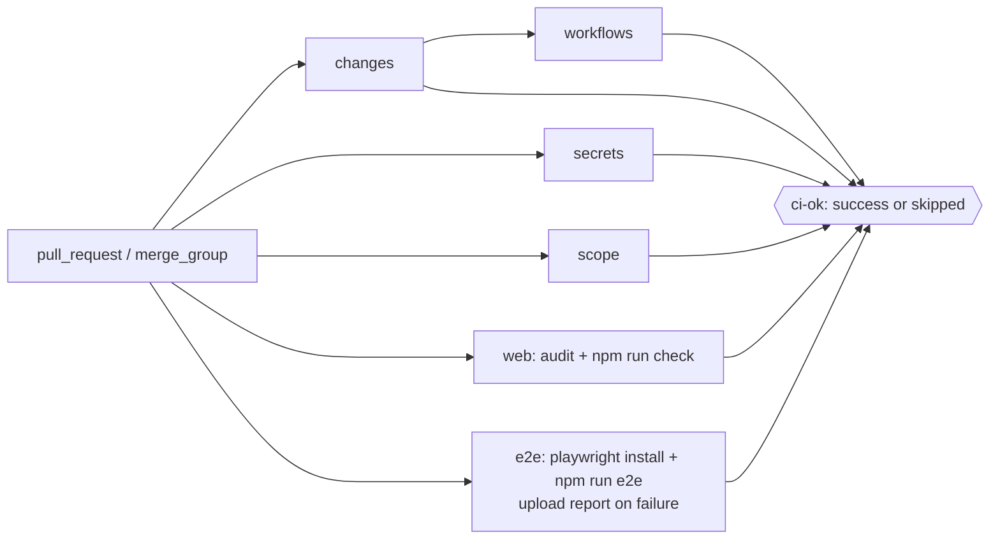

# Brief: Set up engineering quality gates (FOUND-005)

- Story: [docs/stories/found-005-engineering-quality-gates.md](../stories/found-005-engineering-quality-gates.md), https://github.com/eng-rodriguez/personal-website/issues/5
- Branch: `feat/found-005-engineering-quality-gates`, cut from `origin/main` ca694e1. Do not branch from `docs/found-004-ship-notes` (a76d6c4): its `.github/workflows/ci.yml` still has the pre-PR-34 action pins.
- ADR: [0005. Playwright smoke tests outside check](../adr/0005-playwright-smoke-tests-outside-check.md) (Accepted with this brief on 2026-10-19). It supersedes the deferred Playwright part of [ADR 0001](../adr/0001-pin-node-24-and-check-script.md), whose Status line now says so. The rest of ADR 0001 stays in force.

The existing gates (typecheck, ESLint `--max-warnings=0`, Prettier check, Vitest, production build through `npm run check`, run by the `web` job) stay as they are. They are verified and documented, not changed. This story adds Playwright 1.63.0 with Chromium-only smoke tests for the five core routes, the shell, the theme toggle and the no-JS page. They run through a new `e2e` npm script that stays outside `check`, and a new `e2e` CI job that rebuilds the site, uploads the report only on failure and is listed in `ci-ok`. Documentation goes in `docs/testing.md`, `CLAUDE.md` and ADR 0005. No application code changes.

## 1. Layers touched

| Order | Layer | Builder | Paths | Depends on |
| --- | --- | --- | --- | --- |
| 1 | frontend tooling and tests (`web` area, repository root) | factory:react-builder with stack-react | `package.json`, `package-lock.json`, `playwright.config.ts`, `e2e/`, `eslint.config.mjs`, `.gitignore`, `.prettierignore`, `src/scaffold.test.ts`, `docs/testing.md`, `CLAUDE.md` | none |
| 2 | pipeline | factory:pipeline-builder with devsecops-gha | `.github/workflows/ci.yml` | step 1 (`npm run e2e` and the pinned `@playwright/test` must exist) |

- Two builders, sequential, one PR. The react-builder finishes and runs `npm run check` and `npm run e2e` locally, then the pipeline-builder adds the job and runs actionlint and zizmor. Single merge. No rollout, because nothing is deployed.
- Stack: Next.js 16.4.2 App Router, React 19.3.1, TypeScript ~6.0.3, ESLint 10.13.0 with `eslint-config-next` 16.4.2, Prettier 3.9.10, Vitest 5.0.5 with jsdom, npm, Node.js 24 (`.nvmrc`). New: `@playwright/test` 1.63.0 (dev). `next.config.ts`, `tsconfig.json`, `vitest.config.mts` and `.factory.yml` do not change.
- Backend, infra, ml: not touched.

## 2. Ownership
- Site presentation context (`docs/domain.md`). This story adds verification of it and changes no behavior. Writing, Portfolio and Career are not touched.
- `playwright.config.ts` owns how smoke tests run: server, port, browser, retries, reporters and output folders.
- `e2e/*.spec.ts` own the smoke assertions. They import route, site and theme constants from `src/lib/navigation.ts`, `src/lib/site.ts` and `src/lib/theme.ts` with relative imports, so the tests share the app's definitions and do not copy them. These modules have no React import and no `window` access at import time.
- `.github/workflows/ci.yml` owns when the gates run in CI. `ci-ok` stays the single aggregate result.

## 3. Domain model
Not applicable. No content, schemas or migrations.

## 4. API contract
None. No route handlers, server actions or API artifacts.

## 5. Data and consistency
Not applicable. The smoke tests read `localStorage["site-theme"]` in a fresh browser context per test, so no state is shared between tests.

## 6. Frontend
No screen, component or state change. The smoke tests treat the current behavior as the contract:
- Shell (ADR 0003): one `main#main-content`, one `h1` per page, `nav` named "Primary" with 5 links, the current one with `aria-current="page"`.
- Titles: `/` uses the default title, `site.name` ("Personal website"). The other four routes use `` `${label} · ${site.name}` ``, where `label` is the `primaryNav` label (for example "Writing · Personal website").
- Theme (ADR 0004): a radiogroup named "Theme" with radios "System", "Light" and "Dark". It is `invisible` until hydration, and role queries skip hidden elements, so they wait for it without sleeps. Choosing Dark sets `data-theme="dark"` on `<html>` and `localStorage["site-theme"] = "dark"`, and the pre-paint script reapplies it on reload.
- No JavaScript: `data-js` is absent and `[data-theme-toggle]` is `display: none`. Without JavaScript the nav is visible only at `md` (48rem) and wider. Below that it stays hidden, which is FOUND-003 behavior and out of scope. The Chromium project uses the "Desktop Chrome" device (1280 by 720), so AC5 is tested at desktop width.

### Design decisions
- **D1. Dependency.** `npm install --save-dev --save-exact @playwright/test@1.63.0`. The exact pin is required because the browser build is tied to the package version, and it follows the 2-week rule (1.64.x is too new). No other package. It has no install script, so `npm ci --ignore-scripts` is unaffected. Justification: the approved testing stack names Playwright. Lasting, so it is recorded in ADR 0005. It is dev-only, so `npm audit --omit=dev` is unaffected. Do not use `--force` or `--legacy-peer-deps`. The 3 known ESLint `ERESOLVE` notices may still print.
- **D2. Script.** `"e2e": "playwright test"` in `package.json`. `check` is unchanged.
- **D3. `playwright.config.ts`** (root, `defineConfig` from `@playwright/test`):
  - `testDir: "./e2e"`, `fullyParallel: true`, `forbidOnly: !!process.env.CI`, `retries: process.env.CI ? 1 : 0`, `workers: process.env.CI ? 1 : undefined`.
  - `reporter: [["list"], ["html", { open: "never" }]]`. The list reporter shows a retried pass as flaky in the log, and the HTML report marks it "flaky".
  - `use: { baseURL: "http://127.0.0.1:3100", trace: "on-first-retry" }`.
  - `projects: [{ name: "chromium", use: { ...devices["Desktop Chrome"] } }]`.
  - `webServer: { command: "npm run build && npm run start -- --hostname 127.0.0.1 --port 3100", url: "http://127.0.0.1:3100", reuseExistingServer: !process.env.CI, timeout: 180_000, stdout: "pipe", stderr: "pipe" }`.
  - Port 3100 instead of 3000: a `npm run dev` on 3000 is never reused by mistake, so local runs always test a production build unless a developer starts `next start --port 3100` on purpose (documented in `docs/testing.md`). Binding to 127.0.0.1 keeps the local server off the network. In CI `reuseExistingServer` is false, so an occupied port fails with Playwright's "already used" message.
  - Playwright waits for `url` up to `timeout` and stops the server process when the run ends (AC2).
  - Output folders are the defaults: `test-results/` and `playwright-report/`.
- **D4. Smoke specs** (`e2e/`, exempt from the scope check). Use only built-in fixtures (`page`, `context`). Write no custom `test.extend` fixtures, because their `use` callback trips `react-hooks/rules-of-hooks`. Use role and attribute locators and web-first assertions (`toHaveCount`, `toHaveAttribute`, `toHaveTitle`, `toBeChecked`, `toBeHidden`). No `waitForTimeout`. Each `expect` that can fail per route gets a custom message naming the route, and the test titles name the route (AC12).
  - `e2e/core-routes.spec.ts`: one test per `primaryNav` entry, titled `` `${href} renders the shell, title and current nav item` ``.
    1. `const response = await page.goto(href)`, then `expect(response?.ok(), `${href} response`).toBe(true)`.
    2. `page.getByRole("main")` has count 1. `page.getByRole("heading", { level: 1 })` has count 1.
    3. `toHaveTitle` matches the title rule in section 6.
    4. `const nav = page.getByRole("navigation", { name: "Primary" })` is visible and has 5 links. The link named `label` has `aria-current="page"`, and `nav.locator('[aria-current="page"]')` has count 1.
  - `e2e/theme.spec.ts`: one test on `/`, "choosing Dark persists across a reload".
    1. `const group = page.getByRole("radiogroup", { name: "Theme" })`, then `await group.getByRole("radio", { name: "Dark" }).check()`. If Playwright's hit-target check rejects the `sr-only` input, click the label instead (`group.locator("label", { hasText: "Dark" })`) and record which one was used. `force: true` is not allowed.
    2. `<html>` has `data-theme="dark"`, and `expect.poll(() => page.evaluate((k) => localStorage.getItem(k), themeStorageKey))` is `"dark"`.
    3. `page.reload()`. `<html>` still has `data-theme="dark"`, and the Dark radio is checked.
  - `e2e/no-js.spec.ts`: `test.describe` with `test.use({ javaScriptEnabled: false })`, one test per core route, titled `` `${href} without JavaScript shows navigation and no theme control` ``.
    1. The response is OK. `<html>` has no `data-js` attribute.
    2. The Primary nav is visible with 5 visible links.
    3. `page.locator("[data-theme-toggle]")` is hidden, and `page.getByRole("radiogroup", { name: "Theme" })` has count 0.
- **D5. Ignore output folders** (AC7). Add `playwright-report/`, `test-results/`, `blob-report/` and `playwright/.cache/` to `.gitignore` and `.prettierignore`. Add `"playwright-report/**"`, `"test-results/**"`, `"blob-report/**"` and `"playwright/.cache/**"` to `globalIgnores` in `eslint.config.mjs`. `.next/` is already ignored.
- **D6. No `.only`, `.skip` or `.fixme` in smoke tests** (edge case "Flaky test"). `forbidOnly` covers `.only` in CI only. Add one config object to `eslint.config.mjs`, scoped with `files: ["e2e/**/*.ts"]`: `rules: { "no-restricted-syntax": ["error", { selector: "CallExpression[callee.type='MemberExpression'][callee.property.name=/^(only|skip|fixme)$/]", message: "Do not merge focused or skipped smoke tests." }] }`. It uses a core ESLint rule, adds no plugin and changes no existing rule. The builder confirms that a temporary `test.skip` in a spec makes `npm run lint` fail, then removes it.
- **D7. Typecheck and lint.** `tsconfig.json` already includes `**/*.ts`, so `playwright.config.ts` and `e2e/` are typechecked by `npm run typecheck` and `next build`. `eslint .` lints them, and `prettier --check .` formats them. Vitest includes only `src/**/*.test.{ts,tsx}`, so specs never run under Vitest. The builder confirms all four with `npm run check`.
- **D8. Unit test.** `src/scaffold.test.ts` asserts only the order of the `check` steps, so adding `e2e` does not break it. Add one test, `test_found005_e2e_script_runs_playwright_outside_check`: `pkg.scripts.e2e` is `"playwright test"`, `pkg.scripts.check` does not contain `e2e`, and `devDependencies["@playwright/test"]` is exactly `"1.63.0"` with no range character. The existing tests stay unchanged. No tests that only echo documentation prose or workflow YAML.

## 7. Infra and pipeline
Pipeline only. No infrastructure, environment, secret, deployment or Vercel change.

- **P1. Baseline.** Work from `origin/main` ca694e1. Every job there uses `actions/checkout` v7.0.1 (`3d3c42e5…`) and `actions/setup-node` v7.1.0 (`949feb24…`). Copy the full SHAs and version comments from the existing `web` job. Do not reintroduce the v4 pins in the old working tree.
- **P2. New job `e2e`** after `web`, unconditional like `web` (no `needs`, no `changes` filter):
  ```yaml
  e2e:
    runs-on: ubuntu-latest
    timeout-minutes: 15
    permissions:
      contents: read
    env:
      NEXT_TELEMETRY_DISABLED: "1"
    steps:
      - uses: actions/checkout@<same SHA as web> # v7.0.1
        with: { persist-credentials: false }
      - uses: actions/setup-node@<same SHA as web> # v7.1.0
        with: { node-version-file: .nvmrc, cache: npm }
      - run: npm ci --ignore-scripts
      - run: npx playwright install --with-deps chromium
      - run: npm run e2e
      - if: failure()
        uses: actions/upload-artifact@<full SHA> # vX.Y.Z
        with:
          name: playwright-report-${{ github.run_attempt }}
          path: |
            playwright-report/
            test-results/
          retention-days: 7
          if-no-files-found: ignore
  ```
  - `npx playwright install` uses the locally installed, pinned `@playwright/test` CLI, so the browser matches 1.63.0 and nothing depends on an install script. `--with-deps` installs system libraries with `sudo apt-get` on the hosted runner.
  - No browser cache. Restoring a cache of about the same size takes roughly as long as downloading from the Playwright CDN, and skipping it removes a cache key to maintain and a cache-poisoning surface. If a cache is added later, its key must include the Playwright version (story edge case).
  - `upload-artifact`: the pipeline-builder resolves the newest release published on or before 2026-10-05 (at least 2 weeks old) with `gh api repos/actions/upload-artifact/releases`, dereferences the tag to its commit SHA (annotated tags included), pins the full SHA and puts the exact version in the comment. It must be v4 or later. `if: failure()` uploads nothing on a passing run (AC6). `github.run_attempt` in the name avoids a name collision when failed jobs are re-run (v4+ artifacts are immutable per run). It is a number used in `with:` and is never interpolated into `run:`.
  - CI sets `CI=true`, which enables `forbidOnly`, 1 retry, 1 worker and a fresh server.
- **P3. Gate.** `ci-ok` `needs: [changes, secrets, workflows, scope, web, e2e]`. Its script already fails on any result other than `success` or `skipped`. `e2e` is never skipped today. The skipped case is still accepted, as the story asks.
- **P4. Unchanged:** triggers (`pull_request`, `merge_group`), top-level `permissions: contents: read`, `concurrency`, and the `changes`, `secrets`, `workflows`, `scope` and `web` jobs. Also update the header comment line that describes the jobs, so it mentions `e2e`. Fork and Dependabot PRs run `e2e` the same way, since it uses no secrets.
- Cost: one more ubuntu-latest job per PR, about 3 to 5 minutes (install, browser download, build, tests). Accepted in the story.
- Operational handoff: the owner checks that `ci-ok` is the required status check in branch protection. It already aggregates every job, so no new required check is needed unless branch protection lists jobs one by one.



## 8. Security and threat notes
- Authn/z, tenant isolation, input validation: not applicable (no users and no runtime input).
- Secrets: none. The new job has `contents: read`, `persist-credentials: false`, no `secrets.*`, no `pull_request_target` and no deployment.
- Data classification: the smoke target is the public placeholder site. Traces and screenshots contain only page content, and artifacts are kept for 7 days.
- Supply chain: one new dev dependency, pinned exactly and at least 2 weeks old. The browser is downloaded by that pinned CLI. The new action is SHA-pinned.
- Top threats (STRIDE-style):
  1. Tampering through a compromised action or package (`upload-artifact`, `@playwright/test`, Playwright's browser CDN). Mitigation: full SHA pin with an exact version comment, the 2-week age rule, an exact npm pin, lockfile integrity through `npm ci`, a read-only token and no secrets in the job.
  2. Elevation through workflow injection or token misuse. Mitigation: no untrusted `github.event` text interpolated into `run:`, `persist-credentials: false`, and actionlint and zizmor (`--min-severity medium`) clean.
  3. Information disclosure through uploaded artifacts. Mitigation: only `playwright-report/` and `test-results/` are uploaded, only on failure, with 7-day retention. The site has no secrets or personal data beyond the public placeholders.

## 9. Verification per criterion
Run from the repository root on Node.js 24, on `feat/found-005-engineering-quality-gates`. Local Chromium install: `npx playwright install chromium`.

| AC | Implementation | Check | Level |
| --- | --- | --- | --- |
| 1 | P2, P3, D2 | Workflow review: `web` runs `npm run check` and `e2e` runs `npm run e2e`, and `ci-ok` needs both. On the PR, `web`, `e2e` and `ci-ok` pass. The `ci-ok` failure path is checked statically: `ci-ok` lists `e2e` in `needs` and rejects any result other than success or skipped | static + environment |
| 2 | D1, D3 | From a clean checkout, `npm ci`, `npx playwright install chromium`, then `npm run e2e; echo $?` gives exit 0, with "Chromium" as the only project in the list output and the `next build` output in the log. Afterwards `lsof -nP -iTCP:3100 -sTCP:LISTEN` prints nothing | local |
| 3 | D4 `core-routes.spec.ts` | `npm run e2e` reports 5 passing route tests | local |
| 4 | D4 `theme.spec.ts` | `npm run e2e` reports 1 passing theme test | local |
| 5 | D4 `no-js.spec.ts` | `npm run e2e` reports 5 passing no-JS tests | local |
| 6 | P2 artifact step | Owner decision (2026-10-19): local proof only. Locally, the AC12 broken `h1` run with `CI=1 npm run e2e` exits non-zero and writes `playwright-report/` and a trace under `test-results/` for the retried test, which `npx playwright show-report` opens. The upload step is reviewed statically (`if: failure()`, paths, pinned SHA). The upload in a real failing CI run is not verified; this gap is recorded in the PR and closing notes. Passing PR run: the run has no artifact | local + static (environment upload unverified) |
| 7 | D5 | After `npm run e2e`, `git status --porcelain` shows no `playwright-report/` or `test-results/`. `npm run lint` and `npm run format:check` pass with both folders present | local |
| 8 | D7, D8 | `npm run check` exit 0 (record the Vitest file and test counts). `npm audit --audit-level=high --omit=dev` exit 0 | local |
| 9 | P1, P2 | `actionlint` exit 0, and `uvx zizmor==1.28.0 --min-severity medium --format plain .github/workflows` exit 0 (offline, and online if a token is available). `grep -n 'uses:' .github/workflows/ci.yml` shows only full 40-character SHAs. The `e2e` job has `persist-credentials: false` and `contents: read` | static |
| 10 | Section 11 | Local copy of the `scope` loop over `git diff --name-only origin/main...HEAD` prints no error. The `scope` job passes on the PR | local + environment |
| 11 | Section 10 | Owner reads ADR 0005, `CLAUDE.md` and `docs/testing.md` against the AC11 list | manual |
| 12 | D4 messages | One-off and not committed: remove the `h1` from `src/app/writing/page.tsx` and run `npm run e2e`. The failure names `/writing` in the test title and the expect message, with expected count 1 and received 0. Then `git checkout -- src/app/writing/page.tsx`, and `git status` is clean. Record the result in the closing notes | local |

Edge cases: an occupied port (D3; locally, start `npx next start --port 3100` without a build to see a reuse or failure; in CI `reuseExistingServer` is false); slow start (180 s `webServer.timeout`, 15-minute job timeout); flaky tests (1 CI retry, reported as flaky; D6 lint rule, checked by the builder's temporary `test.skip`); browser install (P2, pinned CLI, no cache); hydration (role queries wait; no sleeps; review the specs for `waitForTimeout`); `--ignore-scripts` (P2); duplicate build (accepted); fork and Dependabot PRs (no secrets); docs-only PRs (`e2e` still runs, like `web`); pre-existing audit and `ERESOLVE` notices (unchanged); `AGENTS.md` not committed (`git status` before commit).

Builder-verified at implementation (record in the Checkpoint): `@playwright/test` 1.63.0 is in `package-lock.json` with no range in `package.json`; the D4 `.check()` versus label-click choice; `test.use({ javaScriptEnabled: false })` passes ESLint (if `react-hooks` flags it, create the context with `browser.newContext({ javaScriptEnabled: false })` in the test instead and record it); the D6 temporary `test.skip` fails lint; the `upload-artifact` version, release date and SHA with the `gh api` commands used; e2e run time locally.

Environment evidence, blocked until the PR exists: CI `web`, `e2e`, `scope`, `workflows` and `ci-ok` results, and the AC6 passing run (no artifact). No failing CI run is produced (owner decision: local proof only).

### Manual verification
To be filled by the test-verifier. It must cover at least AC2 (server stopped afterwards), AC7, AC11 (owner reading), AC12 (broken `h1`, recorded in the closing notes), the AC6 local failing-run report and trace, a passing PR run with no artifact, plus a rollback check: after a revert, `npm run check` passes and `ci.yml` has no `e2e` job.

## 10. Docs impact and observability
- `docs/testing.md` (new):
  - Gates table: typecheck, ESLint, Prettier, Vitest, build and audit, with the command each runs, whether it runs locally (`npm run check`) and which CI job runs it (`web`), plus `e2e` (`npm run e2e`, CI job `e2e`), and the `ci-ok` aggregate.
  - Why `e2e` is outside `check` (ADR 0005), so passing `check` does not prove the smoke tests pass.
  - Local setup: `npx playwright install chromium` once per Playwright version (`--with-deps` on Linux). The "Executable doesn't exist" error means the browser is not installed.
  - Running: `npm run e2e`, one file (`npm run e2e -- e2e/theme.spec.ts`), `--headed`, `--ui`, and `npx playwright show-report`. Port 3100, the production build, and reusing a server started with `npm run build && npx next start --port 3100` outside CI.
  - Reading a CI failure: download `playwright-report-<attempt>` from the run summary, unzip it, run `npx playwright show-report <dir>`, and open the trace of the retried test (`npx playwright show-trace`). A retried pass shows as flaky.
  - Adding a smoke test: put it in `e2e/<area>.spec.ts`, import constants from `src/lib`, use role locators and web-first assertions with no sleeps, name the route in titles and messages, use no custom fixtures and no `.only`, `.skip` or `.fixme` (lint), and keep it Chromium-only. What belongs in Vitest instead.
  - Upgrading Playwright: an exact pin, the 2-week rule, then reinstall the browser.
- `CLAUDE.md`:
  - Current state: replace "No content, MDX or e2e tests yet" with "No content or MDX yet". Add the Playwright smoke tests in `e2e/` (core routes, shell, theme, no-JS) and `@playwright/test` 1.63.0 to the installed versions.
  - Approved decisions, Testing: Playwright is installed, Chromium only, runs through `npm run e2e` outside `check`, in the CI `e2e` job, against a local production build (ADR 0005, `docs/adr/0005-playwright-smoke-tests-outside-check.md`). Scripts: add `e2e`.
  - Unresolved architecture: remove the Playwright bullet. Add "whether smoke tests also run against a Vercel preview" to the deployment ownership bullet.
  - Existing commands: `npm run e2e` (needs `npx playwright install chromium` once). The CI list gains the `e2e` job (Playwright install, `npm run e2e`, report artifact on failure) and `ci-ok` aggregating it. "Playwright is not part of it yet" becomes "Playwright runs separately through `npm run e2e`".
  - Paths: `e2e/`, `playwright.config.ts`, `docs/testing.md`.
  - Verification and recovery: run `npm run check` and `npm run e2e` locally.
  - Keep every string asserted by `src/components/site/shell-docs.test.ts`.
- `README.md`: no change (a contributor README is out of scope).
- Observability: none at runtime. CI output is the Playwright list reporter, and the HTML report is uploaded on failure. No secrets or personal data are logged.

## 11. Files that will change
Builders create or modify only these paths. The `scope` job matches each changed path literally against this file.

Tooling and tests (factory:react-builder):
- `package.json` (modified: `e2e` script, `@playwright/test` 1.63.0)
- `package-lock.json` (modified)
- `playwright.config.ts` (new)
- `eslint.config.mjs` (modified: global ignores, D6 rule for `e2e/**`)
- `.gitignore` (modified)
- `.prettierignore` (modified)
- `e2e/core-routes.spec.ts` (new, exempt)
- `e2e/theme.spec.ts` (new, exempt)
- `e2e/no-js.spec.ts` (new, exempt)
- `src/scaffold.test.ts` (modified, exempt)

Pipeline (factory:pipeline-builder):
- `.github/workflows/ci.yml` (modified: `e2e` job, `ci-ok` needs, header comment)

Docs (factory:react-builder):
- `docs/testing.md` (new)
- `CLAUDE.md` (modified)

Planning (orchestrator/architect):
- `docs/briefs/found-005-engineering-quality-gates.md` (this brief)
- `docs/adr/0005-playwright-smoke-tests-outside-check.md` (new)
- `docs/adr/0001-pin-node-24-and-check-script.md` (modified: Status line only)
- `docs/stories/found-005-engineering-quality-gates.md` (present, untracked)

Not committed (gitignored, generated): `playwright-report/`, `test-results/`, `blob-report/`, `playwright/.cache/`, `.next/`, `node_modules/`, `next-env.d.ts`, `*.tsbuildinfo`.
Explicitly not changed: everything under `src/` except `src/scaffold.test.ts`, plus `tsconfig.json`, `vitest.config.mts`, `vitest.setup.ts`, `next.config.ts`, `components.json`, `postcss.config.mjs`, `.nvmrc`, `.factory.yml`, `.github/dependabot.yml`, `.github/workflows/pr-format.yml` and `README.md`. Do not commit the untracked `AGENTS.md` or `docs/reviews/dependabot-actions-pr-34.md` with this story.

## 12. Risk
- Level: **Standard**. It adds a pinned dev dependency, test-only files and a read-only CI job that uses no secrets and deploys nothing, and it changes no application behavior. The main risks are supply chain (a new action and browser download) and CI flakiness, and one PR revert undoes both.
- Recovery: revert the merge commit on `main` through a PR (`git revert -m 1 <merge-sha>`), then run `npm run check` and confirm `ci.yml` has no `e2e` job. If only the CI job misbehaves (for example, the CDN is down), a PR that drops `e2e` from `ci-ok` `needs` and removes the job restores the previous gate. No flag, and no runtime rollback.
- Owner: @eng-rodriguez.

## 13. Open questions and ADRs
- ADR written: [0005. Playwright smoke tests outside check](../adr/0005-playwright-smoke-tests-outside-check.md) (Accepted 2026-10-19). ADR 0001's Status line now points to it.
- Decided by the owner (2026-10-19): AC6 is proven locally only. No throwaway branch or failing CI run is created; the CI upload in a failing run stays unverified until a real failure occurs.
- Decided by the owner (2026-10-19): the D6 `no-restricted-syntax` rule for `e2e/**` is approved.
- Owner action outside the repository: confirm branch protection requires `ci-ok`, the aggregate, and does not list individual jobs.
- Resolved in this brief: port 3100 on 127.0.0.1 with reuse only outside CI (D3); no browser cache (P2); artifact name per run attempt and 7-day retention (P2); `e2e` unconditional like `web` (P2); desktop viewport for the no-JS test, because the narrow no-JS nav is hidden by FOUND-003 design (section 6); relative imports from `src/lib` (section 2).
- Follow-up, not this story: capture console and page errors (such as hydration warnings) in smoke tests; accessibility scanning; a Vercel preview target after the deployment decision; a `cooldown` for `github-actions` in Dependabot (from the PR 34 review).

## 14. Checkpoint
- Phase: brief approved; building
- Scope: FOUND-005 as in the approved story (assumptions A1 to A7 and the Decisions section)
- Baseline: `origin/main` ca694e1; feature branch `feat/found-005-engineering-quality-gates` to be cut from it. The current working tree is `docs/found-004-ship-notes` (a76d6c4), which predates ca694e1.
- Preserved user edits: untracked `AGENTS.md` and `docs/reviews/dependabot-actions-pr-34.md` are not touched and not committed with this story.
- Revisions: 0
- Approvals: story assumptions and decisions approved by @eng-rodriguez; brief, ADR 0005, the D6 rule and local-only AC6 proof approved by @eng-rodriguez on 2026-10-19
- Check evidence: none yet
- Repairs used: 0
- Next action: react-builder (section 1, step 1), then pipeline-builder (step 2)
