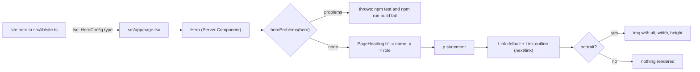

# Brief: Implement homepage hero (HOME-002)

- Story: [docs/stories/home-002-homepage-hero.md](../stories/home-002-homepage-hero.md), https://github.com/eng-rodriguez/personal-website/issues/7
- Branch: `feat/home-002-homepage-hero`, cut from `origin/main` (a40ee9b when this brief was written; the builder records the actual baseline in the Checkpoint)
- ADR: none (section 13 explains why)

`/` gets a Hero Server Component in `src/components/site/hero.tsx`. It renders the owner's name as the page `h1` through PageHeading, the role below it, a positioning statement paragraph, two CTA links (primary "View projects" to `/projects`, outline "Read writing" to `/writing`) and an optional portrait. The copy is a typed `hero` object in `site` (`src/lib/site.ts`). A validator in `src/lib/hero.ts` checks it in unit tests and again at render, so invalid copy fails `npm test` and `npm run build`. The document title stays `site.name`. No new dependency, token, contrast pair, `next/image`, `public/` directory or `next.config.ts` change.

## 1. Layers touched

| Order | Layer | Builder | Paths | Depends on |
| --- | --- | --- | --- | --- |
| 1 | frontend (`web` area, repository root) | factory:react-builder with stack-react | `src/lib` (`hero.ts`, `site.ts`), `src/components/site/hero.tsx`, `src/app/page.tsx`, unit tests, `e2e/`, `docs/design-system.md`, `CLAUDE.md` | none (FOUND-001 and HOME-001 are merged) |

- One builder and one PR. Implementation order inside the PR:
  1. D1 types and validator in `src/lib/hero.ts`, with `hero.test.ts`.
  2. D2 `hero` config in `src/lib/site.ts`.
  3. D3 Hero component, with `hero.test.tsx` and `hero-source.test.ts`.
  4. D4 page adoption, then update `page.test.tsx` and `core-pages.test.tsx`.
  5. D7 Playwright: new `e2e/home-hero.spec.ts` and one added case in `e2e/no-js.spec.ts`.
  6. Docs, with `hero-docs.test.ts`.
- Merge order: a single merge. No rollout, because nothing is deployed.
- Pipeline: no change. `web`, `e2e`, `scope` and `ci-ok` must pass unchanged.
- Infra, backend, ml: not touched.
- Stack: Next.js 16.4.2 App Router (Turbopack build), React 19.3.1, TypeScript ~6.0.3 strict, Tailwind CSS 4.3.3, Vitest 5 with jsdom and React Testing Library, Playwright 1.63.0 (Chromium, Desktop Chrome 1280 by 720), npm, Node.js 24. The only framework API used is `next/link`, through the existing Link primitive. `/` stays a static (○) route. `package.json`, `package-lock.json`, `next.config.ts`, `tsconfig.json`, `eslint.config.mjs` and `playwright.config.ts` do not change.

## 2. Ownership
This is the Site presentation context (`docs/domain.md`), which owns layout, navigation and pages. Writing, Portfolio and Career are not touched. The hero copy is site configuration, not a content type: it has no MDX, frontmatter or Zod schema (story, Out of scope).
- `src/lib/hero.ts` owns the hero config types and the validation rules. It depends only on `primaryNav` from `src/lib/navigation.ts`.
- `src/lib/site.ts` owns the hero copy (`site.hero`). It is the one place the owner edits.
- `src/components/site/hero.tsx` owns the hero markup and layout. It composes the PageHeading and Link primitives and never imports copy itself: the page passes the config in, so tests can pass any config (AC2).
- `src/app/page.tsx` owns which config `/` renders.
- The root layout keeps owning the single `main`, the metadata and the title (ADR 0003). The shell, tokens, breakpoints and primitives do not change.

## 3. Domain model
Not applicable. No aggregates, content schemas or migrations. The config types in D1 are the only model.

## 4. API contract
None. No route handlers, server actions or API artifacts.

## 5. Data and consistency
Not applicable. The source of truth is `site.hero` in `src/lib/site.ts`, read at build time. There is no state, storage, fetching or browser dependency.

## 6. Frontend

### Design decisions
- **D1. Types and validator (`src/lib/hero.ts`, new).**
  ```ts
  import { primaryNav } from "./navigation";

  export type CoreRoute = (typeof primaryNav)[number]["href"];
  export type HeroCta = { readonly label: string; readonly href: Exclude<CoreRoute, "/"> };
  export type HeroPortrait = {
    readonly src: `/${string}`;
    readonly alt: string;
    readonly width: number;
    readonly height: number;
  };
  export type HeroConfig = {
    readonly name: string;
    readonly role: string;
    readonly statement: string;
    readonly ctas: readonly [HeroCta, HeroCta];
    readonly portrait?: HeroPortrait;
  };
  export function heroProblems(hero: HeroConfig): string[];
  ```
  - Types reject at compile time: zero, one or three CTAs (tuple of two), an href outside `primaryNav`, the current page `/`, an external, `mailto:` or `tel:` href, a missing href, and a portrait without `src`, `alt`, `width` or `height`.
  - `heroProblems` repeats every rule at runtime for values cast past the types, and adds the rules types cannot express. It returns one message per problem (for example `"hero.role must not be empty"`), and an empty array when the config is valid:
    - `name`, `role`, `statement` and each CTA `label` are strings with non-whitespace content (`value.trim() !== ""`, the same rule as the primitives' `hasText`). `src/lib` does not import from `src/components`, so the one-line check is local.
    - Exactly two CTAs. Each `href` is a string, is a `primaryNav` href, and is not `/`. The two hrefs differ.
    - With a portrait: `alt` has text; `width` and `height` are positive integers (`Number.isInteger(n) && n > 0`); `src` starts with `/`, its second character is not `/` or `\`, and it has no whitespace or control character (the Link primitive's rule). Only a local path is allowed, so no remote host is contacted and no `next/image` remote configuration is needed.
  - There is no label length rule in code. The documented limit is about 20 characters (D3, section 10). The 320px Playwright test (AC6) runs against the real config, so a label that overflows fails `npm run e2e`.
  - `src/lib` modules stay free of React and component imports.
- **D2. Config (`src/lib/site.ts`, modified).**
  - `site` keeps `name` and `description` unchanged and gains `hero`. The whole object stays `as const`, followed by `satisfies { name: string; description: string; hero: HeroConfig }`, with `import type { HeroConfig } from "./hero"` (type-only, so the e2e specs that import `site` load no extra runtime code).
  - Placeholder copy (approved as generic; the owner may change the wording in review without a brief revision, provided the labels stay short):
    - `name`: `"Your Name"`
    - `role`: `"Software engineer"`
    - `statement`: `"I design and build reliable, accessible software, and I write about the engineering decisions behind it."`
    - `ctas`: `[{ label: "View projects", href: "/projects" }, { label: "Read writing", href: "/writing" }]`
    - no `portrait`.
  - `site.description` stays the metadata description and is no longer rendered on `/`.
- **D3. Hero (`src/components/site/hero.tsx`, new).**
  - `export type HeroProps = { hero: HeroConfig; className?: string }` and `export function Hero({ hero, className }: HeroProps)`. Named export, no default export, no `"use client"`, no hooks, no `any`, no `dark:`, literal class names only.
  - First, `const problems = heroProblems(hero)`. When it is not empty, throw `new Error("Invalid hero config: " + problems.join("; "))`. `/` is prerendered, so this fails `npm run build` as well as the unit tests (domain rule "invalid content does not build").
  - Markup:
    ```tsx
    <div data-slot="hero" className={cn("flex flex-col gap-8 sm:flex-row sm:items-start", className)}>
      <div data-slot="hero-text" className="min-w-0 flex-1">
        <PageHeading title={hero.name} description={hero.role} />
        <p data-slot="hero-statement" className="mt-6 text-lg wrap-break-word">{hero.statement}</p>
        <div data-slot="hero-ctas" className="mt-8 flex flex-wrap gap-3">
          <Link href={primary.href} variant="default" size="lg" className="border border-transparent">{primary.label}</Link>
          <Link href={secondary.href} variant="outline" size="lg">{secondary.label}</Link>
        </div>
      </div>
      {hero.portrait ? (
        // eslint-disable-next-line @next/next/no-img-element -- no image asset or next/image config ships (HOME-002 A12)
        
      ) : null}
    </div>
    ```
  - Heading (A3): the name is the only `h1`, through PageHeading, inside `div[data-slot=page-heading]`. The role is PageHeading's `description`, so it is the muted paragraph directly below the name (`mt-4 text-muted-foreground`), and the existing page tests keep finding a paragraph in the page heading. No sub-headings.
  - Statement (A4): one `p` in the default `foreground` color, `text-lg`, plain text. Config strings are rendered as React text children, never as HTML.
  - CTAs (A5): `Link` with `variant` gives the `buttonVariants` classes, including the focus-visible outline, `whitespace-nowrap` and `motion-reduce:transition-none`. `size="lg"` gives `h-10` (40px tall, the shell's `min-h-10` target size and well above 24 by 24). The primary CTA adds `border border-transparent`, so it keeps a visible boundary in forced-colors mode (where its fill is removed); the outline CTA already has `border border-input`. `flex flex-wrap gap-3` puts the two CTAs on one row when they fit and wraps the second to its own row otherwise (at 320px the content width is 272px, so the placeholder labels wrap). DOM order is primary then outline, so Tab order matches reading order.
  - Portrait (A6, A12): rendered only when configured, so without it the root holds only `hero-text`: no empty element, no reserved width. Below `sm` the portrait stacks under the text; from `sm` (40rem) it sits to the right of the text. The `width` and `height` attributes give the aspect ratio before load (no layout shift), and CSS (`w-32 sm:w-40 h-auto max-w-full`) caps the drawn size, so large intrinsic dimensions never cause horizontal scroll. No `loading="lazy"`, because the hero is above the fold.
  - Why a plain `img` and not `next/image`: A12 forbids `next/image` until a portrait asset is added. `@next/next/no-img-element` is a warning in `eslint-config-next`, and `npm run lint` uses `--max-warnings=0`, so the single `img` line carries the one-line disable comment with its reason. The story that adds a real asset may switch to `next/image` with a static import, and owns that change (section 13).
- **D4. Page adoption (`src/app/page.tsx`, modified).** `export default function Home() { return <Hero hero={site.hero} />; }`. No `metadata` export, so the title stays the layout default `site.name`. The page no longer imports PageHeading directly.
- **D5. Tokens and contrast (A11, AC9).** No new token and no new `TEXT_PAIRS` entry. The hero uses only pairs that `src/app/globals.test.ts` already checks in light, OS dark and explicit dark:
  - `foreground`/`background`: name, statement, outline CTA text.
  - `muted-foreground`/`background`: role.
  - `primary-foreground`/`primary`, plus its 0.9 hover pair: primary CTA.
  - `accent-foreground`/`accent`: outline CTA hover.
  - `input` and `ring` against `background` at 3:1: outline CTA border and focus outline.
  - Print stays light through the unchanged `@media print` block. `globals.test.ts` and `globals.css` do not change.
- **D6. States.** Loading, error, empty and denied do not apply (static content). An invalid config fails the build instead of rendering an error state.

The diagram shows where the copy goes and where an invalid value is stopped.



### Test design
Tests use `test_acN_` names. jsdom has no Tailwind or layout, so unit tests check elements, roles, attributes and literal class names; Playwright covers focus, layout and navigation.

- **`src/lib/hero.test.ts`** (new, AC3, edge cases): a `valid` fixture typed `HeroConfig`.
  - `heroProblems(valid)` and `heroProblems(site.hero)` are `[]`. The second line ties the real copy to the rules, so invalid copy fails `npm test`.
  - `it.each` over `name`, `role`, `statement`, `ctas[0].label`, `ctas[1].label`, each with `""`, `"   "` and `"\n\t"`: exactly one problem naming that field.
  - CTA href: `undefined as never`, `"" as never`, `"/contact" as never`, `"/" as never`, `"https://example.com" as never`, `"mailto:someone@example.com" as never`, `"tel:+15550100" as never`: one problem each. Both CTAs on `/projects`: a duplicate problem. A one-item and a three-item `ctas` cast as `never`: a count problem.
  - Portrait: valid passes. `alt` `""` and `"  "`, `width` `0`, `-1`, `1.5` and `NaN`, `height` `0`, `src` `"//cdn.example"`, `"/\\cdn.example"`, `"/a b.jpg"` and `"https://example.com/a.jpg" as never`: one problem each.
  - Type-only lines under `npm run typecheck`, each with `// @ts-expect-error <reason>`: one CTA, three CTAs, `href: "/contact"`, `href: "/"`, `href: "https://example.com"`, a CTA without `href`, a portrait without `alt`.
- **`src/components/site/hero.test.tsx`** (new, AC1, AC2, AC8):
  - With `valid`: exactly one level-1 heading named `valid.name`, inside `[data-slot="page-heading"]`; the role is the paragraph inside that root; `[data-slot="hero-statement"]` has the statement; `getAllByRole("link")` gives the two CTAs in order with the configured names and hrefs, `data-variant` `default` then `outline`, and the class `h-10`; the primary has `border-transparent`; no link has `outline-none`, a `focus:` class or a `target`.
  - AC2: a second config with every string and both hrefs changed (for example `/experience` and `/resume`) renders the changed values and none of the old ones.
  - AC8: without a portrait, `queryByRole("img")` is null and `[data-slot="hero"]` has exactly one element child (`hero-text`). With `portrait: { src: "/portrait.jpg", alt: "Portrait of the test name", width: 400, height: 500 }`: exactly one `img` with that `alt`, `src`, `width="400"` and `height="500"`, and the classes `h-auto`, `max-w-full` and `w-32`.
  - An invalid config (empty role) throws `Invalid hero config`.
  - Rendering does not need a `next/link` mock (jsdom renders the anchor), as in the shell tests.
- **`src/components/site/hero-source.test.ts`** (new, `// @vitest-environment node`, A7, AC9):
  - `hero.tsx` has no `"use client"`, no `useState`, `useEffect`, `useReducer` or `useLayoutEffect`, no `: any`, `as any` or `<any>`, no `dark:` and no hard-coded color (`#hex`, `rgb(`, `hsl(`, `oklch(`).
  - Every `bg-`, `text-` and `border-` utility in the file is in an allowlist (`foreground`, `background`, `muted-foreground`, `transparent`, `lg`). The hero's text pairs (`foreground/background`, `muted-foreground/background`) and the CTA pairs (`primary-foreground/primary`, `accent-foreground/accent`) are matched in `globals.test.ts`'s `TEXT_PAIRS` with the regex used by `primitives-contrast.test.ts`.
  - `src/lib/hero.ts` imports nothing from `@/components` or `react`.
- **`src/components/site/hero-docs.test.ts`** (new, node, AC10): the `## Hero` section of `docs/design-system.md`, sliced up to the next `\n## `, exists and contains `src/lib/site.ts`, `src/lib/hero.ts`, `HeroConfig`, `portrait`, `alt`, `width`, `height`, `primaryNav`, `outline`, `20 characters`, `320px`, `Tab` and a fenced `ts` example. The existing `primitives-docs.test.ts` and `shell-docs.test.ts` stay unchanged and passing.
- **`src/app/page.test.tsx`** (modified, A9): the level-1 heading name becomes `site.hero.name`; it also asserts `screen.getByText(site.hero.statement)`; `queryByRole("main")` stays null. Intent kept: one `h1`, no own `main`.
- **`src/app/core-pages.test.tsx`** (modified, A9): only the Home row changes, its expected title from `site.name` to `site.hero.name`. The page-heading and paragraph checks and the duplicated-class check stay as they are and pass (the role is the paragraph).
- Unchanged and passing: `src/lib/site.test.ts`, `src/app/globals.test.ts`, `src/components/primitives/*.test.*`, the other `src/components/site/*.test.*`, `e2e/core-routes.spec.ts` (one `main`, one `h1`, title `site.name` on `/`) and `e2e/theme.spec.ts`.

### D7. Playwright
- **`e2e/home-hero.spec.ts`** (new). It imports `site` from `../src/lib/site`, `primaryNav` from `../src/lib/navigation` and `themeStorageKey` from `../src/lib/theme`, uses role locators, web-first assertions, built-in fixtures only and no sleeps, and names the route in each title and message.
  - AC1: on `/`, `main` has one level-1 heading with text `site.hero.name`; the role and statement are visible inside `main`; the title is `site.name`.
  - AC4: for each CTA, `main.getByRole("link", { name: label, exact: true })` has `href` equal to the configured href and not matching `/^(mailto:|tel:|https?:|\/\/)/`; `page.request.get(href)` is OK; clicking it gives `toHaveURL` of the target, and the target has one level-1 heading whose text is the `primaryNav` label for that href. `main` has exactly two links.
  - AC5: for `light` and `dark`, `page.addInitScript` sets `localStorage[themeStorageKey]`, then on `/` press Tab up to 20 times, recording for each focused element whether it is inside `header` or `main` and its accessible name. Expected: the first stop is the skip link; the header stops (brand, a Theme radio, the five nav links) all come before the first stop in `main`; the first stop in `main` is the primary CTA and the next is the outline CTA. On each CTA while focused, `outline-style` is `solid` and `parseFloat(outline-width) >= 2`. Then Enter on the focused outline CTA navigates to its href.
  - AC6: with `page.setViewportSize({ width: 320, height: 800 })` on `/`, `document.documentElement.scrollWidth <= clientWidth`; each CTA's `boundingBox()` has width and height of at least 24 and lies within `0..320` horizontally.
- **`e2e/no-js.spec.ts`** (modified, AC7): add one test inside the existing `javaScriptEnabled: false` describe: `/` shows the name `h1`, the role, the statement and both CTAs, and clicking the primary CTA loads `/projects` with its `h1` (a full document navigation). The existing loop over `primaryNav` is unchanged.

## 7. Infra and pipeline
Not applicable. No workflow, Dependabot, environment or deployment change. The new spec runs in the existing `e2e` job.

## 8. Security and threat notes
- Authn/z and tenant isolation: not applicable (no users).
- Input validation: all hero values come from source code at build time. They are rendered as React text and attributes, never through `dangerouslySetInnerHTML`. CTA hrefs are limited to `primaryNav` routes by type and by `heroProblems`, and the Link primitive's runtime guard still applies. The portrait `src` is limited to a local path.
- Secrets: none.
- Data classification: public placeholder copy. Tests use `example.com`, a reserved 555 number and placeholder names, never the owner's real contact details (CLAUDE.md "Don't"). No contact CTA (A5).
- No new dependency.
- Top threats (STRIDE-style):
  1. Spoofing or tampering through a CTA href edited to an external, protocol-relative or script URL. Mitigation: the type allows only core routes, `heroProblems` rejects anything else at test and build time, and Link throws on unsafe hrefs.
  2. Information disclosure through a portrait `src` pointing at a third-party host, which would send visitor requests and referrers off-site. Mitigation: local paths only, checked by the validator.
  3. Denial of an accessible home page: a second `h1`, a lost focus indicator, overflowing CTAs at 320px, or a CTA without a boundary in forced colors. Mitigation: PageHeading is the only `h1` source (unit and e2e), no focus-removing classes (unit), the AC5 and AC6 Playwright checks, the transparent border on the primary CTA, and Manual verification.

## 9. Verification per criterion
Local checks run from the repository root on Node.js 24. "Built HTML" means `.next/server/app/index.html` after `npm run build`.

| AC | Check | Level |
| --- | --- | --- |
| 1 | `hero.test.tsx`; `page.test.tsx`; `core-pages.test.tsx`; `home-hero.spec.ts` AC1 case; unchanged `core-routes.spec.ts` | local |
| 2 | `hero.test.tsx` changed-config case | local |
| 3 | `hero.test.ts` runtime cases and `@ts-expect-error` lines under `npm run typecheck` (an unused `@ts-expect-error` fails typecheck) | static + local |
| 4 | `home-hero.spec.ts` AC4 case | local |
| 5 | `home-hero.spec.ts` AC5 case in light and dark; Manual step 4 | local + manual |
| 6 | `home-hero.spec.ts` AC6 case; Manual step 5 (320px, 1280px at 200% zoom) | local + manual |
| 7 | `no-js.spec.ts` added case; Manual step 7 | local + manual |
| 8 | `hero.test.tsx` portrait cases; layout with a real image in Manual step 5 | local + manual |
| 9 | `hero-source.test.ts` pair and token checks; unchanged `globals.test.ts`; forced colors and print in Manual step 6 | local + manual |
| 10 | `hero-docs.test.ts`; unchanged `primitives-docs.test.ts` and `shell-docs.test.ts`; owner read in Manual step 8 | local + manual |
| 11 | `npm run check` exit 0, with Vitest file and test counts; `npm run e2e` exit 0, with the Playwright test count; `git diff --stat origin/main -- package.json package-lock.json next.config.ts tsconfig.json eslint.config.mjs playwright.config.ts src/app/globals.css src/app/globals.test.ts` empty | local |
| 12 | CI `scope` job on the PR; locally, `git diff --name-only origin/main...HEAD`, each path exempt or found with `grep -F` in this brief | local + environment |

Edge cases:
- Long copy at 320px and 200% zoom: Manual step 5 with a temporary long config; the real labels by AC6.
- Empty or whitespace copy, zero or three CTAs, duplicate hrefs, `/` as a target, missing or empty `alt`: `hero.test.ts`.
- Forced colors and dark theme: class assertions, AC5 dark run, Manual step 6.
- Hydration: no client code (`hero-source.test.ts`), the no-JS case and Manual step 7.
- Untracked user files not committed: Manual step 1.

Builder-verified at implementation (record in the Checkpoint):
- `/` still builds as static (○) and the built HTML has one `<h1` with the hero name.
- `as const satisfies` keeps the CTA href literals narrow enough to satisfy `Exclude<CoreRoute, "/">` and `LinkHref<H>` without casts. If not, type the CTAs through `HeroConfig` and record the form used; do not use `as` casts in `site.ts` or `hero.tsx`.
- The `@next/next/no-img-element` disable comment is required and accepted by `npm run lint` (if the rule does not fire, drop the comment, because an unused directive warns).
- The AC5 Tab sequence at 1280 by 720 matches the documented header order (skip link, brand, Theme group, links).

If the build fails for a reason other than the deliberate validator throw, stop and report rather than moving validation into a client component.

Environment evidence, blocked until the PR exists: CI `web`, `e2e`, `scope` and `ci-ok`. Not covered by automation: forced colors, print, 200% zoom, mouse-click focus and the layout with a real portrait.

### Manual verification
The owner runs this on a fresh clone of the branch with Node.js 24 before marking the PR ready, and records who ran it and each result in the Checkpoint. Builders do not claim it. Items marked "automated" may also be run by the test agent; that does not replace the human run.

Prerequisites: Chrome or Edge with DevTools (device toolbar, and the Rendering panel's `prefers-color-scheme`, `forced-colors` and print emulation). Unless a step says otherwise, use `npm run build && npm run start` at `http://localhost:3000`.

1. `git status` before committing. Expected: `AGENTS.md` and `docs/reviews/dependabot-actions-pr-34.md` are untracked and not staged, and every changed path is in section 11. Automated.
2. `npm ci`, `npm run check; echo $?`, then `npx playwright install chromium` (once) and `npm run e2e; echo $?`. Expected: both exit 0, with only the 3 known ESLint `ERESOLVE` notices. Record the Vitest and Playwright counts. Covers AC11. Automated.
3. After `npm run build`: `grep -o '<h1' .next/server/app/index.html | wc -l` prints `1`, and `grep -c 'data-slot="hero"' .next/server/app/index.html` prints `1`. Automated.
4. In Light and then Dark, Tab from the address bar on `/`. Expected: skip link, brand, Theme group, nav links, then "View projects", then "Read writing", each CTA with a visible outline; a mouse click on a CTA shows no outline; Enter on a focused CTA navigates. Covers AC5. Human only.
5. On `/` at 320px, at 1280px with 200% zoom, and at 1920px. Expected: no horizontal scrollbar; CTAs fully visible, side by side or wrapped; text wraps. Then temporarily set a 300-character statement, a 60-character unbroken role, and a portrait pointing at any local test image placed in a temporary `public/` directory; repeat at 320px and 640px. Expected: text wraps, the portrait stacks below the text under 640px and sits to the right from 640px, and nothing overflows. Discard the temporary edits and the directory (`git checkout -- src/lib/site.ts && rm -rf public`). Covers AC6, AC8 and the long-copy edge case. Human only.
6. Emulate `forced-colors: active` on `/`. Expected: both CTAs show a boundary. Emulate print. Expected: light colors. Covers AC9 and the forced-colors edge case. Human only.
7. Disable JavaScript and reload `/`. Expected: the same content and layout as with JavaScript, and both CTAs navigate. Covers AC7. Human only.
8. Read the "Hero" section of `docs/design-system.md` and the CLAUDE.md Current state. Expected: the content in section 10. Covers AC10. Human only.
9. Open the PR. Expected: `web`, `e2e`, `scope` and `ci-ok` succeed. Environment evidence, blocked until the PR exists.

Rollback: revert the merge commit through a PR (`git revert -m 1 <merge-sha>`), then re-run step 2. Expected: `/` shows PageHeading with `site.name` and `site.description` again, and `src/components/site/hero.tsx` and `src/lib/hero.ts` are gone.

## 10. Docs impact and observability
- `docs/design-system.md`: a new `## Hero` section after "UI primitives" and before "Breakpoints". It contains:
  - Where the copy lives (`site.hero` in `src/lib/site.ts`), the `HeroConfig` shape from `src/lib/hero.ts` in a fenced `ts` example, and how to edit the copy (change the config only, never `hero.tsx`).
  - The validation rules, and that invalid copy fails `npm test` and `npm run build`.
  - Heading: the name is the only `h1`, through PageHeading; the role is its description; the document title stays `site.name`.
  - CTA rules: exactly two, internal core routes from `primaryNav` only (not `/`, not repeated), no `mailto:`, `tel:` or external links, the primary style first and `outline` second, labels of about 20 characters at most because variant links do not wrap (the 320px e2e test fails on overflow).
  - Portrait: optional and off by default; how to add one (put the file in `public/`, set `src` to its local path, a non-empty `alt`, and the image's real `width` and `height`); local paths only; a plain `img` until a story moves it to `next/image`.
  - Keyboard and mobile checks: Tab order to the two CTAs with a visible outline in Light and Dark, and no horizontal scroll at 320px and at 1280px with 200% zoom.
- `CLAUDE.md` Current state: `/` renders the Hero from `src/components/site/hero.tsx`, with copy in `site.hero` (`src/lib/site.ts`) validated by `src/lib/hero.ts`; PageHeading is on all five routes (through the Hero on `/`); the Playwright smoke tests also cover the home hero. Paths: add the hero copy in `src/lib/site.ts` and its rules in `src/lib/hero.ts`. Keep every string `shell-docs.test.ts` asserts.
- `docs/testing.md`: no change (the spec follows "Adding a smoke test").
- `README.md`: no change.
- Observability: none. No runtime service and nothing is logged.

## 11. Files that will change
Builders create or modify only these paths. Any other file is out of scope and must not be committed.

Frontend / application (factory:react-builder):
- `src/lib/hero.ts` (new)
- `src/lib/site.ts` (modified: `hero` config)
- `src/components/site/hero.tsx` (new)
- `src/app/page.tsx` (modified: renders Hero)

Tests (factory:react-builder; exempt from the scope check):
- `src/lib/hero.test.ts` (new)
- `src/components/site/hero.test.tsx` (new)
- `src/components/site/hero-source.test.ts` (new)
- `src/components/site/hero-docs.test.ts` (new)
- `src/app/page.test.tsx` (modified)
- `src/app/core-pages.test.tsx` (modified: Home row)
- `e2e/home-hero.spec.ts` (new)
- `e2e/no-js.spec.ts` (modified: one added case)

Docs (factory:react-builder):
- `docs/design-system.md` (modified)
- `CLAUDE.md` (modified)

Planning (orchestrator/architect):
- `docs/briefs/home-002-homepage-hero.md` (this brief)
- `docs/stories/home-002-homepage-hero.md` (already present, untracked)

Not committed: `.next/`, `node_modules/`, `next-env.d.ts`, `*.tsbuildinfo`, `playwright-report/`, `test-results/`, and any temporary `public/` directory from Manual step 5. `AGENTS.md` and `docs/reviews/dependabot-actions-pr-34.md` are untracked user files.

Explicitly not changed: `package.json`, `package-lock.json`, `next.config.ts`, `tsconfig.json`, `eslint.config.mjs`, `components.json`, `postcss.config.mjs`, `playwright.config.ts`, `src/app/globals.css`, `src/app/globals.test.ts`, `src/app/layout.tsx`, `src/lib/navigation.ts`, `src/components/primitives/*`, `src/components/ui/*`, the existing `src/components/site/*` files, `e2e/core-routes.spec.ts`, `e2e/theme.spec.ts`, `.github/`, `docs/testing.md` and `README.md`. No new dependency.

## 12. Risk
- Level: **Standard**. It replaces the markup of `/` and adds a validated config and a component, on an undeployed static site with no data, auth, secrets, dependency or deployment impact, and it reverts as one PR.
- Recovery: revert the merge commit on `main` (`git revert -m 1 <merge-sha>`) through a PR, then run `npm run check` and `npm run e2e` (Manual verification, Rollback). Nothing is deployed, so there is no runtime rollback and no flag.
- Owner: @eng-rodriguez.

## 13. Open questions and ADRs
- ADR: none written. The hero is a page component and a typed config inside the approved Next.js, Tailwind and shadcn decisions (ADR 0002, 0003, 0004). It adds no dependency, service, data store or cross-cutting rule, and it reverts in one PR. The rules are recorded in `docs/design-system.md` and enforced by types and tests.
- Open (owner, does not block): the placeholder copy in D2 can be changed in review. "Your Name" as the `h1` next to the "Personal website" brand is intentional placeholder text until real copy lands.
- Open (owner, does not block): the CTA label limit is documented (about 20 characters) and enforced indirectly by the 320px e2e test, not by `heroProblems`. A hard length rule is a small follow-up if preferred.
- Follow-up (not this story): when a portrait asset is added, a story can switch to `next/image` with a static import and drop the lint disable comment; `src` then changes from a path to an import.
- Resolved in this brief:
  - Types plus a runtime validator in `src/lib/hero.ts`, run by tests and at render (D1, D3).
  - The role is PageHeading's description (D3).
  - CTAs are `Link` `default` and `outline` at `size="lg"`, wrapping with `flex-wrap`, with a transparent border on the primary for forced colors (D3).
  - The portrait is a plain `img` behind one lint disable, local paths only, rendered only when configured (D1, D3).
  - No new contrast pair (D5).

## 14. Checkpoint
- Phase: implementation done (uncommitted in the working tree, awaiting owner commit and PR)
- Scope: HOME-002 as in the approved story (A1 to A12, decisions recorded at its top) and this brief
- Baseline: branch `feat/home-002-homepage-hero` at 4678537 (base origin/main e66c548); untracked user files `AGENTS.md`, `docs/reviews/dependabot-actions-pr-34.md` and `docs/stories/home-004-mobile-navigation.md` preserved and not part of this change
- Revisions: none
- Approvals: story approved by @eng-rodriguez on 2026-10-20; brief approved
- Builder-verified items:
  - `/` builds as static (○); built HTML has one `<h1` and one `data-slot="hero"`.
  - `as const satisfies` keeps the CTA hrefs narrow: no casts in `site.ts` or `hero.tsx`.
  - The `@next/next/no-img-element` disable comment is accepted by `npm run lint` (`--max-warnings=0`).
  - AC5 Tab sequence at 1280 by 720 (skip link, header stops, then the two CTAs) passes in light and dark.
- Check evidence: `npm run check` exit 0 (Vitest 30 files, 389 tests passed; build static); `npm run e2e` exit 0 (18 passed, Chromium)
- Repairs used: 0 of 3 (one self-inflicted `@ts-expect-error` placement fix after Prettier, in a new test)
- Manual verification: not started (owner)
- Remaining blockers: owner manual verification; CI `web`, `e2e`, `scope`, `ci-ok` after the PR exists
- Next action: owner reviews, commits and opens the PR
