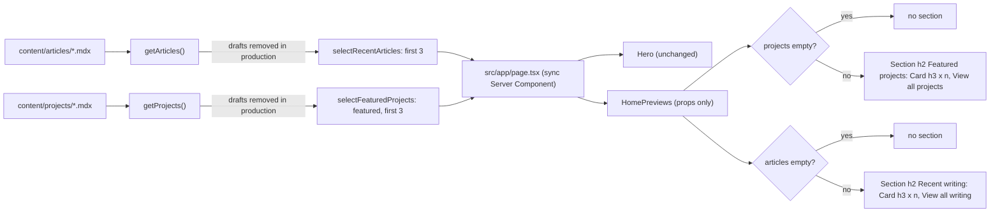

# Brief: Implement homepage content previews (HOME-003)

- Story: [docs/stories/home-003-homepage-content-previews.md](../stories/home-003-homepage-content-previews.md), https://github.com/eng-rodriguez/personal-website/issues/8
- Branch: `feat/home-003-homepage-content-previews`, cut from `origin/main` (d7fa135 when this brief was written; the builder records the actual baseline in the Checkpoint)
- ADR: none (section 13 explains why)

`/` renders two preview sections after the hero: "Featured projects" (Projects with `featured: true`, in `getProjects()` order, at most 3) and "Recent writing" (the first 3 Articles from `getArticles()`). A pure selection module, `src/lib/home.ts`, owns the rules and the limit. A presentational Server Component, `src/components/site/home-previews.tsx`, takes the selected lists as props and builds them from the existing Section, Grid, Card, Tag and Link primitives. A section with nothing to show is not rendered, so with today's empty `content/` the page is exactly the hero. Card titles and a "View all" link per section go to `/projects` or `/writing`. Article dates use a new `src/lib/dates.ts` formatter (en-US, UTC, for example "Oct 25, 2026"). The Card title link gets a 24 by 24 CSS pixel minimum target. `/` stays a synchronous, static (○) Server Component. There is no new dependency, token, contrast pair, client code, environment variable or configuration change.

## 1. Layers touched

| Order | Layer | Builder | Paths | Depends on |
| --- | --- | --- | --- | --- |
| 1 | frontend (`web` area, repository root) | factory:react-builder with stack-react | `src/lib/home.ts`, `src/lib/dates.ts`, `src/components/site/home-previews.tsx`, `src/components/primitives/card.tsx`, `src/app/page.tsx`, fixtures under `src/lib/__fixtures__/{articles,projects}/home/`, unit tests, `e2e/`, docs, `CLAUDE.md` | BLOG-001 and PROJ-001 (merged; `getArticles()` and `getProjects()`), HOME-002 (merged; Hero) |

- One builder and one PR. Implementation order inside the PR:
  1. D1 date formatter with `dates.test.ts`.
  2. D2 fixtures, then D3 selection module with `home.test.ts`.
  3. D4 Card target size, with the `card.test.tsx` additions and the full primitives suite.
  4. D5 `HomePreviews` with `home-previews.test.tsx` and `home-previews-source.test.ts`.
  5. D6 page wiring, then `page.test.tsx` and `content-source.test.ts`; confirm `core-pages.test.tsx` passes unchanged.
  6. D8 Playwright: new `e2e/home-previews.spec.ts` and one case in `e2e/no-js.spec.ts`.
  7. Docs (section 10) with `home-previews-docs.test.ts` and the `content-docs.test.ts` additions.
- Merge order: a single merge. No rollout, because nothing is deployed.
- Pipeline: no change. `web`, `e2e`, `scope` and `ci-ok` must pass unchanged.
- Infra, backend, ml: not touched.
- Stack: Next.js 16.4.2 App Router (Turbopack build), React 19.3.1, TypeScript ~6.0.3 strict, Tailwind CSS 4.3.3, Zod 4.6.6, Vitest 5 (jsdom default) with React Testing Library, Playwright 1.63.0 (Chromium, Desktop Chrome 1280 by 720), npm, Node.js 24 (full ICU, so `Intl` en-US is available). The only framework API used is `next/link`, through the Link primitive. `package.json`, `package-lock.json`, `next.config.ts`, `tsconfig.json`, `eslint.config.mjs`, `vitest.config.mts`, `playwright.config.ts` and `src/app/globals.css` do not change.

## 2. Ownership
- Bounded contexts (`docs/domain.md`): Site presentation consumes Writing (Articles) and Portfolio (Projects) through their public APIs, `getArticles()` in `src/lib/articles.ts` and `getProjects()` in `src/lib/projects.ts`, as in-process calls at build time. Neither content module changes, and nothing outside them imports `src/lib/content/*`.
- `src/lib/home.ts` owns which items the home page shows: the limit, the Project `featured` filter and the decision that Article `featured` is ignored. It imports only types from the content modules, so it has no file-system dependency and is pure.
- `src/lib/dates.ts` owns how a content date (`YYYY-MM-DD`) is shown. Later list and detail pages (BLOG-002, BLOG-003, PROJ-002) reuse it.
- `src/components/site/home-previews.tsx` owns the preview markup. It never loads or filters content: it renders the lists it is given.
- `src/app/page.tsx` wires loaders to selectors to the component.
- `src/components/primitives/card.tsx` keeps owning the title-link pattern and gains the target-size rule (D4).
- The hero, root layout, shell, tokens, breakpoints and navigation do not change.

## 3. Domain model
No aggregates, schemas or migrations change. The rules this story adds on top of the existing models:
- Featured Projects on `/`: `featured === true`, in `getProjects()` order (`startedAt` descending, then slug), first 3. No featured ordering field: the owner controls the choice through `startedAt`.
- Recent writing on `/`: the first 3 of `getArticles()` (`publishedAt` descending, then slug). Article `featured` is not read.
- Drafts: the selectors do not filter drafts; the loaders already drop them in production and keep them in development (existing behavior, story edge case). Because selection runs on the loader output, a draft never takes a slot in production.
- `publishedAt` in the future is shown (publication depends only on `draft`).

## 4. API contract
None. No route handlers, server actions, OpenAPI or API collection (CLAUDE.md: no API contract artifacts). The in-process functions in D1 and D3 are new internal module APIs.

## 5. Data and consistency
- Source of truth: the `.mdx` files in `content/articles` and `content/projects`, read when `/` is prerendered. `/` now also calls both loaders, so invalid content fails `npm run build` from `/` as well as from `/writing` and `/projects` (same `ContentError`, unchanged behavior).
- Consistency: "what is on disk when the build reads it". In production the loader caches per directory and mode, so `/`, `/writing` and `/projects` see the same validated list within one build worker.
- No store, index, event, outbox or idempotency concern.

The diagram shows the data path into `/` and where an empty list stops rendering.



## 6. Frontend

### Design decisions
- **D1. Date formatter (`src/lib/dates.ts`, new).**
  ```ts
  /** Formats a validated content date (YYYY-MM-DD) as en-US, for example "Oct 25, 2026". */
  export function formatContentDate(isoDate: string): string;
  ```
  - A module-level `new Intl.DateTimeFormat("en-US", { year: "numeric", month: "short", day: "numeric", timeZone: "UTC" })` formats `new Date(`${isoDate}T00:00:00Z`)`. The date is built as UTC midnight and formatted in UTC, so the day never shifts in any build or browser time zone (the text is rendered on the server and shipped as HTML).
  - It throws a `RangeError` naming the value when the input does not match `^\d{4}-\d{2}-\d{2}$` or is not a real date (`Number.isNaN(date.getTime())`, or the UTC year, month and day differ from the input). The schema already guarantees this, so a throw is a programming error and fails the build rather than printing "Invalid Date".
  - No React, component or `node:` imports.
- **D2. Fixtures (new).** Valid MDX, Markdown-only bodies (one short paragraph), placeholder text, `example.com` only. They live beside the existing per-type cases so `docs/testing.md`'s layout holds.
  - `src/lib/__fixtures__/articles/home/`:

    | File | `publishedAt` | Other |
    | --- | --- | --- |
    | `draft-newest.mdx` | 2026-10-01 | `draft: true` |
    | `alpha-recent.mdx` | 2026-09-15 | |
    | `beta-recent.mdx` | 2026-09-15 | same date, sorts after `alpha-recent` by slug |
    | `long-article.mdx` | 2026-01-01 | title of about 150 characters, description of about 300 characters, both containing one 60-character unbroken word |
    | `older-featured.mdx` | 2025-12-31 | `featured: true` (fourth published, so it proves Article `featured` does not promote) |

    Production selection: `alpha-recent`, `beta-recent`, `long-article`. Development: `draft-newest`, `alpha-recent`, `beta-recent`.
  - `src/lib/__fixtures__/projects/home/` (all `status: completed` with an `endedAt`, `caseStudy` omitted, one `stack` entry unless stated):

    | File | `startedAt` | `featured` | Other |
    | --- | --- | --- | --- |
    | `draft-featured.mdx` | 2026-09-01 | true | `draft: true` |
    | `not-featured.mdx` | 2026-08-01 | false | |
    | `alpha-featured.mdx` | 2026-07-01 | true | a `links` entry and a `cover`, to prove neither renders |
    | `beta-featured.mdx` | 2026-07-01 | true | same date, after `alpha-featured` by slug |
    | `long-featured.mdx` | 2026-05-01 | true | long title and summary as above; 8 `stack` entries, one of them a 52-character unbroken string |
    | `oldest-featured.mdx` | 2025-01-15 | true | fourth published featured, so it proves the limit |

    Production selection: `alpha-featured`, `beta-featured`, `long-featured`. Development: `draft-featured`, `alpha-featured`, `beta-featured`.
  - The same files are copied into `content/` temporarily in Manual verification step 4 to exercise the page with content. They must therefore pass the real loaders and `compileContent`.
- **D3. Selection (`src/lib/home.ts`, new).**
  ```ts
  import type { Article } from "@/lib/articles";
  import type { Project } from "@/lib/projects";

  export const homePreviewLimit = 3;
  /** Projects with featured: true, in the given (getProjects) order, at most homePreviewLimit. */
  export function selectFeaturedProjects(projects: readonly Project[]): readonly Project[];
  /** The first homePreviewLimit Articles of the given (getArticles) order. Article featured is ignored. */
  export function selectRecentArticles(articles: readonly Article[]): readonly Article[];
  ```
  - `filter` then `slice(0, homePreviewLimit)`, and `slice(0, homePreviewLimit)`. They return new arrays and never sort, mutate or re-read content: ordering knowledge stays in the loaders, and the doc comments state the input contract.
  - Type-only imports, so the module stays pure and testable with inline data as well as loader output.
  - The limit is a constant in code (story, Out of scope: no `site` setting).
- **D4. Card title target size (`src/components/primitives/card.tsx`, modified).** The title link gets `className="inline-block max-w-full min-h-6 min-w-6"`.
  - Why: an inline link's box is the font's content area (about 19px for 16px system fonts), below the 24 by 24 CSS pixels AC11 requires, and Card does not accept a link class. `inline-block` makes the box the 24px line height (`text-base`), `min-h-6` and `min-w-6` guarantee 24 by 24 for a one-line or very short title, and `max-w-full` caps the shrink-to-fit width so a long unbroken word still wraps through the heading's `wrap-break-word` instead of overflowing at 320px.
  - Card is not used by any page today, so no existing page changes. The rule belongs to the title-link pattern, so the BLOG-002 and PROJ-002 lists inherit it. The visible style (underlined `text-primary`, global outline focus) is unchanged.
  - Alternative if the owner prefers not to touch the primitive: the same four utilities through a descendant variant on the Card `className` in `home-previews.tsx` (`[&_[data-slot=link]]:inline-block` and so on). Rejected as the default because it couples the component to Card's internal markup.
- **D5. HomePreviews (`src/components/site/home-previews.tsx`, new).**
  ```ts
  export type HomePreviewsProps = {
    projects: readonly Project[];
    articles: readonly Article[];
  };
  export function HomePreviews({ projects, articles }: HomePreviewsProps): ReactNode;
  ```
  - Named export, no default export, no `"use client"`, no hooks, no `any`, no `dark:`, literal class names only. Type-only imports of `Project` and `Article`. It renders whatever it receives (it does not slice); the selectors own the limit.
  - Returns a fragment with, in this order, the Projects section when `projects.length > 0` and the Articles section when `articles.length > 0`. With both empty it returns `null`: no wrapper element, heading, EmptyState or spacing (AC7, AC8).
  - Projects section: `<Section title="Featured projects" className="mt-16">` (default `h2`), containing `<Grid columns={1}>` with one `<Card key={slug} title={title} href="/projects" description={summary} footer={stack} />` per Project (default `h3`). The footer is `<ul aria-label="Stack" className="flex flex-wrap gap-2">` with one `<li className="max-w-full"><Tag>{entry}</Tag></li>` per `stack` entry (entries are unique case-insensitively, so `key={entry}` is stable). Cover, links, status, role and dates are not rendered.
  - Articles section: `<Section title="Recent writing" className="mt-16">` with `<Grid columns={1}>` and one `<Card key={slug} title={title} href="/writing" description={description} footer={<time dateTime={publishedAt} className="text-sm text-muted-foreground">{formatContentDate(publishedAt)}</time>} />` per Article. `dateTime` is the raw ISO date.
  - Each section ends with `<p className="mt-6"><Link href="/projects" className="inline-flex min-h-10 items-center">View all projects</Link></p>` (or `/writing` and "View all writing"). Distinct names keep the two links unambiguous in a links list (WCAG 2.4.4); both start with "View all" as AC6 asks. `min-h-10` matches the shell's target size.
  - One column: the container is `max-w-prose`, so two columns would give about 270px cards, and with at most 3 items a second column leaves a partial row. Cards stack at every width.
  - Spacing: `mt-16` is applied by each rendered Section only, so an absent section leaves no gap.
  - Heading outline: `h1` (hero) then `h2` (sections) then `h3` (cards); each Section is a `region` named by its heading through `aria-labelledby`.
  - Tab order is DOM order: hero CTAs, then each Projects card title, "View all projects", then each Articles card title, "View all writing". Tags and dates are not focusable.
  - States: loading, error and denied do not apply (static build). Empty is "not rendered". Invalid content is a build failure, never a rendered state.
- **D6. Page (`src/app/page.tsx`, modified).**
  ```tsx
  export default function Home() {
    const projects = selectFeaturedProjects(getProjects());
    const articles = selectRecentArticles(getArticles());
    return (
      <>
        <Hero hero={site.hero} />
        <HomePreviews projects={projects} articles={articles} />
      </>
    );
  }
  ```
  - Stays synchronous (both loaders are synchronous), with no `metadata` export, no `"use client"` and no route segment config. Like `/writing` and `/projects`, it uses no request-time API, so it prerenders as ○. If the build reports `/` as anything other than ○, stop and report rather than adding `dynamic` or `ensureStatic`.
- **D7. Tokens and contrast (AC13).** No new token and no new `TEXT_PAIRS` entry. Every pair is already checked in light, OS dark and explicit dark by `src/app/globals.test.ts`:
  - `card-foreground`/`card`: card surface text.
  - `primary`/`card`: card title links.
  - `muted-foreground`/`card`: card description and date.
  - `secondary-foreground`/`secondary`: Tags.
  - `foreground`/`background`: section headings.
  - `primary`/`background`: "View all" links.
  - `ring` against `background`: focus outline. Print stays light through the unchanged `@media print` block.

### Test design
Tests use `test_acN_` names and `it.each` where cases repeat. Selection and date tests are node-only (`// @vitest-environment node`).

- **`src/lib/dates.test.ts`** (new, AC5):
  - `formatContentDate("2026-10-25")` is `"Oct 25, 2026"`; `"2026-01-01"` is `"Jan 1, 2026"`; `"2025-12-31"` is `"Dec 31, 2025"`; `"2028-02-29"` is `"Feb 29, 2028"`.
  - Under `vi.stubEnv("TZ", ...)` for `Pacific/Kiritimati` (UTC+14) and `Pacific/Pago_Pago` (UTC-11), restored with `vi.unstubAllEnvs()`: the same outputs. Each case first asserts `new Date(2026, 0, 1).getTimezoneOffset()` is `-840` or `660`, so the test fails rather than passing vacuously if the zone did not apply.
  - `""`, `"2026-1-5"`, `"2026-02-30"`, `"2026-10-25T00:00:00Z"` and `"not a date"` throw `RangeError`.
- **`src/lib/home.test.ts`** (new, node, AC1, AC2, AC9, AC14). Loaders are called with explicit `directory` and `mode`:
  - AC1: `selectFeaturedProjects(getProjects({ directory: projects/home, mode: "production" }))` slugs are `alpha-featured`, `beta-featured`, `long-featured` (excludes `not-featured`, the draft and `oldest-featured`).
  - AC2: `selectRecentArticles(getArticles({ directory: articles/home, mode: "production" }))` slugs are `alpha-recent`, `beta-recent`, `long-article`; `older-featured` is absent although `featured: true`.
  - AC9: in production `draft-featured` and `draft-newest` are absent and still 3 items are returned; in development they come first, so the difference proves the loader filter, and in production the draft takes no slot.
  - AC14 counts, for Projects and Articles each:
    - None: `drafts-only` in production and an empty `mkdtempSync` directory give `[]`.
    - Fewer than the limit: `projects/valid` in production gives 1 (`full-project`, the only featured one); for Articles, a temp directory with `alpha-recent.mdx` and `beta-recent.mdx` copied from `articles/home` gives those 2.
    - Exactly the limit: `articles/valid` in production (3 published Articles) gives all 3; for Projects, a temp directory with `alpha-featured.mdx`, `beta-featured.mdx` and `long-featured.mdx` copied from `projects/home` gives all 3.
    - More than the limit: `articles/home` in production (4 published) and `projects/home` in production (4 published featured) give 3, and the development runs (5 each) give 3.
  - `homePreviewLimit` is 3; the selectors return new arrays and leave the input unchanged (frozen loader output does not throw).
- **`src/components/primitives/card.test.tsx`** (modified, D4): the title link has the classes `inline-block`, `max-w-full`, `min-h-6` and `min-w-6`, and still no `outline-none` or `focus:`; a card without `href` is unchanged.
- **`src/components/site/home-previews.test.tsx`** (new, jsdom, AC3, AC4, AC6, AC7). Inline `Project` and `Article` objects built by two small typed helpers:
  - Both lists: exactly two `region`s, named "Featured projects" then "Recent writing" in document order (`compareDocumentPosition`); each has one `h2`; each card is an `article` with one `h3` containing exactly one link; no `h1` is rendered by the component.
  - AC4 Project card: title, summary and one Tag per `stack` entry inside `ul[aria-label="Stack"]`; no `img`, no `https://` link, no status or role text even when the object has `links`, `cover`, `status` and `role`.
  - AC4 Article card: title and description; `time[datetime="2026-10-25"]` with text `Oct 25, 2026`.
  - AC6: every link href is `/projects` in the first region and `/writing` in the second; no href matches `^/(projects|writing)/`; each region has one link named "View all projects" or "View all writing"; link count per region is items plus one.
  - AC7: both empty gives an empty container (`container.firstChild` is null); projects only gives one region and no "Recent writing" text; articles only likewise; no `[data-slot="empty-state"]` in any case.
  - The component renders 4 items when given 4 (it does not slice; the limit is tested in `home.test.ts`).
- **`src/components/site/home-previews-source.test.ts`** (new, node, AC10, AC13), mirroring `hero-source.test.ts`:
  - `home-previews.tsx` and `src/app/page.tsx` have no `"use client"`, no `useState`, `useEffect`, `useReducer` or `useLayoutEffect`, no `: any`, `as any` or `<any>`; `page.tsx` has no `async`.
  - `home-previews.tsx` has no `dark:` and no hard-coded color; every `bg-`, `text-` and `border-` utility is in the allowlist (`muted-foreground`, `sm`).
  - The D7 pairs are matched in `TEXT_PAIRS` with the existing regex.
  - `src/lib/home.ts` and `src/lib/dates.ts` import nothing from `@/components`, `react` or `node:`, and `home.ts` imports the content modules with `import type` only.
- **`src/components/site/home-previews-docs.test.ts`** (new, node, AC15): the `## Home previews` section of `docs/design-system.md`, sliced to the next `\n## `, contains `src/lib/home.ts`, `homePreviewLimit`, `3`, `featured`, `getProjects()`, `getArticles()`, `not rendered`, `/projects`, `/writing`, `View all`, `en-US`, `UTC`, `Oct 25, 2026` and `24 by 24`.
- **`src/lib/content/content-docs.test.ts`** (modified, AC15): `docs/content.md` contains `home page`, and its Projects section states the 3-item limit, and its Articles section states that `featured` does not affect the home page. Existing assertions stay.
- **`src/lib/content/content-source.test.ts`** (modified): add a case that `src/app/page.tsx` is a synchronous Server Component (no `async`, no `"use client"`), next to the `/writing` and `/projects` cases.
- **`src/app/page.test.tsx`** (modified, AC8): with the real empty content, `/` renders no `h2`, no `region` and exactly the two hero CTA links. The existing assertions stay.
- Unchanged and passing: `src/app/core-pages.test.tsx` (Home still has no EmptyState, AC8), `src/components/site/hero*.test.*`, `src/components/primitives/*` other than `card.test.tsx`, `src/lib/articles*.test.ts`, `src/lib/projects*.test.ts`, `src/app/globals.test.ts`, `shell-docs.test.ts`, `primitives-docs.test.ts`.

### D8. Playwright
Playwright builds the real content, which is empty, and `content/` stays empty in this story. Lint forbids `test.skip`, and the story forbids adding real content.

The decision is to keep the production code free of test-only paths. The new spec reads the page as it is: every preview section present must be well-formed, and an absent section must leave nothing behind. With empty content, CI exercises AC7 and AC8 end to end. The card checks for AC6, AC10, AC11 and AC12 run in the browser in Manual verification step 4, which copies the D2 fixtures into `content/` temporarily and runs the same specs. Each test adds a `test.info().annotations` entry `{ type: "content", description: "no preview sections on /; card checks not exercised" }` when it finds no section, so the report never hides that the checks did not run. Until real content exists, the CI evidence for card behavior is unit-level (section 9).

Rejected alternative: an environment variable that points the loaders at a fixture directory for the e2e build. It would add a production code path read on Vercel, so setting it by mistake there would publish fixture content. It would also need a second `next build` and a second server port in `playwright.config.ts`, and it would change `src/lib/articles.ts` and `src/lib/projects.ts`, which this story does not otherwise touch.

- **`e2e/home-previews.spec.ts`** (new). Role locators, web-first assertions, built-in fixtures, no sleeps; the route is named in each title and message. `const regions = page.getByRole("main").getByRole("region")`.
  - AC3, AC7, AC8 "/ preview sections are absent or well-formed": region names are an ordered subsequence of `["Featured projects", "Recent writing"]`; each region has one `h2`, at least one `article`, and each `article` one `h3` with one link. The page has one `h1`. With zero regions: `main` has no `h2`, no `[data-slot="empty-state"]` and exactly two links (the hero CTAs).
  - AC6 "/ preview links go to the section pages": every link in the Projects region has `href="/projects"` and every link in the Writing region `href="/writing"`; clicking the first card title gives `toHaveURL` of that page with the section `h1`; back, then clicking "View all ..." does the same.
  - AC11 "/ previews fit 320px with 24px targets": at `{ width: 320, height: 800 }`, `scrollWidth <= clientWidth`; every link in every region has a `boundingBox()` of at least 24 by 24 within `0..320` horizontally.
  - AC12, for `light` and `dark` through `addInitScript` and `themeStorageKey`: Tab from the top until focus leaves `main` or 40 presses; the names of the stops inside `main` equal the `main` links' text in DOM order (hero CTAs, then each region's card titles and its "View all" link); each preview link, when focused, has `outline-style: solid` and `outline-width >= 2px`.
- **`e2e/no-js.spec.ts`** (modified, AC10): one test in the existing `javaScriptEnabled: false` describe, "/ without JavaScript renders preview links that navigate". Every link in the preview regions is visible; clicking the first one loads its section page with its `h1`. With zero regions it asserts the AC8 state and adds the annotation. The existing cases are unchanged.
- **`e2e/home-hero.spec.ts`** (modified, owner decision at brief approval): the CTA test's link count at line 36 is scoped from `main` to `main.locator('[data-slot="hero"]')`, so it keeps asserting the hero's two CTAs once real content adds preview links. The Tab loop already stops after the first two `main` stops (the CTAs), so it holds with previews. AC8's "main has exactly two links" with empty content stays asserted by `home-previews.spec.ts`. No other change.

## 7. Infra and pipeline
Not applicable. No workflow, Dependabot, environment, deployment or `.factory.yml` change. The new spec runs in the existing `e2e` job.

## 8. Security and threat notes
- Authn/z and tenant isolation: not applicable (no users, static output).
- Input validation: all rendered values come from content already validated by the strict Zod schemas at build time. They are rendered as React text and attributes, never through `dangerouslySetInnerHTML`. Card and "View all" hrefs are the literal strings `/projects` and `/writing`, not derived from content, so no content value reaches an `href`. Project `links` and `cover` are not rendered.
- Secrets: none. No environment variable is added; tests set only `TZ` and `NODE_ENV` through `vi.stubEnv`.
- Data classification: public. Fixtures use placeholder text and `example.com`, never the owner's contact details. Drafts are excluded in production by the existing loader rule.
- Dependencies: none added.
- Top threats (STRIDE-style):
  1. Information disclosure: a draft (for example an unannounced featured Project) shown on `/` in production. Mitigation: selection runs only on loader output, which drops drafts when `NODE_ENV` is `production`; `home.test.ts` proves a featured draft is excluded and takes no slot, and Manual step 4 checks the built HTML.
  2. Tampering or XSS through content text reaching markup or URLs. Mitigation: text children only; hrefs are constants; the Link primitive still throws on an unsafe href.
  3. Denial of an accessible home page: a skipped heading level, an empty landmark, overflow at 320px or targets below 24px. Mitigation: unit tests for the heading and region structure and empty behavior, the D4 target size, the D8 specs with content in Manual step 4, and the human checks in steps 5 to 7.

## 9. Verification per criterion
Local checks run from the repository root on Node.js 24. "Built HTML" means `.next/server/app/index.html` after `npm run build`. "With content" means Manual step 4 (D2 fixtures copied into `content/`).

| AC | Check | Level |
| --- | --- | --- |
| 1 | `home.test.ts` AC1 case | local |
| 2 | `home.test.ts` AC2 case | local |
| 3 | `home-previews.test.tsx` order and heading cases; `home-previews.spec.ts` structure test with content (step 4) | local + manual |
| 4 | `home-previews.test.tsx` Project and Article card cases | local |
| 5 | `dates.test.ts` under two non-UTC `TZ` values with the offset guard; built HTML under `TZ=Pacific/Pago_Pago` in step 4 | local + manual |
| 6 | `home-previews.test.tsx` AC6 case; `home-previews.spec.ts` navigation test with content (step 4) | local + manual |
| 7 | `home-previews.test.tsx` AC7 cases; `home-previews.spec.ts` structure test in CI (empty) | local |
| 8 | `page.test.tsx`; unchanged `core-pages.test.tsx`, `home-hero.spec.ts` and `no-js.spec.ts`; `home-previews.spec.ts` empty branch | local |
| 9 | `home.test.ts` AC9 case; built HTML without draft titles in step 4 | local + manual |
| 10 | `home-previews-source.test.ts`; build output lists `/` as ○ (step 3); `no-js.spec.ts` added case with content (step 4); step 7 | static + local + manual |
| 11 | `card.test.tsx` D4 classes; `home-previews.spec.ts` 320px test with content (step 4); step 5 at 320px and 1280px at 200% zoom | local + manual |
| 12 | `home-previews.spec.ts` keyboard test with content (step 4); step 6 | local + manual |
| 13 | `home-previews-source.test.ts` pair and token checks; unchanged `globals.test.ts`; `git diff --stat origin/main -- package.json package-lock.json src/app/globals.css src/app/globals.test.ts` empty | static + local |
| 14 | `home.test.ts` count cases with fixtures through `directory` and `mode`; `home-previews.test.tsx` takes props only | local |
| 15 | `home-previews-docs.test.ts`, `content-docs.test.ts`, unchanged `shell-docs.test.ts` and `primitives-docs.test.ts`; step 8 | local + manual |
| 16 | `npm run check` exit 0 with Vitest file and test counts; `npm run e2e` exit 0 with the Playwright count; CI `web` and `e2e` | local + environment |
| 17 | CI `scope` job; locally `git diff --name-only origin/main...HEAD`, each path exempt or found with `grep -F` in this brief | local + environment |

Builder-verified at implementation (record in the Checkpoint):
- `/` builds as ○ and the built HTML with empty content has one `<h1`, no `<h2` and no `<section`.
- Card title links measure at least 24 by 24 with D4 (step 4 spec run), including the long fixture title at 320px without overflow. If `inline-block max-w-full` still overflows, use `block` and record it.
- `vi.stubEnv("TZ", ...)` changes the offset in Vitest 5 on Node 24 (the guard assertion passes). If it does not, run the zone cases in a child process (`spawnSync(process.execPath, [...], { env: { TZ } })`) and record that.
- `articles/valid` in production yields exactly 3 Articles and `projects/valid` in production exactly 1 featured Project, as the AC14 count cases assume. If not, use temp directories built from the `home` fixtures for those cases instead.
- The D2 fixtures load in production and development and pass `compileContent` (copy them into `content/` and run `npm test` once; `articles-content.test.ts` and `projects-content.test.ts` compile them), then remove the copies.
- Typed hrefs `"/projects"` and `"/writing"` satisfy `LinkHref<H>` in Card and Link without casts.

Environment evidence, blocked until the PR exists: CI `web`, `e2e`, `scope` and `ci-ok`. CI exercises the card checks only at unit level until real content exists (D8). Not covered by automation: 200% zoom, forced colors, print, a screen reader.

### Manual verification
The owner runs this on a fresh clone of the branch with Node.js 24 before marking the PR ready, and records who ran it and each result in the Checkpoint. Items marked "automated" may also be run by the test agent, which does not replace the human run.

Prerequisites: `nvm use`, `npm ci`, `npx playwright install chromium` (once), Chrome or Edge with DevTools. Stop any server on ports 3000 and 3100 before steps 3 and 4, because Playwright reuses an existing server on 3100 locally.

1. Scope. `git status --short` and `git diff --name-only origin/main...HEAD`. Expected: every changed path is exempt or in section 11; `package.json`, `package-lock.json`, `.github/`, `AGENTS.md` and `docs/reviews/dependabot-actions-pr-34.md` are not staged; `content/` holds only the two `.gitkeep` files. Covers AC17. Automated.
2. Checks. `npm run check; echo $?` and `npm run e2e; echo $?`. Expected: both `0`, only the 3 known `ERESOLVE` notices; record the Vitest and Playwright counts and the "content" annotations. Covers AC16 and AC8. Automated.
3. Static output with empty content. In the step 2 build log `/` is listed as ○. `grep -o '<h1' .next/server/app/index.html | wc -l` prints `1`; `grep -c '<h2' .next/server/app/index.html` prints `0`. Covers AC8 and AC10. Automated.
4. With content (temporary). `cp src/lib/__fixtures__/articles/home/*.mdx content/articles/ && cp src/lib/__fixtures__/projects/home/*.mdx content/projects/`, then `TZ=Pacific/Pago_Pago npm run build`. Expected:
   - `/` is ○; the built HTML contains, in order, "Featured projects", the `alpha-featured`, `beta-featured` and `long-featured` titles, "Recent writing", the `alpha-recent`, `beta-recent` and `long-article` titles; it contains none of the `draft-featured`, `draft-newest`, `not-featured`, `oldest-featured` and `older-featured` titles; it contains `datetime="2026-01-01"` with `Jan 1, 2026`.
   - `npm run e2e -- e2e/home-previews.spec.ts e2e/no-js.spec.ts e2e/home-hero.spec.ts` exits 0 with no "content" annotation (the card, navigation, 320px, keyboard and no-JavaScript checks ran, and the hero spec holds with previews present).
   - Cleanup: `rm content/articles/*.mdx content/projects/*.mdx`, then `git status --short content` prints nothing.
   Covers AC3, AC5, AC6, AC9, AC10, AC11 and AC12 in a browser. Automated.
5. Layout with content (repeat the step 4 copy, `npm run build && npm run start`, open http://localhost:3000/). At 320px, at 1280px with 200% zoom and at 1920px: no horizontal scrollbar; long titles, summaries, the 60-character word and the long Tag wrap; cards stack; no gap where a section is missing (delete the Project copies, rebuild, check that only "Recent writing" follows the hero with no extra space). Covers AC7, AC11 and the long-text edge cases. Human only.
6. Keyboard with content. In Light and then Dark, Tab from the address bar. Expected: header stops, the two hero CTAs, the three Project titles, "View all projects", the three Article titles, "View all writing", each with the visible outline; a mouse click shows no outline; Enter on a card title opens its section page. Covers AC12. Human only.
7. Forced colors, print and no JavaScript with content. Emulate `forced-colors: active`: card borders, Tags and link underlines stay visible. Emulate print: light colors. Disable JavaScript and reload: same content, links navigate. Then remove the copies as in step 4. Covers AC10 and AC13. Human only.
8. Docs. Read "Home previews" and the Card entry in `docs/design-system.md`, the `featured` rows and home-page notes in `docs/content.md`, and the CLAUDE.md Current state. Expected: the content in section 10. Covers AC15. Human only.
9. Open the PR. Expected: `web`, `e2e`, `scope` and `ci-ok` succeed. Environment evidence, blocked until the PR exists.

Rollback: revert the merge commit through a PR (`git revert -m 1 <merge-sha>`), then repeat step 2. Expected: `/` renders only the Hero as before, `src/lib/home.ts`, `src/lib/dates.ts` and `src/components/site/home-previews.tsx` are gone, and the Card title link is inline again.

## 10. Docs impact and observability
- `docs/design-system.md`:
  - New `## Home previews` section after "Hero" and before "Breakpoints": the two sections and their order; selection rules (`selectFeaturedProjects` and `selectRecentArticles` in `src/lib/home.ts`, `homePreviewLimit` 3, Projects with `featured: true` in `getProjects()` order, the first 3 of `getArticles()`, Article `featured` ignored, drafts excluded in production by the loaders); empty behavior (a section with no items is not rendered; no EmptyState); card content (Project: title, summary, stack Tags; Article: title, description, date); card links and "View all" links go to `/projects` and `/writing` until the detail-page stories change them; the date format (`formatContentDate` in `src/lib/dates.ts`, en-US, UTC, "Oct 25, 2026", `<time dateTime>`); one-column Grid; checks (320px, 1280px at 200% zoom, Tab order, 24 by 24 targets).
  - Card entry: the title link is an inline block of at least 24 by 24 CSS pixels and wraps long words.
- `docs/content.md`:
  - Articles: the `featured` row says it is reserved and does not affect the home page; the home page shows the 3 most recent published Articles.
  - Projects: the `featured` row says `true` selects the Project for the home page; at most 3 show, newest `startedAt` first; there is no ordering field, so change `startedAt` or unset `featured` to change the choice; drafts never show.
- `docs/testing.md`: the "Content tests" section mentions the `home` fixture case under each type, used by `src/lib/home.test.ts` and copied into `content/` only for the HOME-003 manual check; "Adding a smoke test" notes that content-dependent specs read the page and annotate when no content exists, because `content/` is empty and `test.skip` fails lint.
- `CLAUDE.md` Current state: `/` renders the Hero followed by the home previews (`src/components/site/home-previews.tsx`, selection in `src/lib/home.ts`, dates in `src/lib/dates.ts`): featured Projects and recent Articles, at most 3 each, a section rendered only when it has items; Playwright also covers the home previews. Paths: add `src/lib/home.ts` and `src/lib/dates.ts`. Keep every string asserted by `shell-docs.test.ts`, `scaffold.test.ts` and `content-docs.test.ts`.
- `docs/domain.md`, `README.md`: no change.
- Observability: none. No runtime service and nothing is logged.

## 11. Files that will change
Builders create or modify only these paths. Any other file is out of scope and must not be committed.

Application (factory:react-builder):
- `src/lib/dates.ts` (new)
- `src/lib/home.ts` (new)
- `src/components/site/home-previews.tsx` (new)
- `src/components/primitives/card.tsx` (modified: title link target size)
- `src/app/page.tsx` (modified: loaders, selectors, HomePreviews)

Fixtures (factory:react-builder):
- `src/lib/__fixtures__/articles/home/draft-newest.mdx`
- `src/lib/__fixtures__/articles/home/alpha-recent.mdx`
- `src/lib/__fixtures__/articles/home/beta-recent.mdx`
- `src/lib/__fixtures__/articles/home/long-article.mdx`
- `src/lib/__fixtures__/articles/home/older-featured.mdx`
- `src/lib/__fixtures__/projects/home/draft-featured.mdx`
- `src/lib/__fixtures__/projects/home/not-featured.mdx`
- `src/lib/__fixtures__/projects/home/alpha-featured.mdx`
- `src/lib/__fixtures__/projects/home/beta-featured.mdx`
- `src/lib/__fixtures__/projects/home/long-featured.mdx`
- `src/lib/__fixtures__/projects/home/oldest-featured.mdx`

Tests (factory:react-builder; exempt from the scope check):
- `src/lib/dates.test.ts` (new)
- `src/lib/home.test.ts` (new)
- `src/components/site/home-previews.test.tsx` (new)
- `src/components/site/home-previews-source.test.ts` (new)
- `src/components/site/home-previews-docs.test.ts` (new)
- `src/components/primitives/card.test.tsx` (modified)
- `src/app/page.test.tsx` (modified)
- `src/lib/content/content-source.test.ts` (modified)
- `src/lib/content/content-docs.test.ts` (modified)
- `e2e/home-previews.spec.ts` (new)
- `e2e/no-js.spec.ts` (modified: one added case)
- `e2e/home-hero.spec.ts` (modified: two-link count scoped to the hero)

Docs (factory:react-builder):
- `CLAUDE.md` (modified)
- `docs/design-system.md` (modified)
- `docs/content.md` (modified)
- `docs/testing.md` (modified)

Planning (architect/orchestrator):
- `docs/briefs/home-003-homepage-content-previews.md` (this brief)
- `docs/stories/home-003-homepage-content-previews.md` (already present, untracked)

Not committed: `.next/`, `node_modules/`, `next-env.d.ts`, `*.tsbuildinfo`, `playwright-report/`, `test-results/`, any `.mdx` copied into `content/` in Manual steps 4 to 7, and the unrelated untracked `AGENTS.md` and `docs/reviews/dependabot-actions-pr-34.md`.

Explicitly not changed: `package.json`, `package-lock.json`, `next.config.ts`, `tsconfig.json`, `eslint.config.mjs`, `vitest.config.mts`, `playwright.config.ts`, `components.json`, `src/app/globals.css`, `src/app/globals.test.ts`, `src/app/layout.tsx`, the other pages, `src/lib/articles.ts`, `src/lib/projects.ts`, `src/lib/content/*`, `src/lib/site.ts`, `src/lib/hero.ts`, `src/lib/navigation.ts`, `src/components/site/hero.tsx` and the other shell components, the other primitives, `src/components/ui/*`, `content/` (only `.gitkeep`), `src/app/core-pages.test.tsx`, the other e2e specs, `.github/`, `.factory.yml`, `docs/domain.md`, `README.md` and ADRs 0001 to 0007.

## 12. Risk
- Level: **Standard**. It adds build-time selection and markup to `/` and a target-size class to an unused primitive, on an undeployed static site with no data, auth, secret, dependency or deployment impact, and it reverts as one PR.
- Recovery: revert the merge commit on `main` (`git revert -m 1 <merge-sha>`) through a PR, then `npm ci`, `npm run check` and `npm run e2e` (Manual verification, Rollback). No flag: with empty `content/` the change has no visible effect, and a content-caused build failure is fixed by correcting the file the error names.
- Owner: @eng-rodriguez.

## 13. Open questions and ADRs
- ADR: none written. The change is a page section and a pure selection helper inside the approved Next.js, Tailwind/shadcn and content decisions (ADR 0002, 0003, 0006, 0007). It adds no dependency, service, data store, environment variable or cross-cutting rule. The home-page meaning of `featured` was anticipated by the BLOG-001 brief (`getArticles().slice(0, n)`) and by ADR 0007 ("HOME-003 filters"), and it is recorded in `docs/content.md` and `docs/design-system.md` and enforced by tests. Deferring professional highlights is a scope decision in the approved story; the future Career story owns its ADR.
- Decided here (owner to confirm at brief approval): D4 changes the Card primitive so its title link is at least 24 by 24 CSS pixels. Fallback: a descendant variant in `home-previews.tsx` with Card unchanged.
- Decided here (owner to confirm): "View all projects" and "View all writing" as the link text; one-column Grid; `mt-16` section spacing.
- Decided here: e2e reads the page as rendered, with an annotation when no content exists, instead of a fixture-directory environment variable (D8). As a result, CI proves AC6, AC10, AC11 and AC12 at unit level only until real content exists. The browser evidence comes from Manual step 4.
- Resolved at brief approval: `e2e/home-hero.spec.ts`'s two-link check is scoped to `[data-slot="hero"]` in this change (D8). Follow-up (first story that publishes real content): `core-pages.test.tsx` loses the `/projects` and `/writing` EmptyState (already noted by PROJ-001).
- Follow-up: BLOG-003 and PROJ-003 switch the card hrefs to detail routes (story, Out of scope).
- Builder-verified at implementation: the items listed in section 9.

## 14. Checkpoint
- Phase: brief approved; implementation
- Scope: HOME-003 as in the approved story (AC1 to AC17, decisions at its top) and this brief
- Baseline: `origin/main` at d7fa135; brief written on `docs/proj-001-ship-notes` (same tree). Untracked user files `AGENTS.md` and `docs/reviews/dependabot-actions-pr-34.md` preserved and not part of this change
- Revisions: none
- Approvals: story approved by @eng-rodriguez; brief approved by @eng-rodriguez on 2026-10-25, covering D4 (Card change), D8 (e2e approach, plus scoping `home-hero.spec.ts` to the hero) and the section 13 choices
- Check evidence: none yet
- Repairs used: 0 of 3
- Remaining blockers: none
- Next action: factory:react-builder implements on `feat/home-003-homepage-content-previews`
