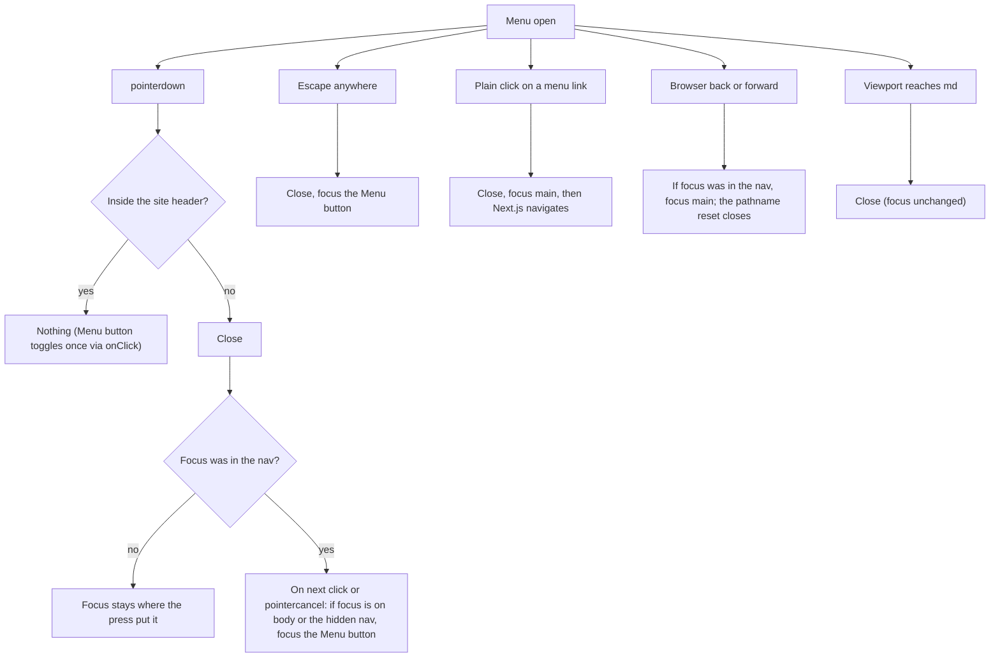

# Brief: Implement mobile navigation (HOME-004)

- Story: [docs/stories/home-004-mobile-navigation.md](../stories/home-004-mobile-navigation.md), https://github.com/eng-rodriguez/personal-website/issues/9
- Branch: `feat/home-004-mobile-navigation`, cut from `origin/main` at e66c548, built in parallel with HOME-002 (section 1)
- ADR: none (section 13 explains why)

Extend the existing non-modal disclosure in `src/components/site/site-nav.tsx`. Add outside-press dismissal scoped to the site header, explicit focus rules for every way the menu closes, a no-JavaScript fallback that shows the links and hides the Menu button, and `print:hidden` on the Menu button. Escape, the pathname reset and the `md` reset stay as they are. Nothing locks scrolling, traps focus or makes the page `inert`. Add a mobile Playwright smoke test and update the docs. No new dependency, route, color, token, Radix component or `playwright.config.ts` change.

## 1. Layers touched

| Order | Layer | Builder | Paths | Depends on |
| --- | --- | --- | --- | --- |
| 1 | frontend (`web` area, repository root) | factory:react-builder with stack-react | `src/components/site`, `src/lib/navigation.ts`, `src/app/globals.css`, `e2e/`, `docs/design-system.md`, `docs/testing.md`, `CLAUDE.md` | none (shares two doc files with HOME-002, see below) |

- One builder and one PR. Implementation order inside the PR:
  1. D1 `mainContentId` move (no behavior change), with `npm run typecheck`.
  2. D2 to D7 in `site-nav.tsx`, with the `site-nav.test.tsx` cases written alongside.
  3. D8 and D9 CSS and classes, with the `globals.test.ts` case.
  4. `site-shell.test.tsx` tab order.
  5. `e2e/mobile-navigation.spec.ts`.
  6. Docs, with `shell-docs.test.ts`.
- Merge order: either PR may merge first (owner decision at brief approval). Both stories edit `docs/design-system.md` and `CLAUDE.md`, so the second PR to merge rebases and resolves those two docs by hand. HOME-002 edits `e2e/no-js.spec.ts`, so this brief leaves it untouched: the narrow no-JS case goes in the new spec.
- No rollout, because nothing is deployed.
- Pipeline: no change. `web`, `e2e`, `scope` and `ci-ok` must pass unchanged. The new spec runs in the existing `e2e` job.
- Infra, backend, ml: not touched.
- Stack: Next.js 16.4.2 App Router, React 19.3.1, TypeScript ~6.0.3 strict, Tailwind CSS 4.3.3, Vitest 5 with jsdom 30 and React Testing Library 16 (`fireEvent` only; `@testing-library/user-event` is not installed and is not added), Playwright 1.63.0 on Chromium. `package.json`, `package-lock.json`, `next.config.ts`, `tsconfig.json` and `playwright.config.ts` do not change.

## 2. Ownership
This is the Site presentation context (`docs/domain.md`: layout, navigation, pages). Writing, Portfolio and Career are not touched.
- `src/components/site/site-nav.tsx` owns the menu: its state, every dismissal path and every focus move caused by closing it. No other module opens, closes or listens for the menu.
- `src/components/site/site-header.tsx` is not changed. It stays the boundary for "inside" presses, which SiteNav finds from its own Menu button (D3), so SiteNav needs no new prop.
- `src/components/site/site-shell.tsx` keeps owning the single `main#main-content` with `tabIndex={-1}` (ADR 0003). It now imports `mainContentId` instead of declaring it (D1).
- `src/app/globals.css` owns the no-JS display rules (D8), next to the existing theme-toggle rule.
- `theme-toggle.tsx` is not changed. It is passed in through the existing `actions` prop.

## 3. Domain model
Not applicable. No content schemas, aggregates or migrations.

## 4. API contract
None. No route handlers, server actions or API artifacts.

## 5. Data and consistency
Not applicable. The menu state is local `useState` in SiteNav, closed on the server and on first render. Nothing is stored or fetched.

## 6. Frontend

### Design decisions
Rules that apply to every decision below:
- All document and window listeners attach only while the menu is open and are removed when it closes or SiteNav unmounts, as today (edge case "no listener is left registered"). The builder may merge the existing Escape and `matchMedia` effects with the new listeners into one `useEffect([open])`, or keep separate effects. Either is fine if each cleanup removes what it added.
- No ref writes and no state reads of the DOM during render, and no synchronous `setState` in an effect body. Those patterns fail the React Hooks lint rules in `eslint-config-next` 16. The existing render-phase pathname reset (`renderedPath`) stays. Refs are written only in event handlers and effects.
- Programmatic focus moves added by this story use `focus({ preventScroll: true })`, so they never fight Next.js scroll handling or a scroll in progress. The existing Escape focus call is left as it is.
- No `outline-none`, no plain `focus:` utilities and no new `transition-*` (the existing `test_ac6_` test keeps enforcing this).

Decisions:
- **D1. `mainContentId` moves to `src/lib/navigation.ts`.** Add `export const mainContentId = "main-content";` there. `site-shell.tsx` imports it and drops its own declaration (nothing else imports it from `site-shell.tsx`). SiteNav imports it from `@/lib/navigation`. The client component cannot import `site-shell.tsx`: that would pull a server module into the client bundle and create the import cycle `site-nav` → `site-shell` → `site-header` → `site-nav`.
- **D2. Element hooks.**
  - Add `navRef = useRef<HTMLElement>(null)` on the `nav`. Keep `toggleRef`.
  - Add `data-menu-toggle=""` to the Menu button and `data-primary-nav=""` to the `nav`. These are used for the no-JS CSS (D8) and the e2e locators.
  - The Menu button's classes become the current string plus `print:hidden` (D9).
  - Everything else stays as it is: `aria-expanded`, `aria-controls="primary-navigation"`, the `nav` `id` and `aria-label="Primary"`, the `open ? "block" : "hidden"` class, and the link classes. The closed `nav` stays `display: none`.
  - DOM order stays: actions, Menu button, then `nav` (A6). The menu never moves focus on open (AC2).
- **D3. Outside press (AC4, AC5, AC8, A4).** While open, add `document.addEventListener("pointerdown", onPointerDown, true)`. It uses the capture phase, so a component that stops propagation cannot hide a press. The handler:
  1. Ignore the event unless `event.target instanceof Node`.
  2. Find the boundary: `const header = toggleRef.current?.closest("header") ?? null`. The search starts from the Menu button, not from the target, so a future `header` inside an article in `main` is never mistaken for the site header.
  3. "Inside" means `header.contains(target)`. If there is no `header` ancestor (SiteNav rendered on its own, as in unit tests), it means `toggleRef.current.parentElement` (the actions cluster) or `navRef.current` contains the target. Inside presses return without doing anything. This covers the Menu button (so its own `onClick` toggles exactly once, AC5), the theme toggle (AC8), the site name, and padding or gaps in the `nav` (edge case).
  4. For an outside press, read `const focusWasInNav = navRef.current?.contains(document.activeElement) ?? false`, then call `setOpen(false)`.
  5. If `focusWasInNav`, restore focus after the press settles, not during `pointerdown`. A focus call during `pointerdown` would be undone by the browser's own focus step on the following `mousedown`, which for touch comes after `pointerup`. Add two one-shot document listeners in the capture phase, `click` and `pointercancel`. The first one to fire removes both and runs `restoreFocusIfLost()`: if `document.activeElement` is `null`, `document.body`, or inside `navRef.current` (the now hidden link), call `toggleRef.current?.focus({ preventScroll: true })`. Otherwise focus has gone where the press put it, such as a link in `main` or `main` itself (it has `tabIndex={-1}`, so a press anywhere in it focuses it), and it is left there.
  6. Keep the remover for these one-shot listeners in a ref (`pendingRestoreRef`). Call it when the menu opens again and when SiteNav unmounts, so a press that never produced `click` or `pointercancel` (for example a long-press context menu) cannot leave a listener behind past the next cycle.
  - Mouse, touch and pen all produce `pointerdown`. Touch-only `click` without `pointerdown` is not supported (story edge case).
  - Touch (O1, decided: close on tap only). For `event.pointerType === "touch"`, an outside `pointerdown` does not close the menu. Record its `pointerId` and whether focus was in the nav, then close on the `click` the tap produces, caught by a capture-phase `click` listener on `document` that exists only while the menu is open; drop the record on a matching `pointercancel`, which the browser sends when it starts panning, so a scroll produces no click and leaves the menu open. Closing on the click and not on `pointerup` matters: the compatibility `mousedown` and `click` are hit-tested after `pointerup`, so a collapse committed on `pointerup` would let the click land on whatever slid under the finger (a "View projects" CTA on `/`, which then navigated). On the click the layout is still open, so it lands on the element actually under the finger. The tap's `mousedown` has already moved focus by then, so the click handler applies step 5's rule directly: if focus was in the nav, `restoreFocusIfLost()`; a tap on `main` leaves focus on `main`, a tap on non-focusable content returns it to the Menu button. A `click` without a preceding outside touch (a keyboard activation, or a mouse click after its `pointerdown` already closed the menu) does nothing. The record lives in the effect's closure, so it needs no ref and goes away with the listeners. Mouse and pen keep closing on `pointerdown` as above.
- **D4. Escape (AC3).** Unchanged: while open, a `keydown` with `key === "Escape"` anywhere closes the menu and focuses the Menu button. When closed, no listener exists, so Escape does nothing. If a D3 restore is pending, Escape cancels it through `pendingRestoreRef`.
- **D5. Choosing a link (AC6, A5).** The link `onClick` becomes:
  ```ts
  onClick={(event) => {
    if (event.metaKey || event.ctrlKey || event.shiftKey || event.altKey || event.button !== 0) return;
    if (!open) return;
    setOpen(false);
    document.getElementById(mainContentId)?.focus({ preventScroll: true });
  }}
  ```
  - A modified click (new tab or window) does not navigate this tab, so the menu stays open and focus stays put. Today such a click also closes the menu. This is the one behavior change outside the story text (see O3).
  - When the menu is closed (inline navigation at `md` and wider), the handler does nothing. The clicked link stays visible, and focus follows the normal Next.js behavior, as today.
  - Focus moves to `main` in the same event, before Next.js navigates. `main` lives in the root layout and is not replaced, so focus stays in it while the new page renders into it. This also covers choosing the current route ("Home" on `/`), where the pathname does not change and the pathname reset (D6) would never run. The `next/link` click handler still runs after ours, because we do not call `preventDefault`.
  - Next.js 16 scrolls the new segment into view and calls `focus()` on its first element. That element is a non-focusable page element, so the call is ignored and focus stays on `main`. The builder checks this in the e2e test (AC6), which accepts focus on `main` or on any element inside it.
  - Fallback, allowed without a brief revision if the e2e test shows focus on `body` after the navigation: rely on the D6 layout effect, which focuses `main` after a path change when focus was in the nav and the nav is now hidden. Record in the Checkpoint whether the fallback was needed. At `md` and wider the link handler does nothing (`open` is false) and the D6 effect skips a visible nav, so focus follows normal Next.js behavior and stays on the link.
  - After a keyboard choice, `:focus-visible` can match on `main`, so the global outline may be drawn around it, as it already is after the skip link (FOUND-003 D3). See O2.
- **D6. Pathname change, back and forward (AC6, edge cases).** The render-phase reset (`pathname !== renderedPath` closes the menu) is unchanged. It cannot move focus, because it runs during render. For browser back and forward while open, a `useLayoutEffect` keyed on the rendered path is the single owner of the rule: after the commit, if `navRef.current` contains `document.activeElement` and the nav is no longer visible (`checkVisibility()` is `false`, which is the collapsed mobile menu), it focuses `main` with `preventScroll`. At `md` and wider the nav stays visible, so the effect does nothing and focus follows normal Next.js behavior. There is no `popstate` listener. Other programmatic navigation does not exist in the site today.
- **D7. Viewport reaches `md` (AC9).** Unchanged: the `matchMedia("(min-width: 48rem)")` change listener closes the menu, and a round trip across `md` leaves it closed. If the Menu button had focus, it is now `display: none` and focus falls to `body`. This is a known limitation, not covered by the story (section 13).
- **D8. No JavaScript (AC10, A7).** Add two unlayered rules to `globals.css`, after the existing `html:not([data-js]) [data-theme-toggle]` rule. Keep them as separate rules, because `globals.test.ts` finds the existing rule by its exact selector:
  ```css
  html:not([data-js]) [data-menu-toggle] {
    display: none;
  }
  html:not([data-js]) [data-primary-nav] {
    display: block;
  }
  ```
  - Unlayered rules outrank Tailwind utilities in `@layer utilities` (`inline-flex`, `hidden`), the same reasoning as the existing rule.
  - Without JavaScript, the theme script never sets `data-js`. Below `md` the Menu button disappears and the `nav` shows its `flex-col` list of five stacked links. At `md` and wider nothing changes.
  - With JavaScript, `data-js` is set before first paint, so these rules never match. The server HTML and the first client render are both closed, so there is no hydration mismatch and no layout shift (A7). `<html>` keeps its existing `suppressHydrationWarning`, and no other element gets it.
  - If a future CSP blocked the inline script, these rules would match and show the open link list with no Menu button. That page is degraded but usable, never dead.
  - The Breakpoints section of `docs/design-system.md` currently says the links work only "at `md` and wider" without JavaScript. That gap closes here.
- **D9. Print (AC11, A8).** `print:hidden` on the Menu button hides it in print at every width. The `nav` print behavior is unchanged: at `md` and wider the links print inline, and below `md` a closed menu stays `display: none` as today. Light print colors come from the existing `@media print` rules.
- **D10. No scroll lock (AC7, A1).** Nothing in SiteNav writes `document.body.style`, `document.documentElement.style`, `overflow`, `inert` or `aria-modal`, and no focus trap exists. The menu is in flow, so the page always scrolls. Unit and e2e tests enforce this (Test design).
- **D11. Reduced motion (A9).** No transition or animation is added to the Menu button or the `nav`. Links keep `transition-colors motion-reduce:transition-none`.
- **D12. Targets and contrast (A12).** No new color, token or pair. The Menu button and links keep `min-h-10`, `border-input` and the global outline.
- States: loading, empty, error and denied do not apply (static navigation). The no-JS state is D8.

The diagram shows what each way of closing does to focus.



### Test design
Unit tests use `test_acN_` names, `fireEvent` and the existing `matchMedia` stubs. jsdom applies no Tailwind and no media queries, so unit tests check state, attributes, classes and `document.activeElement`. The e2e test checks real layout, touch and focus.

Unit test harness for the dismissal cases: render
```tsx
<>
  <header><SiteNav actions={<button type="button">Action</button>} /></header>
  <main id="main-content" tabIndex={-1}><a href="#x">In main</a><p>Text</p></main>
  <footer><p>Footer text</p></footer>
</>
```
so presses inside and outside the header have real targets. `fireEvent.pointerDown` followed by `fireEvent.click` on the same target simulates a press. Because jsdom does not move focus on press, a test that presses a focusable element calls `.focus()` on it between the two events, as a browser would.

**`src/components/site/site-nav.test.tsx`** (modified; existing tests stay and pass):
- `test_ac1_click_opens_and_shows_the_nav`: click gives `aria-expanded="true"` and the `nav` has `block`, not `hidden`. The Menu button has `data-menu-toggle` and the `nav` has `data-primary-nav`.
- `test_ac3_escape_when_closed_changes_nothing`: with a main link focused, Escape leaves `aria-expanded="false"` and focus on the link.
- `test_ac3_escape_from_main_link_focuses_the_toggle`: open, focus the link in `main`, press Escape: closed, focus on the Menu button.
- `test_ac4_outside_press_closes`: open, pointerdown on the footer `p`: closed.
- `test_ac4_outside_press_with_focus_in_nav_returns_focus_to_toggle`: open, focus "Writing" in the nav, pointerdown and click on the footer `p`: closed, and focus is on the Menu button.
- `test_ac4_outside_press_on_focusable_keeps_its_focus`: open, focus a nav link, pointerdown on the main link, `.focus()` it, click: closed, and focus stays on the main link.
- `test_ac4_outside_press_with_focus_outside_nav_does_not_move_focus`: open, focus the main link, pointerdown and click on the footer `p`: closed, focus still on the main link.
- `test_ac4_pointercancel_restores_focus`: open, focus a nav link, pointerdown on the footer `p`, then `fireEvent.pointerCancel(document)`: focus on the Menu button.
- `test_ac4_press_inside_nav_padding_keeps_it_open`: pointerdown on the `ul`: still open.
- `test_ac4_press_inside_header_keeps_it_open`: pointerdown on the action button: still open.
- `test_ac4_without_header_ancestor_uses_own_elements`: SiteNav rendered without `header`. Pointerdown on the `ul` keeps it open, and pointerdown on `document.body` closes it.
- `test_ac4_listeners_attach_only_while_open`: spy on `document.addEventListener` and `removeEventListener`. No `pointerdown` listener while closed. After open then Escape, every `pointerdown`, `keydown`, `click` and `pointercancel` listener that was added has been removed. After unmount with a pending restore, the `click` and `pointercancel` listeners are removed.
- `test_ac5_toggle_press_closes_once_and_keeps_focus`: open, focus the Menu button, pointerdown then click on it: `aria-expanded="false"`, focus on the Menu button.
- `test_ac5_rapid_toggling_matches_press_count`: three pointerdown and click pairs on the Menu button give `"true"`, four give `"false"`.
- `test_ac6_link_choice_closes_and_focuses_main`: open, click "Writing": closed, `document.activeElement` is `main#main-content`.
- `test_ac6_modified_click_keeps_menu_and_focus`: open, `fireEvent.click(link, { ctrlKey: true })` (also `metaKey`): still open, focus not moved.
- `test_ac6_link_click_when_closed_does_not_move_focus`: menu closed, focus "Writing", click it: focus is still on the link (desktop path).
- `test_ac6_path_change_with_focus_in_hidden_nav_focuses_main`: open, focus a nav link, mock `checkVisibility` to `false`, change the mocked pathname: focus on `main`. `test_ac6_path_change_with_visible_nav_keeps_focus` (`checkVisibility` true) and `test_ac6_path_change_with_focus_outside_nav_keeps_focus` leave focus alone. The desktop case is also covered in e2e because jsdom has no layout.
- `test_ac7_opening_sets_no_scroll_lock`: after open, `document.body.style.overflow` and `document.documentElement.style.overflow` are `""`, and no element has `inert`, `aria-modal` or `overflow-hidden`.
- `test_ac8_theme_toggle_press_keeps_menu_open`: render the harness with `actions={<ThemeToggle />}` (setup as in `theme-toggle.test.tsx`), open, pointerdown and click on the "Dark" label: still open, and the "Dark" radio is checked.
- `test_ac9_round_trip_across_md_stays_closed`: open, fire `matches: true` then `matches: false`: closed.
- `test_ac11_toggle_is_hidden_in_print`: the Menu button has `print:hidden`.
- `test_a9_no_new_transitions`: the Menu button and the `nav` have no class starting with `transition` or `animate`.
- The existing `test_ac4_link_click_closes` keeps passing, because a plain `fireEvent.click` has `button: 0` and no modifiers.

**`src/components/site/site-shell.test.tsx`** (modified):
- `test_ac2_tab_order_menu_then_links_in_order`: in the focusable list from the existing selector, the Menu button's index plus 1 is the "Home" link, and the five nav links follow in `primaryNav` order.

**`src/app/globals.test.ts`** (modified):
- `test_ac10_shows_links_and_hides_menu_without_js`: rules with selectors `html:not([data-js]) [data-menu-toggle]` (`display: none`) and `html:not([data-js]) [data-primary-nav]` (`display: block`) exist, and both have `parent === root` (unlayered). The existing `test_ac11_` theme-toggle test stays unchanged.

**`src/components/site/shell-docs.test.ts`** (modified):
- `test_ac12_design_system_describes_the_mobile_menu`: the Global shell section contains `pointerdown`, `Escape`, `outside`, `scroll lock`, `data-menu-toggle` and `print`.
- `test_ac12_testing_doc_describes_the_mobile_smoke_test`: `docs/testing.md` contains `mobile-navigation.spec.ts` and `375`.
- The existing assertions stay.

**`e2e/mobile-navigation.spec.ts`** (new):
- Configuration: `test.use({ viewport: { width: 375, height: 667 }, hasTouch: true })` at file level, with no `isMobile`. The default Desktop Chrome project stays, and `playwright.config.ts` is not changed. Locators: `page.getByRole("button", { name: "Menu" })` and `page.getByRole("navigation", { name: "Primary" })`. Every test names its route in titles and `expect` messages (`docs/testing.md`).
- For each `primaryNav` route, AC1: `goto`, tap Menu, `aria-expanded="true"`, five visible links, and `document.documentElement.scrollWidth <= document.documentElement.clientWidth`. Collect console messages during load and assert none match `/hydrat|#418|#423|#425/i` (hydration edge case).
- AC2 on `/`: `menu.focus()`, `keyboard.press("Enter")`: expanded, Menu focused. `Tab`: "Home" focused. `Tab`: "Writing" focused. Close with Escape, then `keyboard.press(" ")`: expanded.
- AC3 on `/writing`: tap to open, `keyboard.press("Escape")`: `aria-expanded="false"`, nav hidden, Menu focused.
- AC4 on `/`: tap to open, tap `main` at a text-free position: closed. Then open with the keyboard, Tab to "Home", tap the footer at `{ x: 2, y: 2 }` (its padding): closed, and Menu is focused.
- AC5: tap to open, tap Menu again: closed, and still closed after a short `expect.poll` (no reopen).
- AC6 from `/`: tap to open, tap "Writing": `toHaveURL(/\/writing$/)`, `aria-expanded="false"`, `#primary-navigation a[aria-current="page"]` has text "Writing". `expect.poll` on `page.evaluate` returning `activeElement !== body && main.contains(activeElement)` is `true`. Repeat with the keyboard (Enter on "Projects").
- AC7 on `/`: append a 3000px spacer to `document.body` with `page.evaluate`, tap to open, check that `getComputedStyle` `overflow` and `overflow-y` of `html` and `body` are not `hidden`, then `page.mouse.wheel(0, 600)`: `scrollY` grows. Press Escape: `scrollY` is unchanged (no jump), and another wheel still scrolls.
- AC8 on `/`: tap to open, tap the "Dark" label in the Theme radiogroup: `html` has `data-theme="dark"`, and Menu is still expanded.
- AC9 on `/`: tap to open, `setViewportSize({ width: 1024, height: 768 })`: Menu hidden, nav visible, no element with `aria-expanded="true"`. Resize back to 375: closed.
- AC10, in `test.describe` with `test.use({ javaScriptEnabled: false })`, for each `primaryNav` route: all five links visible, Menu `toBeHidden()`, `[data-theme-toggle]` hidden, and no horizontal scroll.
- AC11 on `/`: `page.emulateMedia({ media: "print" })`: Menu hidden. Repeat at 1024 wide.
- Unchanged and passing: `core-routes.spec.ts`, `no-js.spec.ts` and `theme.spec.ts` (Desktop Chrome).

## 7. Infra and pipeline
Not applicable. No workflow, environment or deployment change. The new spec runs in the existing `e2e` job.

## 8. Security and threat notes
- Authn/z, tenant isolation, secrets: not applicable (static public site, no users).
- Input validation: no user input. Event targets are checked with `instanceof Node` before `contains`. Hrefs stay the `primaryNav` constants.
- Data classification: public navigation labels only. Nothing is logged or stored.
- No new dependency.
- Top threats (STRIDE-style; the realistic risks are availability and usability):
  1. Denial of navigation: a dead Menu button without JavaScript, or a stuck scroll lock. Mitigation: D8 CSS fallback, no scroll lock by design (D10), and unit plus e2e tests for both.
  2. Denial through lost focus: keyboard and screen reader users stranded on `body` after closing. Mitigation: a focus rule for each close path (D3 to D6), unit tests per rule, and the e2e AC4 and AC6 focus checks.
  3. Tampering through listener leaks: global listeners left registered could close the menu or move focus unexpectedly later. Mitigation: listeners attach only while open, the pending-restore cleanup ref, and `test_ac4_listeners_attach_only_while_open`.

## 9. Verification per criterion
All checks run locally from the repository root on Node.js 24. "e2e" means `e2e/mobile-navigation.spec.ts` under `npm run e2e` against the local production build on port 3100.

| AC | Check | Level |
| --- | --- | --- |
| 1 | `test_ac1_*`; e2e AC1 (layout, no horizontal scroll) | local |
| 2 | `site-shell.test.tsx` `test_ac2_*` (DOM order); e2e AC2 (Enter, Space, Tab) | local |
| 3 | existing `test_ac4_escape_*`, `test_ac3_*`; e2e AC3 | local |
| 4 | `test_ac4_*` (eight cases); e2e AC4 (real touch and focus) | local |
| 5 | `test_ac5_*`; e2e AC5 | local |
| 6 | `test_ac6_*`; e2e AC6 (real Next.js navigation, focus in `main`). This is the only place the Next.js focus behavior is verified (D5 fallback) | local |
| 7 | `test_ac7_*`; e2e AC7 (computed styles and wheel). Touch scrolling: Manual step 4 | local + manual |
| 8 | `test_ac8_*`; e2e AC8 | local |
| 9 | existing md test and `test_ac9_*`; e2e AC9 (real `matchMedia`) | local |
| 10 | `globals.test.ts` `test_ac10_*`; e2e AC10 (no-JS at 375) | local |
| 11 | `test_ac11_*`; e2e AC11 (`emulateMedia` print). Print preview: Manual step 5 | local + manual |
| 12 | `npm run check` exit 0 (typecheck, ESLint `--max-warnings=0`, Prettier, Vitest, build); `npm run e2e` exit 0; `shell-docs.test.ts`; owner read in Manual step 7 | local + manual |

- Edge cases: rapid toggling (`test_ac5_rapid_*`), back and forward (`test_ac6_path_change_*`, e2e Back and 1024px Enter cases), `md` round trip (`test_ac9_*`, e2e AC9), press on the Menu button (`test_ac5_*`), nav padding (`test_ac4_press_inside_nav_*`), main and footer presses (`test_ac4_*`), Escape from the theme toggle or `main` (`test_ac3_*`), hydration (e2e console check), screen reader attributes (existing structure tests), forced colors and 320px at 200% zoom (Manual steps 2 and 6).
- Scope: CI `scope` job. Locally, `git diff --name-only origin/main...HEAD`, with each path exempt or found by `grep -F` in this brief.
- Builder-verified at implementation (record in the Checkpoint): whether the D5 fallback was needed; `print:hidden` appears in the built CSS under `@media print`; the two D8 rules appear unlayered in the built CSS; jsdom 30 dispatches `pointerdown` and `pointercancel` through `fireEvent` (if not, construct `new Event("pointerdown", { bubbles: true })` in the tests, without adding a dependency).
- Environment evidence, blocked until the PR exists: CI `web`, `e2e`, `scope` and `ci-ok`.
- Not automated: a real touch device, a screen reader, forced colors, the print preview and 320px at 200% zoom. Firefox and WebKit are out of scope.

### Manual verification
The owner runs this on the branch with Node.js 24 before marking the PR ready, and records who ran it and each result in the Checkpoint. Builders do not claim it. Use `npm run build && npm run start` at `http://localhost:3000` with Chrome or Edge DevTools unless a step says otherwise.

1. `git status`, then `npm ci`, `npm run check; echo $?`, `npm run e2e; echo $?`. Expected: both exit 0 with only the 3 known ESLint `ERESOLVE` notices. The untracked user files (`AGENTS.md`, `docs/reviews/dependabot-actions-pr-34.md`) are not staged. Record the Vitest and Playwright counts. Automated.
2. 320px at 200% zoom: set the window to 640px wide and zoom to 200% (a 320 CSS px layout) on `/` and `/writing`. Expected: the site name, Theme group and Menu wrap without clipping, overlap or horizontal scroll. Open the menu: links are stacked, at least 40px tall, and the page has no horizontal scroll. Human only.
3. Touch: in the DevTools device toolbar with touch emulation (or on a real phone over the LAN, `npm run start -- --hostname 0.0.0.0`), tap Menu, tap outside in `main`, tap Menu twice quickly, tap a link, and tap the Theme options while open. Expected: AC1, AC4, AC5, AC6 and AC8 behavior, with no double toggle. Record the device and browser if a real phone was used. Human only.
4. Scroll by touch with the menu open on a page long enough to scroll (DevTools: drag with touch emulation). Expected: the page scrolls, with no lock and no jump to top. The menu stays open during the drag (O1), and a tap outside the header afterwards closes it. Human only.
5. Print preview (Ctrl+P or Cmd+P) on `/` at 375px and at 1280px, with the menu open and closed. Expected: no Menu button, light colors, and the links inline at 1280px. Human only.
6. Forced colors: emulate `forced-colors: active` at 375px. Expected: the Menu button border and focus outline are visible. Human only.
7. Screen reader smoke (VoiceOver with Safari or Chrome on macOS, or NVDA on Windows) at 375px: the Menu button is announced as "Menu, button, collapsed" and then "expanded". Tab moves to "Home" in the "Primary" navigation. Escape returns to "Menu, collapsed". Choosing "Writing" announces the new page, and the reading cursor is in the main content, not at the top of the document. Human only.
8. Read the "Global shell" and "Breakpoints" sections of `docs/design-system.md`, `docs/testing.md` and the CLAUDE.md Current state. Expected: the content in section 10. Human only.
9. Open the PR. Expected: `web`, `e2e`, `scope` and `ci-ok` succeed. Environment evidence.
10. Back and forward: at 375px open the menu on `/`, choose "Writing", open the menu again, then press the browser Back button. Expected: the menu closes and focus is in the main content, not on the document body (edge case "browser back or forward"; AC6). Human only.
11. Mouse and keyboard dismissal at 375px (narrow desktop window): open the menu, click in `main` (mouse closes on press, unlike touch which closes on tap, O1), then reopen and press Escape with focus on the theme toggle. Expected: the menu closes each time; after Escape, focus is on the Menu button (AC3, AC4). Human only.

Before step 1, make sure no other dev or e2e server is listening on port 3100 (`lsof -iTCP:3100 -sTCP:LISTEN`), because `playwright.config.ts` reuses an existing server locally and would test the wrong build.

Rollback check: see section 12.

## 10. Docs impact and observability
- `docs/design-system.md` "Global shell": replace the Breakpoint bullet with a "Mobile menu" bullet group covering:
  - The non-modal disclosure: no focus trap, no `inert` and no scroll lock, so the page always scrolls.
  - Dismissal: Escape anywhere, an outside `pointerdown` (outside the site header), link choice, pathname change, and reaching `md`.
  - Focus rules: no focus move on open. Escape returns focus to the Menu button. After an outside press, focus returns to the Menu button only if it was in the menu and the press left it nowhere. A plain link choice focuses `main#main-content`. Back or forward with focus in the menu focuses `main`. Modified clicks leave the menu open.
  - No-JS: the `data-menu-toggle` and `data-primary-nav` rules.
  - Print: the Menu button is hidden.
- `docs/design-system.md` "Breakpoints": change the no-JS line to say links work at every width, and the 320px line to include outside tap.
- `docs/testing.md` "Adding a smoke test": one line saying a viewport-specific spec sets `viewport` and `hasTouch` with file-level `test.use` (example: `e2e/mobile-navigation.spec.ts` at 375 by 667), and the default project stays Desktop Chrome.
- `CLAUDE.md` Current state: one sentence saying the mobile menu closes on Escape, outside press, link choice, route change and `md`, restores focus, never locks scrolling, and shows the links without JavaScript, and that Playwright covers it at 375px. Keep every string that `shell-docs.test.ts` asserts.
- `README.md`: no change.
- Observability: none. There is no runtime service, and nothing is logged.

## 11. Files that will change
Builders create or modify only these paths. Any other file is out of scope and must not be committed.

Frontend / application (factory:react-builder):
- `src/components/site/site-nav.tsx` (modified: D2 to D7)
- `src/components/site/site-shell.tsx` (modified: imports `mainContentId`)
- `src/lib/navigation.ts` (modified: exports `mainContentId`)
- `src/app/globals.css` (modified: two unlayered no-JS rules)

Tests (factory:react-builder; exempt from the scope check):
- `src/components/site/site-nav.test.tsx` (modified)
- `src/components/site/site-shell.test.tsx` (modified)
- `src/components/site/shell-docs.test.ts` (modified)
- `src/app/globals.test.ts` (modified: one new test)
- `e2e/mobile-navigation.spec.ts` (new)

Docs (factory:react-builder):
- `docs/design-system.md` (modified)
- `docs/testing.md` (modified)
- `CLAUDE.md` (modified)

Planning (orchestrator/architect):
- `docs/briefs/home-004-mobile-navigation.md` (this brief)
- `docs/stories/home-004-mobile-navigation.md` (already present, untracked)

Not committed: `.next/`, `node_modules/`, `test-results/`, `playwright-report/`, `next-env.d.ts`, `*.tsbuildinfo`. `AGENTS.md` and `docs/reviews/dependabot-actions-pr-34.md` are untracked user files.

Explicitly not changed: `src/components/site/site-header.tsx`, `src/components/site/theme-toggle.tsx`, `src/app/layout.tsx`, `src/lib/theme.ts`, `src/components/primitives/*`, `src/components/ui/*`, `e2e/core-routes.spec.ts`, `e2e/no-js.spec.ts`, `e2e/theme.spec.ts`, `playwright.config.ts`, `package.json`, `package-lock.json`, `next.config.ts`, `tsconfig.json`, `eslint.config.mjs`, `.github/` and `README.md`.

## 12. Risk
- Level: **Standard**. It changes shared shell behavior on every route, adds document-level listeners and programmatic focus, and adds a global CSS rule. The site is undeployed and static, with no data, auth, secrets, dependency or pipeline impact, and the change reverts as one PR.
- Recovery: revert the merge commit on `main` through a PR (`git revert -m 1 <merge-sha>`), then run `npm run check` and `npm run e2e`. Expected after the revert: the FOUND-004 menu (no outside dismissal, no no-JS fallback), `mainContentId` back in `site-shell.tsx`, and `e2e/mobile-navigation.spec.ts` gone. Nothing is deployed, so there is no runtime rollback and no flag.
- Owner: @eng-rodriguez.

## 13. Open questions and ADRs
- ADR: none written. The story keeps the approved non-modal disclosure (FOUND-003 A3, FOUND-004 A7) inside the shell decided in ADR 0003. The no-JS rule follows the `data-js` mechanism of ADR 0004. The focus rules are component behavior recorded in `docs/design-system.md` and enforced by tests. Nothing adds a dependency, service or lasting architectural tradeoff. A future modal menu would need its own story and probably an ADR.
- **O1 (decided by @eng-rodriguez at brief approval: close on tap only).** Closing on an outside touch `pointerdown` would close the in-flow menu at the start of a scroll and shift content mid-gesture. Touch now closes on the `click` the tap produces and ignores a touch ended by `pointercancel` (D3); mouse and pen keep `pointerdown`. Repair round 3 moved the touch close from `pointerup` to the click, because a collapse on `pointerup` let the click land on content that slid under the finger. Story A4 is amended accordingly. Tests: one unit case per branch (touch tap closes on the following click and not on `pointerup`, touch cancel keeps open, a click without an outside touch keeps open, mouse pointerdown closes), the e2e AC4 tap and the e2e tap at the CTA's closed-layout position.
- **O2 (owner, does not block).** After a keyboard link choice, the global `:focus-visible` outline may be drawn around `main` (same as after the skip link today). Accept in Manual step 7, or a later story can move focus to the page `h1` instead (that needs `tabIndex={-1}` in PageHeading).
- **O3 (owner, does not block).** D5 leaves the menu open on modified clicks (Ctrl, Cmd, Shift, Alt or a non-primary button). Today any click closes it. The owner may veto this in review, and the code then drops the first guard line.
- Known limitation (not this story): if the Menu button has focus when the viewport reaches `md`, it becomes `display: none` and focus falls to `body` (D7).
- Builder-verified at implementation: the items in section 9. If focus after a link choice lands on `body` even with the D5 fallback, stop and report for a brief revision.
- Resolved in this brief: the header boundary is found from the Menu button with `closest("header")` (D3), focus restoration waits for the press to settle (D3), link choice focuses `main` in the click (D5), back and forward use a layout effect that skips a visible nav (D6), `mainContentId` moves to `src/lib/navigation.ts` (D1), the no-JS rules are separate unlayered rules (D8), and the narrow no-JS e2e case lives in the new spec, so `e2e/no-js.spec.ts` (edited by HOME-002) stays untouched.

## 14. Checkpoint
- Phase: final review approved by @eng-rodriguez; PR opened
- Scope: HOME-004 as in the approved story (A1 to A12, AC1 to AC12) and this brief
- Baseline: `origin/main` at e66c548, in a separate worktree because HOME-002 is active in the main checkout; untracked user files `AGENTS.md` and `docs/reviews/dependabot-actions-pr-34.md` preserved and not committed
- Revisions: O1 decided (touch closes on tap only); merge order relaxed so HOME-004 is built in parallel with HOME-002; D5 and D6 rewritten in repair round 2 (a layout effect gated on `checkVisibility()` replaces the `popstate` listener)
- Approvals: story approved by @eng-rodriguez; brief approved by @eng-rodriguez with O1 = close on tap only
- Check evidence: `npm run check` exit 0 (26 files, 384 Vitest tests); `npm run e2e` 32/32 with port 3100 free. One early e2e run failed 3/30 while another checkout's server likely held port 3100 (not proven); every run on a free port passed. Deviations: two pending-listener refs instead of one; the AC7 e2e Escape check asserts `scrollY > before / 2` because Chromium scroll anchoring moves the page when the menu collapses.
- Manual verification: run by the agent at the owner's request in headless Chromium against the production build (touch, print and forced-colors emulation; the accessibility tree instead of a screen reader), not by a human. Steps 2 to 8, 10 and 11 pass (25 scripted checks). Step 9 waits for CI. Not done: a real phone, VoiceOver or NVDA, and a real print dialog.
- Repairs used: 2 of 3. Round 1: same-document Back with focus on a menu link dropped focus to `body` (found in manual step 10). Round 2: the round 1 fix moved focus to `main` after a desktop link choice, contradicting D5 (found by all three reviewers, confirmed at 1024px).
- Open findings (not blocking): design Important, listener bookkeeping in `site-nav.tsx` could move into a same-file hook; Minor, modifier-check helper, `remove` declared after use, e2e Escape scroll read without a poll, time-based no-reopen check, mouse-press restore listeners left until the next open, `checkVisibility` stubbed on the prototype in unit tests; a touch tap closes the menu before the compatibility click, so the click lands on whatever moved under the finger (no links in `main` or the footer today).
- Known limitation (accepted by @eng-rodriguez at final review): browsers without `checkVisibility` (Safari before 17.4) skip the Back focus move, so focus falls to `body`; nothing is stolen.
- Next action: open the PR; after merge, update the closing notes to Shipped
