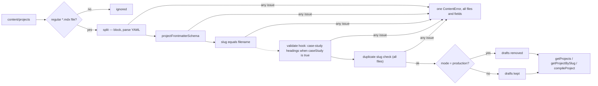

# Brief: Define the Project content model (PROJ-001)

- Story: [docs/stories/proj-001-project-content-model.md](../stories/proj-001-project-content-model.md), https://github.com/eng-rodriguez/personal-website/issues/10
- Branch: `feat/proj-001-project-content-model`, baseline 1b5c7f5
- ADR: [0007 Project model with case studies](../adr/0007-project-model-with-case-studies.md)

Add Project as the second content type on the ADR 0006 pipeline. Each Project is one local MDX file at `content/projects/<slug>.mdx`, validated by a strict Zod 4 schema in `src/lib/projects.ts`. A case study is a Project with `caseStudy: true` whose body has the level-2 headings `Problem`, `Approach`, `Decisions` and `Outcome`, once each and in that order. The heading check runs inside the shared loader through a new optional per-collection `validate` hook, so its issues are collected into the same single `ContentError` as Frontmatter issues, drafts are checked in every mode, and Articles behave exactly as before. A small code-fence-aware heading scanner (`src/lib/content/headings.ts`) finds the headings without a new dependency. `/projects` calls `getProjects()` while it is prerendered, so `next build` fails on invalid Frontmatter, slugs, duplicates and case-study headings, and keeps its EmptyState. No Project is published, no dependency is added, and there is no CI, e2e, `.factory.yml` or `next.config.ts` change.

## 1. Layers touched

| Order | Layer | Builder | Paths | Depends on |
| --- | --- | --- | --- | --- |
| 1 | frontend (`web` area, repository root) | factory:react-builder with stack-react | `src/lib/content/`, `src/lib/articles.ts` (import only), `src/lib/projects.ts`, `src/lib/__fixtures__/projects/`, `content/projects/`, `src/app/projects/page.tsx`, `CLAUDE.md`, docs | FOUND-001, BLOG-001 (merged; ADR 0006 pipeline) |

- One builder and one PR. Implementation order inside the PR:
  1. Move the cover schema to `src/lib/content/schema.ts` (D3) and confirm the Article tests pass unchanged.
  2. The heading scanner (D5) with its tests.
  3. The `validate` hook in `loadCollection` (D4) with its tests, then the full existing suite to prove Articles are unchanged.
  4. `src/lib/projects.ts` (D1, D2, D6), fixtures and tests.
  5. `/projects` (D7) and the real-content test (D8).
  6. Docs (section 10), with the docs test.
- Merge order: a single merge. No rollout, because nothing is deployed.
- Pipeline: no change. `web`, `e2e`, `scope` and `ci-ok` must pass unchanged. The `e2e/` specs are not edited (story A10).
- Infra, backend, ml: not touched.
- Stack: Next.js 16.4.2 App Router (Turbopack build), React 19.3.1, TypeScript ~6.0.3 strict, Zod 4.6.5, yaml 2.9.1, next-mdx-remote 6.0.0, Vitest 5 (jsdom default, `src/**/*.test.{ts,tsx}`), Prettier 3.9.10 (checks `.mdx`, ignores `*.md`), npm, Node.js 24. `package.json`, `package-lock.json`, `next.config.ts`, `tsconfig.json`, `vitest.config.mts`, `eslint.config.mjs`, `.prettierignore` and `src/app/globals.css` do not change.

## 2. Ownership
- Bounded context: Portfolio (`docs/domain.md`) owns Projects and case studies. Site presentation (`/projects`) consumes them through `src/lib/projects.ts` only, an in-process call at build time. No services, events or network calls.
- `src/lib/projects.ts` owns the Project schema, the case-study section rule, the content directory constant, the ordering and the Project component allowlist (empty). Pages never import `src/lib/content/*` directly.
- `src/lib/content/*` stays content-agnostic. It gains two pieces that know nothing about Projects: an optional `validate` hook in `loadCollection` and a Markdown heading scanner. The cover schema moves there because Articles and Projects share its rule (story A3: "same rules as the Article cover").
- Writing (Articles) keeps its behavior: `src/lib/articles.ts` changes only its import of the cover schema. Career is not touched.

## 3. Domain model
No database and no migrations. The model is the Project schema, the case-study rule and their invariants.

- **D1. Project schema (`src/lib/projects.ts`).** `projectFrontmatterSchema = z.strictObject({...})`, built from the shared pieces in `src/lib/content/schema.ts` (`slugSchema`, `isoDateSchema`, `nonEmptyText`, `coverSchema`):

  | Field | Rule | Default |
  | --- | --- | --- |
  | `title` | `nonEmptyText` | required |
  | `slug` | `slugSchema`, equal to the filename (loader) | required |
  | `summary` | `nonEmptyText` | required |
  | `role` | `nonEmptyText` | required |
  | `stack` | `z.array(nonEmptyText).min(1, "must list at least one entry")` with a `superRefine` that reports a repeated entry, compared with `toLowerCase()` after trim, at its index: `stack.2: duplicate entry "typescript" (entries are compared case-insensitively)` | required |
  | `startedAt` | `isoDateSchema` | required |
  | `endedAt` | `isoDateSchema.optional()` | absent |
  | `status` | `z.enum(projectStatuses, "must be one of active, completed, archived")`, `projectStatuses = ["active", "completed", "archived"] as const` | required |
  | `featured` | `z.boolean().default(false)` | `false` |
  | `draft` | `z.boolean().default(false)` | `false` |
  | `links` | `linksSchema` (below) | `[]` |
  | `cover` | `coverSchema.optional()` (D3) | absent |
  | `caseStudy` | `z.boolean().default(false)` | `false` |

  - `linkSchema = z.strictObject({ label: nonEmptyText, url: httpsUrlSchema, kind: z.enum(["repo", "live", "other"], "must be one of repo, live, other") })`.
  - `httpsUrlSchema = z.string().refine(isHttpsUrl, "must be an absolute https:// URL")`, where `isHttpsUrl` (module-private) returns true only when the string starts with `https://`, contains no whitespace, and `new URL(value)` succeeds with `protocol === "https:"` and a non-empty `hostname` (a `try`/`catch` returns false). `http://`, `//host`, `/path`, `mailto:` and `https://` alone are rejected. Reachability is not checked.
  - `linksSchema = z.array(linkSchema).default([]).superRefine(...)`: a second `repo` or `live` link gets an issue at `[index, "kind"]`: `links.2.kind: only one "repo" link is allowed`. `other` links are unlimited.
  - Object refinements, each with `when: () => true` so they run when other fields are invalid (the BLOG-001 deviation), guarding raw types with `typeof`:
    - `endedAt >= startedAt` when both are strings, `path: ["endedAt"]`, `"must not be before startedAt"`. Equal dates are allowed. String comparison is correct for validated `YYYY-MM-DD`.
    - `status !== "active" || endedAt === undefined`, `path: ["endedAt"]`, `"must be omitted while status is active"`. `completed` or `archived` without `endedAt` is allowed.
  - Unknown keys, including in `links[]` and `cover`, are rejected by `strictObject`.
  - Exported types, inferred from the schema:
    - `ProjectFrontmatter = z.input<typeof projectFrontmatterSchema>` (what an author writes).
    - `Project = Readonly<z.output<typeof projectFrontmatterSchema>>` (normalized metadata, dates stay strings). Returned objects and arrays are frozen by the loader.
    - `ProjectStatus = (typeof projectStatuses)[number]`.
    - `CompiledProject = { readonly project: Project; readonly content: ReactElement }`.
- **D2. Case-study rule (`src/lib/projects.ts`).** `export const caseStudySections = ["Problem", "Approach", "Decisions", "Outcome"] as const` (exported for PROJ-003). Module-private `caseStudyIssues({ data, body, bodyLineOffset })` returns `[]` when `data.caseStudy` is `false`. Otherwise it scans the body (D5) and, for each section name in order, with line numbers made file-relative (`line + bodyLineOffset`):
  - No level-2 heading with exactly that text, but a heading of another level with that text: `"### Decisions" (line 18) must be a level-2 heading "## Decisions"`.
  - No heading with that text at any level: `case study section "## Outcome" is missing`.
  - More than one level-2 heading with that text: `case study section "## Problem" appears 2 times (lines 9, 31); it must appear once`.
  - Order, checked over the sections found exactly once (so a missing section does not hide a misorder): at the first section whose line is before the previous found section's line, one issue `case study section "## Approach" (line 9) must come after "## Problem" (line 14); the order is Problem, Approach, Decisions, Outcome`.
  - Every issue has `field: "(body)"` (as compile errors do) and names the heading, which satisfies AC4.
  - Text is compared exactly after trimming and removing the closing `#` sequence: `## problem` or `## **Problem**` counts as missing. Content before `## Problem` and any other headings, at any level, are allowed. A level-2 `## Problem` plus a `### Problem` subsection is allowed (only level 2 counts once a level-2 heading exists).
- Invariants (added to `docs/domain.md`, confirmed for Projects):
  - Every Project's Frontmatter passes the schema, and a Project with `caseStudy: true` has the four sections in order; either failure fails `next build`. An unsafe or broken body fails `npm run check` and, from PROJ-003, `next build`.
  - A slug equals its filename, is lowercase kebab-case and is unique among Projects.
  - Drafts never appear when `NODE_ENV` is `production`, and are still validated, including the case-study rule.
  - An `active` Project has no `endedAt`.

## 4. API contract
None for HTTP. No route handlers, server actions, OpenAPI or API collection (CLAUDE.md: no API contract artifacts). The in-process content API below is the contract PROJ-002, PROJ-003, PROJ-004 and HOME-003 build on.

- **D6. Project API (`src/lib/projects.ts`, server only).** Same shape as the Article API:
  ```ts
  export type { ContentMode, ContentOptions };
  export { ContentError } from "@/lib/content/errors";

  export function getProjects(options?: ContentOptions): readonly Project[];
  export function getProjectBySlug(slug: string, options?: ContentOptions): Project | undefined;
  export function compileProject(slug: string, options?: ContentOptions): Promise<CompiledProject | undefined>;
  ```
  - `getProjects` is synchronous and returns published Projects sorted by `startedAt` descending, then `slug` ascending, both by code-unit comparison (a module-private `compareCodePoints`, the same 3-line helper as `articles.ts`; it is not shared because it is not content knowledge and moving it would touch more of `articles.ts`). `[]` for a missing or empty directory or only drafts in production. `featured` is a plain field; there is no featured ordering (HOME-003 filters).
  - `getProjectBySlug` returns the Project from the validated list, or `undefined` for an unknown slug, a draft in production, or a non-kebab-case argument (`../valid/full-project`, `Full-Project`, `""`). It never builds a path from its argument.
  - `compileProject` finds the entry the same way and calls `compileContent(entry.body, { file, lineOffset: entry.bodyLineOffset, components: projectComponents })` with `const projectComponents: ContentComponents = {}`. It returns `undefined` where `getProjectBySlug` would and rejects with a `ContentError` for an unsafe or malformed body.
  - Defaults: `directory` is `path.join(process.cwd(), "content", "projects")`; `mode` is `"production"` when `process.env.NODE_ENV === "production"`, otherwise `"development"`. Only tests pass these options.
  - Every call loads and validates the whole directory, so any call fails on any invalid file, drafts included.
- **Errors.** Unchanged `ContentError` format (ADR 0006). Example:
  ```text
  Invalid content (2 files):
    content/projects/site-rebuild.mdx
      - endedAt: must be omitted while status is active
      - links.1.url: must be an absolute https:// URL
    content/projects/payments-case-study.mdx
      - (body): case study section "## Outcome" is missing
  ```

## 5. Data and consistency
- Source of truth: the `.mdx` files in Git. No store, index, event or outbox. Consistency is "what is on disk when the build reads it".
- **D4. Loader hook (`src/lib/content/collection.ts`).** Minimal, backward-compatible extension, the only loader change:
  - New exported type:
    ```ts
    export type EntryCheck<T> = (entry: {
      readonly data: Readonly<T>;
      readonly body: string;
      readonly bodyLineOffset: number;
    }) => readonly { readonly field?: string; readonly message: string }[];
    ```
  - `loadCollection({ directory, schema, mode, validate })` with `validate?: EntryCheck<z.output<S>>`, passed through to `loadUncached`.
  - In `loadUncached`, for a file whose schema parse succeeded, after the slug/filename check and before the entry is pushed, call `validate` when given and push each returned issue with the file's `file` added. The entry is still pushed so the duplicate check runs. Files whose Frontmatter failed the schema are not passed to `validate` (there is no typed `data`); ADR 0007 records this.
  - Because it runs inside the existing loop, before the throw and before the draft filter: all issues from all files end in one `ContentError` in file order, drafts are checked in production too, and a cached result (production only) is always a validated one.
  - Without `validate` the loop is unchanged, so `getArticles` and friends behave as before; the unchanged `articles.test.ts` and `articles-content.test.ts` are the evidence.
  - `validate` must not throw; a throw is a programming error and propagates as is.
  - The cache key stays directory plus mode. Each directory holds one type with one `validate`, so this is sufficient (existing comment applies).
  - Why not a scan in `getProjects()` after loading: in production the loader has already dropped drafts, so a draft case study would escape the check, and heading errors would be thrown separately from Frontmatter errors of other files. Story A4 asks the brief to say where the check runs: in the loader hook, registered by `src/lib/projects.ts`.

The diagram shows what happens to each Project file; the dashed step is the new hook.



- **D5. Heading scanner (`src/lib/content/headings.ts`).** `export function scanHeadings(body: string): readonly { depth: 1 | 2 | 3 | 4 | 5 | 6; text: string; line: number }[]`, `line` 1-based within the body. A line scanner, because no Markdown parser is a direct dependency (`@mdx-js/mdx` and `mdast` packages are only transitive through next-mdx-remote, and the story allows no new dependency). Rules, a CommonMark subset sufficient for top-level sections:
  - Split on `\n` and drop a trailing `\r`.
  - Fence open: `^ {0,3}(`{3,}|~{3,})(.*)$`; for a backtick fence the info string must not contain a backtick. Fence close: the same character, at least as long as the opening run, `^ {0,3}(`{3,}|~{3,})[ \t]*$`. A shorter run or the other character does not close it. An unclosed fence runs to the end of the body. No heading is reported inside a fence.
  - ATX heading outside a fence: `^ {0,3}(#{1,6})(?:[ \t]+(.*?))?[ \t]*$`, then remove an optional closing sequence `[ \t]+#+$` (or a text consisting only of `#`), then trim. `#Problem` (no space), seven `#`, four leading spaces or a leading tab are not headings. An empty `##` gives text `""`.
  - Not handled, by design: setext headings, headings inside blockquotes or list items, and HTML. A case-study section written that way is reported as missing, which fails safe. `docs/content.md` says to use `## Problem`.
- Idempotency: loading is a pure function of the directory contents. Concurrency: synchronous reads in one process; build workers each hold their own cache.
- Indexes: not applicable.

## 6. Frontend

### Design decisions
- **D3. Shared cover schema (`src/lib/content/schema.ts`).** Move `coverSchema` unchanged (same regex and messages) from `src/lib/articles.ts` to `schema.ts` and export it; `articles.ts` imports it. No Article behavior changes; `articles-schema.test.ts` passes unchanged.
- **D7. `/projects` (`src/app/projects/page.tsx`).** Same pattern as `/writing`: a synchronous Server Component with `const projects = getProjects();`, the unchanged PageHeading, and the unchanged EmptyState (`mt-8`, "No projects yet", "Projects and case studies will appear here.") only when `projects.length === 0`. Nothing else renders when the list is not empty, until PROJ-002 adds the list. `metadata` is unchanged and the route must still build as ○ static. `src/app/core-pages.test.tsx`, `src/components/site/site-shell.test.tsx` and `src/app/layout.test.ts` render or import the page and pass unchanged, because the real `content/projects` holds only `.gitkeep` and `NODE_ENV` is `test`.
- **D8. Real-content test (`src/lib/projects-content.test.ts`, node).** Runs `getProjects({ mode: "development" })` on the real `content/projects` and `compileProject` for every slug, drafts included. With no content it passes trivially. Once Projects exist, invalid Frontmatter, a broken case study, or an unsafe or broken body fails `npm test`, so `npm run check` and CI fail. Like Articles, `/projects` validates Frontmatter and headings in `next build` but does not compile bodies until PROJ-003 adds detail pages.
- **Content directory.** `content/projects/.gitkeep` (empty). No real or draft Project is added (story A7).
- States: loading, error and denied do not apply (static build). Empty is the existing EmptyState. Invalid content is a build failure, never a rendered state.
- No dependency is added; `package.json` and `package-lock.json` do not change.

### Test design
Node-only tests start with `// @vitest-environment node`, use `test_acN_` names and `it.each` where cases repeat, pass `directory` and `mode` explicitly, and create changing directories with `mkdtempSync(join(tmpdir(), "projects-"))`, removed in `afterEach`, as in `articles.test.ts`.

Fixtures (`src/lib/__fixtures__/projects/`). Formatted by Prettier, which rewrites `~~~` fences to backticks, so tilde fences are covered by inline strings in `headings.test.ts`, not by fixtures. Values are placeholders using `example.com`, never real contact details.
- `valid/full-project.mdx`: every field; `startedAt: 2026-01-15`, `endedAt: 2026-03-01`, `status: completed`, `featured: true`, `stack` with `TypeScript`, `Next.js` and `C#`, links `repo`, `live` and two `other`, a `cover`, `caseStudy: true`. Body: an introduction paragraph, `## Problem`, `## Approach` with a `### Constraints` subsection, `## Decisions`, an extra `## Stack notes`, `## Outcome`, and a backtick fenced code block containing `## Problem` (proves fences are ignored, otherwise it would be a duplicate).
- `valid/another-project.mdx`: required fields only, `startedAt: 2026-01-15` (sorts before `full-project` by slug), `status: active`, `caseStudy` omitted; body with `## Outcome` before `## Problem` (no constraint without `caseStudy`).
- `valid/minimal-project.mdx`: required fields only, `startedAt: 2025-06-01`, `status: archived`, no `endedAt`.
- `valid/draft-project.mdx`: `draft: true`, `startedAt: 2026-05-01` (newest, so its position proves the filter).
- `valid/notes.md` and `valid/nested/nested-project.mdx`: ignored. `nested-project.mdx` has invalid Frontmatter, so reading it would fail the test.
- `invalid/broken-project.mdx`: `draft: true`, empty `title`, `stack: []`, `status: paused`, `startedAt: 2026-02-30`, unknown key `client`, a link with `url: http://example.com`, a `cover` without `alt`.
- `invalid/ended-while-active.mdx`: `status: active` with `endedAt`, `stack` with `TypeScript` and `typescript`, two `repo` links.
- `invalid/ended-before-start.mdx`: `status: completed`, `endedAt` before `startedAt`.
- `invalid/no-frontmatter.mdx`: a body with no `---` block.
- `invalid/case-study-missing.mdx`: valid Frontmatter, `draft: true`, `caseStudy: true`; has `## Problem`, `## Approach`, `### Decisions`, no `Outcome`.
- `invalid/case-study-repeated.mdx`: `caseStudy: true`; `## Problem` twice, other three once, in order.
- `invalid/case-study-misordered.mdx`: `caseStudy: true`; `## Approach` before `## Problem`.
- `invalid/case-study-fenced.mdx`: `caseStudy: true`; the only `## Outcome` is inside a backtick fence.
- `duplicate/shared-slug.mdx` and `duplicate/copy-of-shared.mdx`: both `slug: shared-slug`.
- `drafts-only/only-draft.mdx`: a valid draft.

Test files:
- **`src/lib/content/headings.test.ts`** (node, AC4, edge cases): levels 1 to 6 with text and 1-based lines; closing `##` removed; up to 3 leading spaces accepted; 4 spaces, a tab, `#Problem` and `#######` rejected; empty `##`; backtick and tilde fences hide headings; a shorter closing run or the other character does not close; a backtick info string containing a backtick is not a fence; an unclosed fence hides the rest; CRLF input.
- **`src/lib/content/collection.test.ts`** (node, new, D4) with a minimal inline schema in temp directories: `validate` issues carry the file and are combined with another file's Frontmatter issues in one `ContentError`; `validate` runs on a draft in production mode; it is not called for a file whose Frontmatter fails the schema; without `validate` a valid directory loads as before.
- **`src/lib/projects-schema.test.ts`** (AC1, AC2): defaults for a minimal object (`featured`, `draft`, `caseStudy` `false`, `links` `[]`, no `endedAt` or `cover` keys); each D1 rule rejected with its field path (missing and whitespace-only `title`, `summary`, `role`; `stack` empty, `[""]`, case-insensitive duplicate at `stack.1`; `status` unknown; `startedAt` `2026-02-30` and with a time; `endedAt` before `startedAt`; `endedAt` with `active`; link `http://`, relative, `//host`, missing `label`, unknown `kind`, unknown link key, second `repo`, second `live` at `links.N.kind`; `cover` without `alt`, `cover.src` relative; unknown top-level key); `endedAt` equal to `startedAt`, `completed`/`archived` without `endedAt`, and three `other` links accepted.
- **`src/lib/projects.test.ts`** (AC1 to AC7, AC9):
  - `valid` in development: four Projects in the order `draft-project`, `another-project`, `full-project`, `minimal-project`; `full-project` has every field with `caseStudy: true`; `minimal-project` has the defaults and no `endedAt` or `cover` keys; `notes.md` and `nested/` ignored.
  - `valid` in production: without `draft-project`; `getProjectBySlug("draft-project")` and `compileProject("draft-project")` return `undefined` in production and a Project in development.
  - `invalid`: one `ContentError` whose issues cover every invalid file with the expected fields (`title`, `stack`, `status`, `startedAt`, `client`, `links.0.url`, `cover.alt`, `endedAt` twice, `stack.1`, `links.1.kind`, the missing block, and `(body)` issues naming `## Outcome` and `### Decisions` for `case-study-missing`, `## Problem` for `case-study-repeated`, `## Approach` for `case-study-misordered`, `## Outcome` for `case-study-fenced`). It also fails in production (drafts `broken-project` and `case-study-missing` still validated).
  - `duplicate`: names both files, with the mismatch on `copy-of-shared.mdx`.
  - Missing directory, empty temp directory and `drafts-only` in production return `[]`.
  - `getProjectBySlug` returns `undefined` for an unknown slug, `../valid/full-project`, `Full-Project` and `""`, without throwing.
  - Cache: with `vi.stubEnv("NODE_ENV", "production")` a second load of a changed temp directory returns the cached result; with `test` it throws. `vi.unstubAllEnvs()` in `afterEach`.
  - Returned Projects, `stack`, `links` and `cover` are frozen.
  - `compileProject("full-project", { directory: valid })` returns `project.slug === "full-project"` and content whose `renderToStaticMarkup` HTML contains `<h2>Problem</h2>` and `<h2>Outcome</h2>` (AC4).
  - An inline temp file with `caseStudy: true` whose body contains `{1 + 1}` loads (headings valid) and `compileProject` rejects naming the file (AC7; the compile path is shared and fully tested in `compile.test.ts`).
- **`src/lib/projects-content.test.ts`** (node, D8, AC7, AC8).
- **`src/lib/content/content-source.test.ts`** (modified): add `src/lib/content/headings.ts` and `src/lib/projects.ts` to `modules`, add `src/lib/projects.ts` to the `node:` imports list, and assert `src/app/projects/page.tsx` has no `async` and no `"use client"`.
- **`src/lib/content/content-docs.test.ts`** (modified, AC10): `docs/content.md` contains `content/projects`, `summary`, `role`, `stack`, `startedAt`, `endedAt`, `status`, `links`, `caseStudy`, `## Problem`, `## Approach`, `## Decisions`, `## Outcome`; `docs/adr/0007-project-model-with-case-studies.md` contains `caseStudy`, `## Problem`, `ADR 0006` and `Status: Accepted`; `CLAUDE.md` contains `ADR 0007`, `content/projects` and `src/lib/projects.ts`, and its "Unresolved architecture" section no longer contains `whether case studies`; `docs/domain.md` contains `` `Project` ``, `` `ProjectFrontmatter` `` and `caseStudy`, and no longer contains `whether a case study is a kind of project`. Existing assertions stay.
- Unchanged and passing: `src/lib/articles*.test.ts`, `src/lib/content/schema.test.ts`, `frontmatter.test.ts`, `compile.test.ts`, `src/app/core-pages.test.tsx`, `src/components/site/site-shell.test.tsx`, `src/app/layout.test.ts`, `shell-docs.test.ts`, `src/scaffold.test.ts` and every `e2e/*.spec.ts`.

## 7. Infra and pipeline
Not applicable. No workflow, Dependabot, environment, deployment or `.factory.yml` change.

## 8. Security and threat notes
- Authn/z and tenant isolation: not applicable (no users, static output).
- Input validation: Frontmatter by the strict Zod schema; links restricted to absolute `https://` URLs; case-study headings by the loader hook; bodies by the unchanged ADR 0006 rejection plugin with an empty allowlist; slug arguments by lookup in the validated list.
- Secrets: none. No environment variable other than `NODE_ENV` is read.
- Data classification: public. Drafts are public in the repository (`docs/content.md` already says so). Fixtures use `example.com` and placeholder text. Project links are public by intent; no contact details are added.
- Dependencies: none added.
- Top threats (STRIDE-style):
  1. Tampering or XSS through link URLs (`javascript:`, `data:`) once PROJ-004 renders `links`. Mitigation: only absolute `https://` URLs with a host pass the schema, checked with `new URL`, so a dangerous scheme cannot reach the page.
  2. Elevation of privilege through code in a Project body during `next build`. Mitigation: the same `compileContent` path as Articles (rejection plugin before `blockJS`), with an empty Project allowlist; `projects-content.test.ts` compiles every real Project.
  3. Information disclosure through a draft shipping to production, or path traversal through a slug. Mitigation: the inherited draft filter on `NODE_ENV === "production"`, tested for all three functions; slugs are looked up, not joined into paths. The scanner is linear in body size with anchored regexes and no nested quantifiers, so a body cannot make the build hang.

## 9. Verification per criterion
Local checks run from the repository root on Node.js 24.

| AC | Check | Level |
| --- | --- | --- |
| 1 | `projects.test.ts` (`valid`, full and minimal), `projects-schema.test.ts` defaults | local |
| 2 | `projects-schema.test.ts`, `projects.test.ts` `invalid` case; Manual step 4 | local + manual |
| 3 | `projects.test.ts` `duplicate` case; Manual step 4 | local + manual |
| 4 | `headings.test.ts`, `projects.test.ts` case-study fixtures and `compileProject("full-project")`; Manual step 5 | local + manual |
| 5 | `projects.test.ts` production and development cases for all three functions, invalid drafts failing in production; `collection.test.ts` hook on drafts | local |
| 6 | `projects.test.ts` ordering, missing, empty and drafts-only cases; `featured` on `full-project` | local |
| 7 | `projects.test.ts` unsafe inline body; `compile.test.ts` unchanged; `projects-content.test.ts`; Manual step 6 | local + manual |
| 8 | `npm run build` with only `.gitkeep`: `/projects` listed as ○; `.next/server/app/projects.html` has one `<h1` and `data-slot="empty-state"`; `core-pages.test.tsx` unchanged; `npm run e2e` with `git diff --stat origin/main -- e2e` empty; Manual step 4 | local + manual |
| 9 | `projects.test.ts`, `projects-schema.test.ts` over the four fixture sets | local |
| 10 | `content-docs.test.ts`; Manual step 7 | local + manual |
| 11 | `npm run check` exit 0 (record Vitest file and test counts) and `npm run e2e` exit 0; CI `web` and `e2e` | local + environment |
| 12 | CI `scope` job; locally `git diff --name-only origin/main...HEAD`, each path exempt or found with `grep -F` in this brief | local + environment |

Backward compatibility of the loader (D4): the unchanged Article tests and `/writing` building as ○ with its EmptyState.

Builder-verified at implementation (record in the Checkpoint):
- `z.enum(values, "message")` in Zod 4.6.5 reports the custom message for an unknown and a missing `status`; if the string form is not accepted, use `{ error: "..." }`.
- The `stack` and `links` `superRefine`s run after `.min(1)` and `.default([])` as specified, and object refinements with `when: () => true` report `endedAt` issues alongside other invalid fields.
- `EntryCheck` and the generic `loadCollection` signature compile without `any` or an `as` cast in `projects.ts`.
- Prettier leaves the fixtures' fenced `## Problem` lines and headings unchanged (`npm run format:check`).
- `/projects` builds as ○ static and `next build` prints no new warning.

Environment evidence, blocked until the PR exists: CI `web`, `e2e`, `scope` and `ci-ok`. Not covered by automation: `next build` failing on invalid Project content in a real build (Manual steps 4 and 5), because a test cannot leave invalid content in the repository.

### Manual verification
The owner runs this on a fresh clone of the branch with Node.js 24 before marking the PR ready, and records who ran it and each result in the Checkpoint. Items marked "automated" may also be run by the test agent, which does not replace the human run.

1. `git status` on the branch before committing. Expected: every changed path is in section 11; `package.json`, `package-lock.json`, `e2e/`, `.github/`, `AGENTS.md` and `docs/reviews/dependabot-actions-pr-34.md` are not staged. Automated.
2. `npm ci`. Expected: only the 3 known `ERESOLVE` notices. Automated.
3. `npm run check; echo $?` and `npm run e2e; echo $?`. Expected: both exit 0; the build lists `/projects` and `/writing` as ○. Then `grep -c 'data-slot="empty-state"' .next/server/app/projects.html` prints 1. Covers AC8 and AC11. Automated.
4. Create `content/projects/bad-project.mdx` with `slug: other-name`, an empty `title`, `status: active` and an `endedAt`, and run `npm run build`. Expected: the build fails with one `ContentError` naming `content/projects/bad-project.mdx`, `title`, `endedAt` and the slug mismatch. Replace it with a valid `content/projects/first-project.mdx` and a copy `content/projects/copy.mdx` keeping `slug: first-project`, and rebuild: the error names both files. Delete the files. Covers AC2, AC3 and AC8 at build level. Automated.
5. Create a valid `content/projects/case-study.mdx` with `caseStudy: true` and only `## Problem`, `## Approach`, `## Decisions`, then run `npm run build`. Expected: the build fails naming the file and `## Outcome`. Add `## Outcome` before `## Problem` and rebuild: it fails naming the order. Move `## Outcome` to the end and rebuild: it passes, and `projects.html` has the PageHeading without the EmptyState (the list is no longer empty). Set `draft: true`, remove `## Outcome` and rebuild: it still fails. Delete the file. Covers AC4 and AC5 at build level. Automated.
6. Create a valid `content/projects/unsafe-project.mdx` whose body is `{process.env.HOME}`, then run `npm test`. Expected: `projects-content.test.ts` fails naming the file and the expression; `npm run build` still passes in this story (bodies are compiled by PROJ-003 pages). Delete the file. Covers AC7. Automated.
7. Read ADR 0007, the Projects section of `docs/content.md`, the Project, Case study and Frontmatter rows and invariants of `docs/domain.md`, and the CLAUDE.md Current state, Approved decisions, Unresolved architecture and Paths. Expected: the content in section 10. Covers AC10. Human only.
8. Open the PR. Expected: `web`, `e2e`, `scope` and `ci-ok` succeed. Environment evidence, blocked until the PR exists.

Rollback: revert the merge commit through a PR (`git revert -m 1 <merge-sha>`), then step 3. Expected: `src/lib/projects.ts`, `src/lib/content/headings.ts`, the hook and `content/projects` are gone, the cover schema is back in `articles.ts`, and `/projects` renders the EmptyState unconditionally.

## 10. Docs impact and observability
- `docs/adr/0007-project-model-with-case-studies.md` (new, written with this brief).
- `docs/content.md`: retitle to cover both types (for example "Content") and add a "Projects" section: `content/projects/<slug>.mdx`; a copyable Frontmatter example and a field table matching D1 with defaults; `stack` display strings unique case-insensitively; `endedAt` omitted while `active`; links `https://` only, one `repo`, one `live`; case studies (`caseStudy: true`, the four `##` headings in order, exact text, ATX form, introduction and extra sections allowed, fenced headings ignored); the same draft, MDX and "Invalid content does not build" rules, with `/projects` validating Frontmatter and case-study headings in `npm run build` and `src/lib/projects-content.test.ts` checking bodies until PROJ-003. Keep every term asserted by the existing docs test.
- `docs/domain.md`: Project code name `Project` (`src/lib/projects.ts`); Case study redefined as a Project with `caseStudy: true` and the four sections, code name `caseStudy` on `Project`; Frontmatter row adds `ProjectFrontmatter` / `projectFrontmatterSchema`; the intro sentence mentions PROJ-001; the unresolved note keeps only the resume question; Invariants extended to Projects as in section 3.
- `docs/testing.md`: the "Content tests" section mentions `src/lib/__fixtures__/projects/<case>/` and `src/lib/projects-content.test.ts`.
- `CLAUDE.md`:
  - Current state: add that the Project content model exists (`src/lib/projects.ts` on the shared loader, ADR 0007), `content/projects` is empty, and `/projects` validates Project content at build.
  - Approved decisions: extend the Content item with "Projects, including case studies as Projects with `caseStudy: true` (ADR 0007, `docs/adr/0007-project-model-with-case-studies.md`)".
  - Unresolved architecture: the Content model item keeps only the resume question, citing ADR 0003, 0006 and 0007 as decided.
  - Paths: add `content/projects` and the Project API in `src/lib/projects.ts`.
  - Ownership and contracts: content contract is the Zod schemas in `src/lib/articles.ts` (ADR 0006) and `src/lib/projects.ts` (ADR 0007).
  - Keep every string asserted by `shell-docs.test.ts`, `scaffold.test.ts` and `content-docs.test.ts`.
- `README.md`: no change.
- Observability: none. No runtime service and nothing is logged. Errors contain only file paths, field names, heading names and line numbers.

## 11. Files that will change
Builders create or modify only these paths. Any other file is out of scope and must not be committed.

Application (factory:react-builder):
- `src/lib/content/schema.ts` (modified: exports `coverSchema`)
- `src/lib/content/collection.ts` (modified: `EntryCheck` type and optional `validate` hook)
- `src/lib/content/headings.ts` (new)
- `src/lib/articles.ts` (modified: imports `coverSchema`, no behavior change)
- `src/lib/projects.ts` (new)
- `src/app/projects/page.tsx` (modified: calls `getProjects()`, EmptyState only when empty)
- `content/projects/.gitkeep` (new, empty)

Fixtures (factory:react-builder):
- `src/lib/__fixtures__/projects/valid/full-project.mdx`
- `src/lib/__fixtures__/projects/valid/another-project.mdx`
- `src/lib/__fixtures__/projects/valid/minimal-project.mdx`
- `src/lib/__fixtures__/projects/valid/draft-project.mdx`
- `src/lib/__fixtures__/projects/valid/notes.md`
- `src/lib/__fixtures__/projects/valid/nested/nested-project.mdx`
- `src/lib/__fixtures__/projects/invalid/broken-project.mdx`
- `src/lib/__fixtures__/projects/invalid/ended-while-active.mdx`
- `src/lib/__fixtures__/projects/invalid/ended-before-start.mdx`
- `src/lib/__fixtures__/projects/invalid/no-frontmatter.mdx`
- `src/lib/__fixtures__/projects/invalid/case-study-missing.mdx`
- `src/lib/__fixtures__/projects/invalid/case-study-repeated.mdx`
- `src/lib/__fixtures__/projects/invalid/case-study-misordered.mdx`
- `src/lib/__fixtures__/projects/invalid/case-study-fenced.mdx`
- `src/lib/__fixtures__/projects/duplicate/shared-slug.mdx`
- `src/lib/__fixtures__/projects/duplicate/copy-of-shared.mdx`
- `src/lib/__fixtures__/projects/drafts-only/only-draft.mdx`

Tests (factory:react-builder; exempt from the scope check):
- `src/lib/content/headings.test.ts` (new)
- `src/lib/content/collection.test.ts` (new)
- `src/lib/content/content-source.test.ts` (modified)
- `src/lib/content/content-docs.test.ts` (modified)
- `src/lib/projects-schema.test.ts` (new)
- `src/lib/projects.test.ts` (new)
- `src/lib/projects-content.test.ts` (new)

Docs (factory:react-builder):
- `CLAUDE.md` (modified)
- `docs/content.md` (modified)
- `docs/domain.md` (modified)
- `docs/testing.md` (modified)

Planning (architect/orchestrator):
- `docs/briefs/proj-001-project-content-model.md` (this brief)
- `docs/adr/0007-project-model-with-case-studies.md` (new)
- `docs/stories/proj-001-project-content-model.md` (already present, untracked)

Not committed: `.next/`, `node_modules/`, `next-env.d.ts`, `*.tsbuildinfo`, any temporary file from Manual steps 4 to 6, and the unrelated untracked `AGENTS.md` and `docs/reviews/dependabot-actions-pr-34.md`.

Explicitly not changed: `package.json`, `package-lock.json`, `src/lib/content/frontmatter.ts`, `src/lib/content/compile.ts`, `src/lib/content/errors.ts`, `src/app/writing/page.tsx`, the Article fixtures, `next.config.ts`, `tsconfig.json`, `vitest.config.mts`, `vitest.setup.ts`, `eslint.config.mjs`, `.prettierignore`, `src/app/globals.css`, `src/app/layout.tsx`, the other pages, `src/components/*`, `src/lib/navigation.ts`, `src/lib/site.ts`, `e2e/*`, `playwright.config.ts`, `.github/`, `.factory.yml`, `README.md` and ADRs 0001 to 0006.

## 12. Risk
- Level: **Standard**. Ordinary application behavior with existing verification: a new build-time check over an empty directory and an optional, backward-compatible hook in the shared loader that `/writing` also uses, with no dependency, data, auth, secret or deployment impact, reverting as one PR.
- Recovery: revert the merge commit on `main` (`git revert -m 1 <merge-sha>`) through a PR, then `npm ci`, `npm run check` and `npm run e2e` (Manual verification, Rollback). No flag: with an empty `content/projects` the change has no visible effect, and a content-caused build failure is fixed by correcting or removing the file the error names.
- Owner: @eng-rodriguez.

## 13. Open questions and ADRs
- ADR written: [0007 Project model with case studies](../adr/0007-project-model-with-case-studies.md) (Accepted, from the approved story). It records case study as a kind of Project, the `caseStudy` flag and ordered `##` sections, the load-time check through the loader hook, the Project schema on the ADR 0006 pipeline, and the rejected alternatives.
- Decided here, refining story A4 (confirmed by @eng-rodriguez at brief approval): the heading check runs in the shared loader through the `validate` hook registered by `src/lib/projects.ts`, not in `getProjects()` after loading, so drafts are checked in production and all issues share one `ContentError`. The story keeps out of scope only loader changes "beyond what the case-study heading check needs"; this hook is exactly that need.
- Decided here (owner to confirm): the cover schema moves to `src/lib/content/schema.ts`, touching `src/lib/articles.ts` by one import, so Articles and Projects cannot drift.
- Open (owner, does not block; default chosen): the section check is skipped for a file whose Frontmatter fails the schema, so an author fixes Frontmatter first and then sees heading errors. Running it on raw data would need an unvalidated `caseStudy`; not worth the complexity.
- Open (owner, does not block): only ATX headings with exact English text count. A setext or formatted heading is reported as missing. Documented in `docs/content.md`.
- Follow-ups: PROJ-002 renders the list (and replaces the conditional EmptyState); PROJ-003 adds `/projects/<slug>`, compiles bodies in `next build` and may use `caseStudySections`; PROJ-004 checks `cover.src` and renders links; HOME-003 filters `featured`.
- Builder-verified at implementation: the items listed in section 9.

## 14. Checkpoint
- Phase: brief approved, implementation
- Scope: PROJ-001 as in the approved story (A1 to A10, with fixtures only, `endedAt` optional and forbidden while `active`, extra `##` sections allowed with `caseStudy`) and this brief
- Baseline: `feat/proj-001-project-content-model` cut from `origin/main` at 1b5c7f5 (docs-only change over bc2317a)
- Revisions: none
- Approvals: story, brief and ADR 0007 approved by @eng-rodriguez, including the loader `validate` hook and the shared `coverSchema`
- Check evidence: none yet
- Repairs used: 0 of 3
- Remaining blockers: none
- Next action: factory:react-builder implements section 11 on `feat/proj-001-project-content-model`
