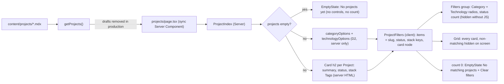

# Brief: Build the Projects index with cards and filters (PROJ-002)

- Story: [docs/stories/proj-002-projects-index.md](../stories/proj-002-projects-index.md), https://github.com/eng-rodriguez/personal-website/issues/11
- Branch: `feat/proj-002-projects-index`, cut from `origin/main` (f7dd765 when this brief was written; the builder records the actual baseline in the Checkpoint)
- ADR: none (section 13 explains why)

`/projects` lists every published Project as a Card in `getProjects()` order. Each card shows the title as an `h2` (no link), the summary, the status and one Tag per `stack` entry. Above the list, a "Filters" group holds two native radio groups, "Category" (from `status`) and "Technology" (from `stack`), which combine with AND. A polite status region shows and announces the result count. When nothing matches, an EmptyState "No matching projects" offers "Clear filters". A pure module, `src/lib/project-filters.ts`, owns option derivation, matching and the count label. A Server Component, `src/components/site/project-index.tsx`, renders the cards and the "No projects yet" state, and computes the options. A small client component, `src/components/site/project-filters.tsx`, gets the cards as pre-rendered React nodes plus the filter fields, and holds the selection in local state. Without JavaScript the controls are hidden by a `data-js` CSS rule, the same hook as the theme toggle (ADR 0004), so every card shows. `/projects` stays static (○). There is no new dependency, token, contrast pair, schema field, environment variable or `useSearchParams`. With today's empty `content/projects` the page looks the same as it does now.

Owner decisions confirmed before this brief: Category is the existing `status` field only (no "Case study" option, no new field), and cards are not links until PROJ-003. Story decisions 2 to 8 apply as written.

## 1. Layers touched

| Order | Layer | Builder | Paths | Depends on |
| --- | --- | --- | --- | --- |
| 1 | frontend (`web` area, repository root) | factory:react-builder with stack-react | `src/lib/project-filters.ts`, `src/components/site/project-index.tsx`, `src/components/site/project-filters.tsx`, `src/app/projects/page.tsx`, `src/app/globals.css` (one no-JS rule), fixtures under `src/lib/__fixtures__/projects/index/`, unit tests, `e2e/`, docs, `CLAUDE.md` | PROJ-001 (merged; `getProjects()`, `Project`, `projectStatuses`), HOME-003 (merged; Card title rules, `wrap-anywhere` Tag call-site pattern) |

- One builder and one PR. Implementation order inside the PR:
  1. D1 fixtures. Copy them into `content/projects` once, run `npm test`, then remove the copies (see section 9).
  2. D2 `project-filters.ts` with `project-filters.test.ts`.
  3. D5 no-JS rule in `globals.css` with the `globals.test.ts` addition.
  4. D4 `ProjectFilters` client component with `project-filters.test.tsx`.
  5. D3 `ProjectIndex` with `project-index.test.tsx`, then D6 page wiring, `core-pages.test.tsx` and `project-index-source.test.ts`.
  6. D8 Playwright: new `e2e/projects-index.spec.ts` and one case in `e2e/no-js.spec.ts`.
  7. Docs (section 10) with `project-index-docs.test.ts` and the `content-docs.test.ts` additions.
- Merge order: a single merge. No rollout, because nothing is deployed.
- Pipeline: no change. `web`, `e2e`, `scope` and `ci-ok` must pass unchanged.
- Infra, backend, ml: not touched.
- Stack: Next.js 16.4.2 App Router (Turbopack build), React 19.3.1, TypeScript ~6.0.3 strict, Tailwind CSS 4.3.3, Zod 4.6.6, Vitest 5 (jsdom default) with React Testing Library, Playwright 1.63.0 (Chromium), npm, Node.js 24. Framework APIs used: `"use client"`, `useState`, `useSyncExternalStore`, `useId` and `useRef` from React, and passing server-rendered elements as props to a client component. No `next/navigation`, no `useSearchParams`, no route segment config. `package.json`, `package-lock.json`, `next.config.ts`, `tsconfig.json`, `eslint.config.mjs`, `vitest.config.mts` and `playwright.config.ts` do not change.

## 2. Ownership
- Bounded contexts (`docs/domain.md`): Site presentation consumes Portfolio through its public API, `getProjects()` in `src/lib/projects.ts`, as an in-process call at build time. `src/lib/projects.ts` and `src/lib/content/*` do not change.
- `src/lib/project-filters.ts` owns the index's filtering rules: which Category and Technology options exist, their labels and order, what "matches" means, and the count wording. It imports from `@/lib/projects` with `import type` only, and has no React, DOM or `node:` dependency, so it is pure and safe to import from the client component.
- `src/components/site/project-index.tsx` (Server Component) owns the index markup: the "No projects yet" state, the card content, and calling the D2 option functions once at build time.
- `src/components/site/project-filters.tsx` (Client Component) owns only interaction: the selection state, the controls, the count region, which cards are hidden, and the "No matching projects" state. It never loads content and does not import Card or Tag.
- `src/app/projects/page.tsx` wires `getProjects()` to `ProjectIndex`.
- `src/app/globals.css` gets one unlayered no-JS rule next to the existing `data-js` rules (ADR 0004 pattern).
- Primitives, the shell, tokens, breakpoints and navigation do not change.

## 3. Domain model
No aggregate, schema or migration changes. `status` and `stack` drive the filters, and no field is added (ADR 0007 is unchanged). The rules this story adds:
- **Category options.** The statuses present among the listed Projects, in lifecycle order (Active, Completed, Archived, the same order as `projectStatuses`), so the order does not depend on the content. Labels are "Active", "Completed" and "Archived".
- **Technology options.** One option per distinct `stack` entry across the listed Projects. Entries are grouped by `entry.toLowerCase()`, the same rule `stackSchema` uses to reject duplicates inside one Project (`src/lib/projects.ts`). The label is the spelling of the first Project in `getProjects()` order that contains the entry. Options are sorted with `Intl.Collator("en-US", { sensitivity: "base" })`, with ties broken by code-point order of the key, so the order is deterministic.
- **Matching.** A Project matches when (no Category is chosen, or its `status` equals the chosen one) AND (no Technology is chosen, or some entry of its `stack` has the chosen key). Order is the input order (`startedAt` descending, then slug).
- **Drafts.** The module does not filter drafts. The loader drops them in production and keeps them in development (existing rule), so a draft's `stack` never creates an option in production.
- `featured`, `caseStudy`, `role`, dates, `links` and `cover` are not read by the index.

## 4. API contract
None. There are no route handlers, server actions, OpenAPI or API collection (CLAUDE.md: no API contract artifacts). Filtering runs in the browser on data embedded at build time. The D2 functions are new internal module APIs.

## 5. Data and consistency
- Source of truth: the `.mdx` files in `content/projects`, read when `/projects` is prerendered. Invalid content still fails `npm run build` with the same `ContentError`.
- What reaches the browser: the prerendered HTML of every card, plus the RSC payload for the client component's props. Those props are the slug, `status` and the `stack` keys of each card, the two option lists, and the card elements. The summary, title and Tags are already in the HTML. No `links`, `cover`, `role` or body crosses the boundary.
- Consistency: options are computed once on the server and passed as props, so server and client never derive them separately. This rules out a hydration mismatch from browser ICU differences in collation.
- No store, index, event, outbox or idempotency concern. The selection is in-memory React state and is never persisted (story decision 4).

The diagram shows what renders on the server, what crosses into the client component, and which states appear.



## 6. Frontend

### Design decisions
- **D1. Fixtures (`src/lib/__fixtures__/projects/index/`, new).** Valid MDX with Markdown-only bodies, placeholder text and `example.com` only. Each must pass the real loader and `compileContent`.

  | File | `startedAt` | `status` | `stack` | Other |
  | --- | --- | --- | --- | --- |
  | `alpha-active.mdx` | 2026-09-01 | active | `TypeScript`, `React` | first to contain both entries, so it sets the labels "TypeScript" and "React" |
  | `beta-active.mdx` | 2026-09-01 | active | `react`, `Go` | same date, after `alpha-active` by slug; lowercase `react` groups with "React" |
  | `draft-hidden.mdx` | 2026-08-01 | completed | `Elixir`, `typescript` | `draft: true`, `endedAt` 2026-08-15; `Elixir` appears only here |
  | `gamma-completed.mdx` | 2026-06-01 | completed | `Go`, `typescript` | `endedAt` 2026-07-01; entries in a different order and case from `alpha-active` |
  | `long-archived.mdx` | 2025-03-01 | archived | 10 entries, including `TypeScript` and one 52-character unbroken entry | `endedAt` 2025-06-01; title of about 150 and summary of about 300 characters, each with one 60-character unbroken word; `caseStudy: true` with the four sections; one `links` entry (`kind: repo`, `https://example.com/repo`) and a `cover`, to prove neither renders |

  - Production: 4 Projects in the order `alpha-active`, `beta-active`, `gamma-completed`, `long-archived`. Category options: Active, Completed, Archived. Technology options include "Go", "React" and "TypeScript" (once each), the long entry and the other `long-archived` entries, and no "Elixir".
  - Development: 5 Projects, with `draft-hidden` third. "Elixir" is offered.
  - Reference combinations (production): Category Active + Technology Go gives `beta-active` only. Technology TypeScript gives `alpha-active`, `gamma-completed`, `long-archived`. Category Completed + Technology React gives no match.
  - Manual step 4 copies the same files into `content/projects` temporarily.
- **D2. Filter module (`src/lib/project-filters.ts`, new).**
  ```ts
  import type { Project, ProjectStatus } from "@/lib/projects";

  /** The fields filtering reads. Cards and other data stay outside. */
  export type FilterableProject = Pick<Project, "slug" | "status" | "stack">;
  export type FilterOption<V extends string> = { readonly value: V; readonly label: string };
  /** null in a group means "All": that group adds no constraint. */
  export type ProjectFilter = { readonly category: ProjectStatus | null; readonly technology: string | null };

  /** Lifecycle order of Category options; a unit test keeps it equal to projectStatuses. */
  export const categoryOrder: readonly ProjectStatus[];      // ["active", "completed", "archived"]
  export const noProjectFilter: ProjectFilter;               // { category: null, technology: null }
  export const projectStatusLabels: Readonly<Record<ProjectStatus, string>>;
  /** stack entries are grouped by this key; must match stackSchema's duplicate rule. */
  export function technologyKey(entry: string): string;     // entry.toLowerCase()
  export function categoryOptions(projects: readonly FilterableProject[]): readonly FilterOption<ProjectStatus>[];
  export function technologyOptions(projects: readonly FilterableProject[]): readonly FilterOption<string>[];
  export function matchesProjectFilter(project: FilterableProject, filter: ProjectFilter): boolean;
  export function filterProjects<T extends FilterableProject>(projects: readonly T[], filter: ProjectFilter): readonly T[];
  /** "No matching projects", "1 project", "3 projects". */
  export function projectCountLabel(count: number): string;
  ```
  - Type-only import. `@/lib/projects` loads `node:path`, Zod and the MDX compiler at module level, and the client component imports this module. A value import, even of `projectStatuses`, could pull the loader into the client bundle. So `categoryOrder` is a local `as const satisfies readonly ProjectStatus[]` tuple, and `project-filters.test.ts` asserts it equals `projectStatuses`, so a new status cannot be silently left out. `projectStatusLabels` is typed `Record<ProjectStatus, string>`, so a new status fails typecheck until it has a label.
  - "All" is `null`, not a string, so a technology called "All" or "all" cannot collide with it.
  - The functions return new arrays and never mutate or re-sort their input.
  - `projectCountLabel` throws `RangeError` for a negative or non-integer count (programming error).
- **D3. ProjectIndex (`src/components/site/project-index.tsx`, new, Server Component).**
  ```ts
  export type ProjectIndexProps = { projects: readonly Project[] };
  export function ProjectIndex({ projects }: ProjectIndexProps): ReactNode;
  ```
  - Empty: returns the existing `<EmptyState className="mt-8" title="No projects yet" description="Projects and case studies will appear here." />`, moved verbatim from `page.tsx`. There are no controls, count or "No matching projects" (AC7).
  - Otherwise: returns `<ProjectFilters items={...} categoryOptions={categoryOptions(projects)} technologyOptions={technologyOptions(projects)} />`. Each item is `{ slug, status, stack: project.stack.map(technologyKey), card }`. `card` is this element:
    ```tsx
    <Card title={project.title} headingLevel="h2" description={project.summary} footer={
      <>
        <p className="text-sm text-muted-foreground">Status: {projectStatusLabels[project.status]}</p>
        <ul aria-label="Stack" className="mt-3 flex flex-wrap gap-2">
          {project.stack.map((entry) => <li key={entry} className="max-w-full"><Tag className="wrap-anywhere">{entry}</Tag></li>)}
        </ul>
      </>
    } />
    ```
    There is no `href`, so the title is plain heading text (Card already supports this; no primitive change). Tags keep each Project's own spelling. The `wrap-anywhere` call-site class is the same one HOME-003 used.
  - Named export, no `"use client"`, no hooks, no `any`, no `dark:`, literal class names only.
- **D4. ProjectFilters (`src/components/site/project-filters.tsx`, new, `"use client"`).**
  ```ts
  export type ProjectFilterItem = { readonly slug: string; readonly status: ProjectStatus; readonly stack: readonly string[]; readonly card: ReactNode };
  export type ProjectFiltersProps = {
    items: readonly ProjectFilterItem[];
    categoryOptions: readonly FilterOption<ProjectStatus>[];
    technologyOptions: readonly FilterOption<string>[];
  };
  export function ProjectFilters(props: ProjectFiltersProps): ReactNode;
  ```
  `stack` here holds keys, so matching reuses `matchesProjectFilter` unchanged, because `technologyKey` is idempotent.

  **Why this shape.** The cards are rendered on the server and passed in as `ReactNode` props, so the list HTML and Tags are server output (AC10). The client bundle gets only the interaction code plus Grid, EmptyState and Button. Rejected: (a) a client component that imports Card and Tag and renders the cards from `Project` data. It ships the card code and more data to the client, and AC10 asks for server-rendered cards. (b) A server-rendered list with a client wrapper that hides cards through DOM queries. It is imperative, harder to test, and splits state from rendering.

  Markup, in order:
  1. A wrapper `<div data-project-filters="" className="mt-8 print:hidden">`. Without JavaScript, D5 hides it (`display: none`), so the controls and the count are absent (AC9). With JavaScript the pre-paint script sets `data-js` before first paint, so the controls render immediately with no layout shift.
  2. Inside it, `<div role="group" aria-labelledby={id}>` with `<p id={id} className="text-sm font-semibold">Filters</p>` (`useId`). A heading is avoided so that the card `h2`s stay the only level below the `h1`.
  3. Two `<fieldset disabled={!hydrated} className="mt-4 min-w-0">`, each with `<legend className="text-sm font-semibold">Category</legend>` or `Technology`, then `<div className="mt-2 flex flex-wrap gap-2">` with one `<label>` per option: "All" first, then the given options in order. Radio names are `project-category` and `project-technology`. The "All" radio has `value=""`; the others use the status or the technology key. Each input is `type="radio"`, controlled (`checked`, `onChange`), `autoComplete="off"` and `className="sr-only"`, so the label is the hit area. `hydrated` comes from `useSyncExternalStore(noopSubscribe, () => true, () => false)`. The server and hydration pass render `disabled`, and the client re-renders enabled right after. A click before hydration therefore cannot leave a checked radio that disagrees with the list.
  4. Label classes (literal string), following the theme toggle: `group inline-flex min-h-10 max-w-full cursor-pointer items-center gap-1 rounded-md border border-input px-3 text-start text-sm text-muted-foreground wrap-anywhere has-checked:border-primary has-checked:bg-primary has-checked:font-semibold has-checked:text-primary-foreground has-focus-visible:outline-2 has-focus-visible:outline-offset-2 has-focus-visible:outline-ring forced-colors:has-checked:underline forced-colors:has-checked:decoration-2 forced-colors:has-checked:underline-offset-4`. The selected option shows a fill, a heavier weight and a leading `<span aria-hidden="true" className="hidden group-has-checked:inline">✓</span>`, so color is not the only cue (AC6). `min-h-10` gives a 40px-high target, and the padding keeps even "Go" wider than 24px.
  5. `<p role="status" aria-atomic="true" className="mt-4 text-sm text-muted-foreground">{projectCountLabel(visible)}</p>`. It is always present while the wrapper shows, and its text is replaced on each change, never appended. On first render it reads "4 projects" and is not announced, because it did not change. Rapid changes replace the pending polite message, so only the last count is spoken in practice (screen-reader check in Manual step 6).
  6. After the wrapper, `<Grid columns={1} className="mt-6">` with every item, in input order: `<div key={slug} data-project-slug={slug} className={matches ? undefined : "not-print:hidden"}>{card}</div>`. Non-matching cards stay in the DOM but are hidden on screen (and so from assistive technology) and shown in print. Print therefore always has the full list and no controls (AC13). The visible count equals the number of matching items (AC4).
  7. When the count is 0: `<EmptyState className="mt-6 print:hidden" title="No matching projects" description="No project matches the chosen category and technology." action={<Button type="button" variant="outline" size="lg" onClick={clear}>Clear filters</Button>} />`. `clear` sets both groups to "All" and focuses the Category "All" radio through a ref. That radio is always rendered, so focus never falls to `body` when the button disappears (AC5).
  - State: `useState<ProjectFilter>(noProjectFilter)`. The initial client state equals the server render (both "All", every card visible), so hydration matches (story edge case). No URL, storage or `useSearchParams` (story decision 4).
  - Keyboard: native radios. Tab enters each group at its checked option, arrows move and select within a group, and the global `:focus-visible` outline is drawn on the label (`has-focus-visible`). No `outline-none`, no `focus:` and no `dark:` classes.
  - Named export, no `any`. The client component imports types from `@/lib/projects`, D2 functions from `@/lib/project-filters`, and Grid, EmptyState and Button. It does not import Card, Tag, any value from `@/lib/projects`, `next/navigation` or `fetch`.
  - States: loading, error and denied do not apply (static build). Empty content is D3. No match is item 7. Invalid content is a build failure.
- **D5. No-JS rule (`src/app/globals.css`, modified).** Add, next to the existing unlayered `data-js` rules and with the same comment style:
  ```css
  /* Without JavaScript the filters cannot work: hide them; every Project stays listed. */
  html:not([data-js]) [data-project-filters] {
    display: none;
  }
  ```
  Why a CSS rule and not "hidden until hydrated": the existing pattern hides JS-only controls before first paint through the attribute the pre-paint script always sets. The controls therefore appear at once with JavaScript and never cause a layout shift above the list. Without JavaScript nothing implies filtering exists. No token or theme block changes.
- **D6. Page (`src/app/projects/page.tsx`, modified).** It keeps `metadata` and the PageHeading, and replaces the inline EmptyState with `<ProjectIndex projects={getProjects()} />`. It stays synchronous with no `"use client"` and no route segment config. If the build reports `/projects` as anything other than ○, stop and report rather than adding `dynamic`.
- **D7. Tokens and contrast (AC13).** No new token and no new `TEXT_PAIRS` entry. Every pair is already checked in light, OS dark and explicit dark:
  - `card-foreground`/`card`: card title.
  - `muted-foreground`/`card`: summary and status.
  - `secondary-foreground`/`secondary`: Tags.
  - `foreground`/`background`: "Filters" and the legends.
  - `muted-foreground`/`background`: unselected options and the count.
  - `primary-foreground`/`primary`: selected option.
  - `input` and `ring` against `background` (3:1): option borders and focus outline.
  - Button outline variant: existing pairs. Print stays light through the unchanged `@media print` block.

### Test design
Tests use `test_acN_` names and `it.each` where cases repeat. Pure and source tests are node-only (`// @vitest-environment node`).

- **`src/lib/project-filters.test.ts`** (new, node, AC2, AC3, AC11, AC14). Inline `FilterableProject` objects built by a typed helper, with no content and no DOM, except the AC11 cases:
  - AC14 cases: no Projects (no options, `filterProjects` gives `[]`); one Project (one Category and its Technology options, which match it); no filter (input returned in order, as a new array); Category only; Technology only; both groups (AND); no match (`[]`); `"TypeScript"` and `"typescript"` in two Projects (one option, labelled with the first Project's spelling, both match); the same entries in a different order in two Projects (same options, same matches).
  - AC2: only statuses present are offered, in `categoryOrder` even when the input order is archived, active; `categoryOrder` equals `projectStatuses`; Technology options sort case-insensitively in en-US ("go" before "React" before "typescript"), with a deterministic tie-break.
  - AC3: order is unchanged under every filter; a filter with `null` in a group equals that group being absent; the input is not mutated (a frozen array does not throw).
  - `technologyKey` is idempotent; `projectCountLabel` gives "No matching projects", "1 project", "2 projects" and throws on `-1` and `1.5`.
  - AC11 with fixtures: `getProjects({ directory: index, mode: "production" })` gives the 4 slugs in D1 order, and no option has the label "Elixir". In `mode: "development"`, "Elixir" is offered and `draft-hidden` is third.
- **`src/components/site/project-index.test.tsx`** (new, jsdom, AC1, AC7, AC8, AC10). Fixtures through `getProjects({ directory, mode })`:
  - AC1: 4 `article`s in D1 order; each has one `h2` with the title, the summary, "Status: Active", "Completed" or "Archived", and one Tag per `stack` entry in `ul[aria-label="Stack"]`; the fragment has no `h1` (the page's PageHeading owns it).
  - AC7: `projects={[]}` renders exactly one `[data-slot="empty-state"]` with "No projects yet", and no `group`, `radio`, `status` or "No matching projects".
  - AC8: the rendered index contains no `a` element at all (titles are not links, and `links` from `long-archived` is not rendered); no `href` starts with `/projects/`; no `img`.
  - Each slug has one `[data-project-slug]` wrapper, in D1 order.
- **`src/components/site/project-filters.test.tsx`** (new, jsdom, AC2 to AC6, AC9). Inline items with simple card nodes (`<article><h2>Title</h2></article>`), plus `userEvent`:
  - AC2: a `group` named "Filters" contains two `group`s (fieldsets) named "Category" and "Technology"; each has "All" first and checked, then the given options in order.
  - AC3: choosing Technology Go, then Category Active, shows only the matching cards in order; the others have the `not-print:hidden` class; choosing "All" in a group lifts its constraint.
  - AC4: the `status` region's text is "4 projects", then "1 project" after a filter; the number of cards without the hidden class equals the count; after several quick changes the region holds one message.
  - AC5: Category Completed + Technology React shows the EmptyState "No matching projects" with a "Clear filters" button; clicking it checks both "All" radios, restores every card, removes the EmptyState and leaves `document.activeElement` on the Category "All" radio.
  - AC6: every radio has an accessible name from its visible label; radios in a group share one `name`; arrow-key navigation with `userEvent.keyboard` moves the checked option within a group; each label carries `min-h-10`, `has-focus-visible:outline-2` and the `group-has-checked` check mark, and none has `outline-none` or `focus:`.
  - AC9 and hydration: `renderToString(<ProjectFilters ... />)` contains `data-project-filters`, both fieldsets `disabled`, both "All" radios checked and every card without the hidden class, so the server HTML equals the initial client state.
- **`src/components/site/project-index-source.test.ts`** (new, node, AC10, AC13, AC14), following `home-previews-source.test.ts`:
  - `project-index.tsx` and `src/app/projects/page.tsx` have no `"use client"` and no hooks; `page.tsx` has no `async`.
  - `project-filters.tsx` starts with `"use client"` and contains no `useSearchParams`, `next/navigation`, `fetch(`, Card or Tag import, value import from `@/lib/projects`, `dark:`, `outline-none` or `: any`.
  - `src/lib/project-filters.ts` imports nothing from `react`, `@/components` or `node:`, and imports `@/lib/projects` with `import type` only.
  - The D7 pairs are matched in `TEXT_PAIRS` with the existing regex; every `bg-`, `text-` and `border-` utility in the two components is in an allowlist.
- **`src/components/site/project-index-docs.test.ts`** (new, node, AC16): the `## Projects index` section of `docs/design-system.md`, sliced to the next `\n## `, contains `src/lib/project-filters.ts`, `getProjects()`, `status`, `stack`, `AND`, `All`, `case-insensitive`, `first`, `No projects yet`, `No matching projects`, `Clear filters`, `role="status"`, `data-js`, `print`, `not a link` and `PROJ-003`.
- **`src/lib/content/content-docs.test.ts`** (modified, AC16): `docs/content.md`'s Projects section states that `status` and `stack` drive the `/projects` filters and that no category field exists. Existing assertions stay.
- **`src/app/globals.test.ts`** (modified, D5): the unlayered rule `html:not([data-js]) [data-project-filters]` exists with `display: none`, found as the existing toggle rules are.
- **`src/app/core-pages.test.tsx`** (modified, AC16): the `/projects` case also asserts that with the real empty content there is no `group` named "Filters", no `radio` and no `status` role. The shared assertions stay (the "No projects yet" text comes from `ProjectIndex` now).
- Unchanged and passing: `primitives-source.test.ts` (no primitive changes), `card.test.tsx`, `home-previews*.test.*`, `projects*.test.ts`, `content-source.test.ts` (its `/projects` sync check still holds), `shell-docs.test.ts`, `primitives-docs.test.ts`, `theme-toggle.test.tsx`.

### D8. Playwright
As in HOME-003, `content/projects` stays empty and production code has no test-only path. The new spec reads the page as rendered. With no cards it asserts the AC7 state and adds `test.info().annotations` `{ type: "content", description: "no Projects on /projects; filter checks not exercised" }`. Manual step 4 copies the D1 fixtures into `content/projects` and runs the same specs. Rejected again: a fixture-directory environment variable, for the reasons in the HOME-003 brief D8.

- **`e2e/projects-index.spec.ts`** (new). Role locators, web-first assertions, no sleeps. A console listener fails the test on any `error` message containing "hydrat".
  - AC7 "/projects shows No projects yet and no controls when empty": with zero `article`s in `main`, the "No projects yet" EmptyState is visible, and there is no `group` named "Filters", no `radio`, no `status` and no "No matching projects". This always runs in CI.
  - AC2, AC3, AC4, AC5 "/projects filters without a network request" (content only): wait for `networkidle`, then start recording `page.on("request")`. Choose a Technology, then a Category, then a non-matching pair, and check the visible `article` count against the `status` text each time. Click "Clear filters" and expect focus on Category "All" and every card visible. The recorded request list must be empty.
  - AC6 "/projects filter controls by keyboard in light and dark" (content only): for `light` and `dark` via `addInitScript` and `themeStorageKey`, Tab into Category, check `outline-style: solid` and `outline-width >= 2px` on the focused label, press ArrowRight, expect the next option checked, then Tab moves to Technology. Every label's `boundingBox()` is at least 24 by 24.
  - AC12 "/projects fits 320px" (content only): at `{ width: 320, height: 800 }`, `scrollWidth <= clientWidth`; every card, label and Tag box is within `0..320`.
  - AC3 reload: after a filter and `page.reload()`, both "All" radios are checked and every card is visible.
- **`e2e/no-js.spec.ts`** (modified, AC9): one test in the existing describe, "/projects without JavaScript lists every Project and hides the filters". `[data-project-filters]` is hidden, there is no visible `radio` or `status`, and every `article` in `main` is visible. With zero `article`s it asserts "No projects yet" and adds the annotation. Existing cases are unchanged.

## 7. Infra and pipeline
Not applicable. No workflow, Dependabot, environment, deployment or `.factory.yml` change. The new spec runs in the existing `e2e` job.

## 8. Security and threat notes
- Authn/z and tenant isolation: not applicable (no users, static output).
- Input validation: every rendered value comes from content validated by the strict Zod schema at build time, rendered as React text. There is no `dangerouslySetInnerHTML`. The index renders no `href` at all, so no content value reaches a URL. Radio `value`s are technology keys used only for comparison in memory.
- Client data: the RSC payload carries only slug, status, stack keys, option labels and the card elements already in the HTML. `links`, `cover`, `role` and bodies are not sent.
- Secrets: none. No environment variable is added.
- Data classification: public. Fixtures use placeholder text and `example.com`. Drafts are excluded in production by the existing loader rule.
- Dependencies: none added.
- Top threats (STRIDE-style):
  1. Information disclosure: a draft's title or `stack` entry shown in production through the list, an option or the count. Mitigation: everything derives from loader output, which drops drafts in production. `project-filters.test.ts` proves "Elixir" is absent in production, and Manual step 4 greps the built HTML and RSC payload.
  2. Tampering or XSS through content text reaching markup or URLs. Mitigation: text children only and no hrefs. Card titles are not links (AC8).
  3. Denial of an accessible index: controls that do nothing without JavaScript, focus lost on "Clear filters", silent result changes, overflow at 320px or color-only selection. Mitigation: the D5 rule, the focus ref, the `role="status"` region, wrapping classes, the check mark, unit and Playwright tests, and Manual steps 5 to 7.

## 9. Verification per criterion
Local checks run from the repository root on Node.js 24. "Built HTML" means `.next/server/app/projects.html` after `npm run build`. "With content" means Manual step 4.

| AC | Check | Level |
| --- | --- | --- |
| 1 | `project-index.test.tsx` AC1 case | local |
| 2 | `project-filters.test.ts` option cases; `project-filters.test.tsx` AC2 case | local |
| 3 | `project-filters.test.ts` AND and order cases; `project-filters.test.tsx` AC3 case; `projects-index.spec.ts` no-request test with content (step 4) | local + manual |
| 4 | `project-filters.test.tsx` AC4 case; spec count checks with content | local + manual |
| 5 | `project-filters.test.tsx` AC5 case (focus target); spec with content | local + manual |
| 6 | `project-filters.test.tsx` AC6 case; spec keyboard test with content; step 6 | local + manual |
| 7 | `project-index.test.tsx` AC7 case; `core-pages.test.tsx`; spec empty test in CI | local |
| 8 | `project-index.test.tsx` AC8 case (no `a`, no `/projects/` href); step 4 grep | local + manual |
| 9 | `globals.test.ts` D5 rule; `project-filters.test.tsx` server-render case; `no-js.spec.ts` added case (empty in CI, with content in step 4); step 7 | local + manual |
| 10 | `project-index-source.test.ts`; build output lists `/projects` as ○ (step 3); client-chunk check (step 3) | static + local |
| 11 | `project-filters.test.ts` AC11 fixture cases; built HTML in step 4 without "Elixir" or the draft title | local + manual |
| 12 | spec 320px test with content; step 5 at 320px and 200% zoom | local + manual |
| 13 | `project-index-source.test.ts` pair check; unchanged `TEXT_PAIRS`; step 7 print | static + local + manual |
| 14 | `project-filters.test.ts` inline cases; component takes props only | local |
| 15 | spec annotation in CI (empty); `project-filters.test.tsx` covers filtering with fixture items | local |
| 16 | `project-index-docs.test.ts`, `content-docs.test.ts`, `core-pages.test.tsx`, unchanged `shell-docs.test.ts`; step 8 | local + manual |
| 17 | `npm run check` exit 0 with Vitest counts; `npm run e2e` exit 0 with Playwright count; CI `web` and `e2e` | local + environment |
| 18 | CI `scope` job; locally `git diff --name-only origin/main...HEAD`, each path exempt or found with `grep -F` in this brief | local + environment |

Builder-verified at implementation (record in the Checkpoint):
- `/projects` builds as ○, and with empty content the built HTML has one `<h1`, the "No projects yet" text and no `data-project-filters`.
- No client chunk under `.next/static/chunks` contains `loadCollection`, `node:path` or `compileContent` (`grep -l`). This proves the type-only import in D2 kept the loader out of the client bundle.
- Tailwind 4.3.3 generates `not-print:hidden` as `@media not print { display: none }` (grep the built CSS). If not, use `hidden print:block` and record it.
- `getProjects()` with fixtures works in the jsdom environment for `project-index.test.tsx`. If it does not, load the fixtures in a node test and pass inline `Project` objects to the jsdom test, and record that.
- `group-has-checked:inline` shows the check mark only on the checked label (Manual step 4 screenshot or spec).
- Back navigation: with content, filter, follow a header link, then go back. Expected: controls and list agree (both "All", or both the last selection if the browser restored the page from bfcache). If Chrome restores a checked radio that disagrees with the list, add a `pageshow` reset and record it (section 13).
- The D1 fixtures load in production and development and pass `compileContent`: copy them into `content/projects`, run `npm test` once (`projects-content.test.ts` compiles them), then remove the copies.

Environment evidence, blocked until the PR exists: CI `web`, `e2e`, `scope` and `ci-ok`. CI exercises filter behavior only at unit level until real content exists (D8). Not covered by automation: 200% zoom, forced colors, print, a screen reader.

### Manual verification
The owner runs this on a fresh clone of the branch with Node.js 24 before marking the PR ready, and records who ran it and each result in the Checkpoint. Items marked "automated" may also be run by the test agent, which does not replace the human run.

Prerequisites: `nvm use`, `npm ci`, `npx playwright install chromium` (once), Chrome or Edge with DevTools, and a screen reader (VoiceOver on macOS). Stop any server on ports 3000 and 3100 before steps 3 and 4.

1. Scope. `git status --short` and `git diff --name-only origin/main...HEAD`. Expected: every changed path is exempt or in section 11; `package.json`, `package-lock.json`, `.github/`, `AGENTS.md`, `docs/reviews/dependabot-actions-pr-34.md` and `docs/reviews/dependabot-prs-56-57.md` are not staged; `content/projects` holds only `.gitkeep`. Covers AC18. Automated.
2. Checks. `npm run check; echo $?` and `npm run e2e; echo $?`. Expected: both `0`, only the 3 known `ERESOLVE` notices; record the Vitest and Playwright counts and the "content" annotations. Covers AC15 and AC17. Automated.
3. Static output with empty content. In the step 2 build log `/projects` is ○. `grep -c 'data-project-filters' .next/server/app/projects.html` prints `0`; `grep -c 'No projects yet' .next/server/app/projects.html` is at least `1`. `grep -lE 'loadCollection|node:path' .next/static/chunks/*.js` prints nothing. Covers AC7 and AC10. Automated.
4. With content (temporary). `cp src/lib/__fixtures__/projects/index/*.mdx content/projects/ && npm run build`. Expected:
   - `/projects` is ○; the built HTML has the 4 production titles in D1 order, `data-project-filters`, no `draft-hidden` title, no "Elixir", no `href="/projects/`, no `example.com/repo` and no ``), then repeat step 2. Expected: `/projects` renders the PageHeading and "No projects yet" as before, and the three new modules and the `data-project-filters` rule are gone.

## 10. Docs impact and observability
- `docs/design-system.md`: a new `## Projects index` section after "Home previews" and before "Breakpoints". It covers:
  - The order (`getProjects()`) and the card content: title as `h2`, not a link until PROJ-003; summary; "Status: …"; stack Tags.
  - The filters (`src/lib/project-filters.ts`): Category from `status`, Technology from `stack`, case-insensitive grouping with the first spelling as the label, en-US alphabetical order, "All" first, single-select native radios, AND between groups, and options derived only from listed Projects.
  - The count (`role="status"`, the wording) and the two empty states: "No projects yet" with no controls, and "No matching projects" with "Clear filters" and focus to Category "All".
  - No-JavaScript behavior (the `data-js` rule hides the controls and every Project is listed), print (the full list, no controls), and local state without URL sync.
  - The checks: 320px, 200% zoom, 24 by 24 targets, and the check mark as a non-color cue.
  - In "Themes", next to the toggle note, one line: the filters use the same `data-js` hook.
- `docs/content.md` Projects section: `status` and `stack` drive the `/projects` filters; there is no category or tags field; `stack` spelling matters because the first Project (newest) sets the option label; drafts never create an option in production.
- `docs/testing.md`: the "Content tests" section mentions the `index` fixture case under `projects`, used by `project-filters.test.ts` and `project-index.test.tsx`, and copied into `content/` only for the PROJ-002 manual check. It also notes that `e2e/projects-index.spec.ts` annotates when no Projects exist.
- `CLAUDE.md` Current state: `/projects` renders the Projects index (`src/components/site/project-index.tsx`, client filters in `src/components/site/project-filters.tsx`, rules in `src/lib/project-filters.ts`). Cards are in `getProjects()` order with Category (status) and Technology (stack) filters, combined with AND. The filters are hidden without JavaScript, and cards are not links until PROJ-003. Playwright also covers the Projects index. Paths: add `src/lib/project-filters.ts`. Keep every string asserted by `shell-docs.test.ts`, `scaffold.test.ts` and `content-docs.test.ts`.
- `docs/domain.md`, `README.md`, ADR 0007: no change.
- Observability: none. No runtime service, and nothing is logged.

## 11. Files that will change
Builders create or modify only these paths. Any other file is out of scope and must not be committed.

Application (factory:react-builder):
- `src/lib/project-filters.ts` (new)
- `src/components/site/project-index.tsx` (new)
- `src/components/site/project-filters.tsx` (new)
- `src/app/projects/page.tsx` (modified: renders `ProjectIndex`)
- `src/app/globals.css` (modified: one `html:not([data-js]) [data-project-filters]` rule, D5)

Fixtures (factory:react-builder):
- `src/lib/__fixtures__/projects/index/alpha-active.mdx`
- `src/lib/__fixtures__/projects/index/beta-active.mdx`
- `src/lib/__fixtures__/projects/index/draft-hidden.mdx`
- `src/lib/__fixtures__/projects/index/gamma-completed.mdx`
- `src/lib/__fixtures__/projects/index/long-archived.mdx`

Tests (factory:react-builder; exempt from the scope check):
- `src/lib/project-filters.test.ts` (new)
- `src/components/site/project-index.test.tsx` (new)
- `src/components/site/project-filters.test.tsx` (new)
- `src/components/site/project-index-source.test.ts` (new)
- `src/components/site/project-index-docs.test.ts` (new)
- `src/app/core-pages.test.tsx` (modified)
- `src/app/globals.test.ts` (modified: D5 rule)
- `src/lib/content/content-docs.test.ts` (modified)
- `e2e/projects-index.spec.ts` (new)
- `e2e/no-js.spec.ts` (modified: one added case)

Docs (factory:react-builder):
- `CLAUDE.md` (modified)
- `docs/design-system.md` (modified)
- `docs/content.md` (modified)
- `docs/testing.md` (modified)

Planning (architect/orchestrator):
- `docs/briefs/proj-002-projects-index.md` (this brief)
- `docs/stories/proj-002-projects-index.md` (already present, untracked)

Not committed: `.next/`, `node_modules/`, `next-env.d.ts`, `*.tsbuildinfo`, `playwright-report/`, `test-results/`, any `.mdx` copied into `content/projects` in Manual steps 4 to 7, and the unrelated untracked `AGENTS.md`, `docs/reviews/dependabot-actions-pr-34.md` and `docs/reviews/dependabot-prs-56-57.md`.

Explicitly not changed: `package.json`, `package-lock.json`, `next.config.ts`, `tsconfig.json`, `eslint.config.mjs`, `vitest.config.mts`, `playwright.config.ts`, `components.json`, the tokens and theme blocks in `src/app/globals.css`, `src/app/layout.tsx`, the other pages, `src/lib/projects.ts`, `src/lib/articles.ts`, `src/lib/content/*`, `src/lib/home.ts`, `src/lib/theme.ts`, `src/components/primitives/*`, `src/components/ui/*`, the shell and home components, `content/` (only `.gitkeep`), the other e2e specs, `.github/`, `.factory.yml`, `docs/domain.md`, `README.md` and ADRs 0001 to 0007.

## 12. Risk
- Level: **Standard** (the story's "medium"). It adds the first client component with form-like controls and one CSS rule, on an undeployed static site. There is no data, auth, secret, dependency, schema or deployment impact, and it reverts as one PR. With empty `content/projects` the visible page is unchanged, so the filter behavior cannot be observed in production until real content ships. Unit tests and Manual step 4 are the evidence until then.
- Recovery: revert the merge commit on `main` (`git revert -m 1 <merge-sha>`) through a PR, then `npm ci`, `npm run check` and `npm run e2e` (Manual verification, Rollback). No flag: with no JavaScript or a client failure, the server-rendered list still shows every Project, which is the safe fallback.
- Owner: @eng-rodriguez.

## 13. Open questions and ADRs
- ADR: none written.
  - Client interaction pattern. Server-rendered cards are passed as nodes to a small client wrapper, and JS-only controls are hidden by the existing `data-js` CSS hook. Both use approved decisions: the Next.js App Router and React (CLAUDE.md), and ADR 0004's `data-js` pattern, already applied to the theme toggle and the menu. It adds no dependency, service or cross-cutting rule, it is documented in `docs/design-system.md`, and later lists (BLOG-002) can follow or deviate from it without breaking anything. If a later story adds URL-synced or shared filter state across routes, that story should record an ADR.
  - Rendering. `/projects` staying static (○) is a fact about this route, enforced by the build check and the source test. It does not settle the open project-wide question in CLAUDE.md (revalidation, dynamic routes). PROJ-003's detail route is the natural place for that ADR.
- Decided here (owner to confirm at brief approval):
  - Print shows the full list even while a filter is applied (non-matching cards use `not-print:hidden`). Alternative: print only what is shown, which is simpler (render only matches) but contradicts AC13's "full list".
  - D5 adds one rule to `globals.css` instead of rendering the controls hidden until hydration. Alternative: `hidden` until hydrated, which leaves `globals.css` untouched but shifts the list down once the page hydrates.
  - Category option order is the lifecycle order (Active, Completed, Archived), not alphabetical.
  - The card status reads "Status: Active" as muted text, not a Tag, so it is not confused with stack Tags.
  - The selected option shows a "✓" check mark in addition to fill and weight. There is no icon library.
  - When nothing matches, the count also reads "No matching projects", the same text as the EmptyState title. Both are kept, because AC4 and AC5 each name it.
- Deviation from a story edge case, owner to confirm: "back and forward resets to All" holds for a reload and a normal history load. On a bfcache restore, Chrome may keep the last selection. The invariant enforced is that the controls and the list always agree. Fallback if the owner wants a strict reset: a `pageshow` listener that resets when `event.persisted`, at the cost of a few lines and one more test.
- Follow-ups: PROJ-003 makes card titles links to `/projects/<slug>`. PROJ-004 renders `links`. The first story that publishes real content removes the "No projects yet" expectation from `core-pages.test.tsx` and lets the Playwright filter checks run in CI. Moving `wrap-anywhere` into the Tag primitive is still a possible follow-up (HOME-003).
- Builder-verified at implementation: the items listed in section 9.

## 14. Checkpoint
- Phase: brief approved, implementation next
- Scope: PROJ-002 as in the approved story (AC1 to AC18, decisions 1 to 8; decision 1 confirmed as `status` only and decision 7 as no links) and this brief
- Baseline: `origin/main` at 9be10a1 (`feat/proj-002-projects-index` branched from it; the brief was drafted against f7dd765, same tree for `src/`, `e2e/` and `docs/` except `src/scaffold.test.ts`). Untracked user files `AGENTS.md`, `docs/reviews/dependabot-actions-pr-34.md` and `docs/reviews/dependabot-prs-56-57.md` preserved and not part of this change
- Revisions: none yet
- Approvals: story approved by @eng-rodriguez, with Category = `status` only and cards not links confirmed explicitly; brief approved by @eng-rodriguez with the section 13 choices, including back-forward cache restoring the last selection
- Check evidence: none yet
- Repairs used: 0 of 3
- Remaining blockers: none
- Next action: factory:react-builder implements on `feat/proj-002-projects-index` in the section 1 order
